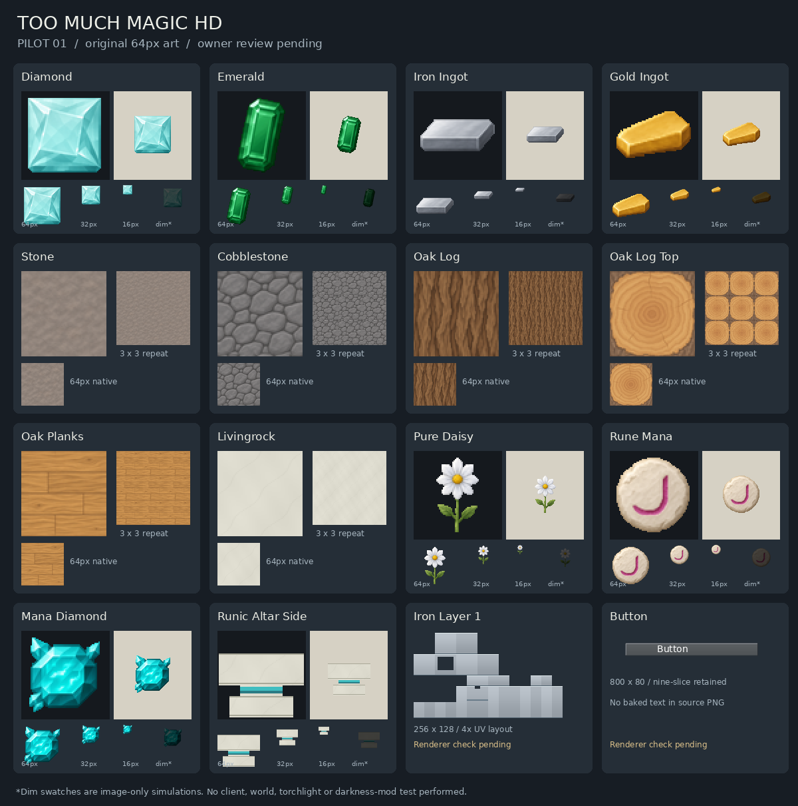

# Pilot 01 — owner review pending

Selected review candidates: **16 PNGs**, 11 vanilla and 5 Botania. They are original
project artwork. These selected final candidate files live at their exact override
paths in `art/too-much-magic-hd/assets/`; they are **drafted**, not approved,
distributed, client-tested or suitable as a complete pack. No raw generation output,
rejected variant or third-party texture is committed.

## Review decision

Approve or revise the material language before production batches. In particular:
the broad square pale-aqua diamond, elongated step-cut emerald, restrained metal
planes, warm oak, quiet stone, cream Botania mineral and richer cyan mana gem.
The UV and GUI candidates establish technical layout only and need a client check
before their appearance can be accepted on the rendered model or interface.

The board compares 2x nearest-neighbor views with native 64px and 32/16px slots,
light/dark backdrops, and 3x3 block repeats. Dim swatches are arithmetic image
simulations, **not** neutral-daylight/torchlight/darkness-mod game captures. The
small white flower retains a yellow center and green stem; rune mana retains its
magenta hooked symbol. Mana remains distinct from ordinary diamond.

## Files and method

- Individual PNGs and their exact hashes/dimensions: the 16 decision rows in
  `art/registry/inventory.json`; source facts are in its verified catalog shards.
- Generation prompts: [prompts.json](prompts.json). Built-in image generation was
  used once per generated asset, with no reference images supplied. The source
  canvas was larger; final painting/processing targets the actual native 64px
  result. This is original artwork, not an enlargement of upstream textures.
- `art/tools/prepare_pilot.py`: clean alpha, select the main sprite component,
  deliberately fit within 56x56 on 64x64, Lanczos reduction, binary edge cleanup
  and zero hidden RGB. Block images are reduced to 64px and opposing edge values
  reconciled. Tiling still needs visual and game review.
- Livingrock and the altar face are original deterministic mineral painting.
  The altar side preserves native model regions: the slab occupies source rows
  4–9, neck rows 10–11 at columns 4–11, base rows 12–15 at columns 2–13.
  Their shapes come from the pinned model contract, not an image seed.
- Iron layer 1 is original panel painting on the standard humanoid cuboid UV
  template, **256x128** from a native 64x32 sheet. Client pose/seam testing is
  pending. This does not complete the armor family.
- Button is **800x80** from native 200x20, with the original logical nine-slice
  contract (`width: 200`, `height: 20`, `border: 3`). No text is baked in the PNG.
  Actual GUI scaling and nine-slice rendering are pending.
- `art/tools/review_pilot.py` produces only the small review board. It does not
  build a resource-pack ZIP or launch Minecraft.

## Evidence and limits

Source freeze: integration `1413154722a92cdeefa88e2dc40c12c09f8baf80`.
Botania Revived `Botania-Revived-1.21.1-2.0.2-NeoForge.jar`, provider SHA-1
`b333e5ac4fd55b0e8822238ced0b25b193db9628`, verified before semantic/model
inspection. Vanilla client comes from Mojang's SHA-1-verified 1.21.1 metadata.
See the source lock and archive audit for their SHA-256 identities.

Official Soartex stone/village and Kaworru Botania gallery previews were inspected
as visual references on 2026-11-16. No gallery picture or reference pack was
submitted to image generation or copied into the repository. The exact historical
Soartex 1.12 diamond sprite is still **not inspected**; this candidate interprets
the owner's square/princess-cut description with original geometry.

Agent source review: native readability, distinct gem classes, alpha, plane/value
hierarchy and repeats inspected. PNG decode, dimensions, hashes and selected alpha
contracts pass. Nine synthetic tooling tests and catalog integrity checks pass.
**Owner approval: pending. Client/game/lighting acceptance: not run.**
