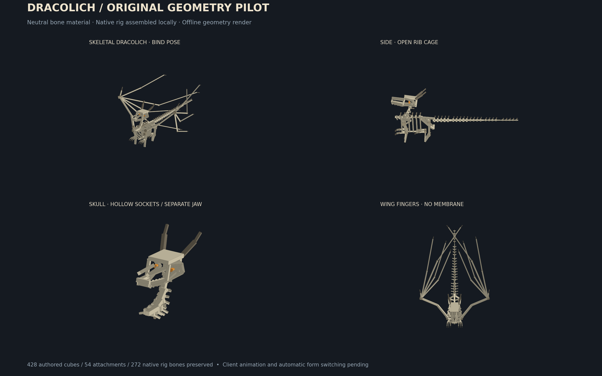

# Dracolich skeleton model — first geometry pilot

**Real original 3D geometry, model-only. No automatic in-game replacement yet.**



428 solid cubes on 54 native attachment points: hollow skull and separate jaw,
six paired open ribs, shoulder blades, open pelvis, four articulated legs with
paired lower bones and toes, neck vertebrae, segmented tail, skeletal wing
fingers, and bone spars for the alternate bodies' small wings/flippers.
There are no opaque body shells, wing membranes or transparent-skin tricks.

The neutral ivory/brown material is for checking structure. Cave black bone
with inner fire, Sea prismarine/coral, and Forest white bone/moss remain the
approved **next texture pass**, not completed skins. Amber eye cubes are a
material placeholder, not an implemented emissive rendering layer.

## Files

| File | Purpose |
| --- | --- |
| `dracolich-neutral-review.geo.json` | Open/import as a Bedrock model in Blockbench, with `dracolich_neutral.png`; static baked pose, original mesh groups, no upstream rig |
| `dracolich-neutral-review.glb` | Standalone static 3D inspection in a glTF viewer/Blender; flat neutral materials, no copied skeleton or animation |
| `dracolich.mesh.json` | Authoritative rig attachment mesh; original cubes keyed by native bone name |
| `dracolich_neutral.png` | Original 128×32 per-face UV palette atlas |
| `rig-contract.json` | Target version, source snapshot and rig fingerprint; contains no rig data |
| `validation.json` | Executed static checks and explicit remaining client gates |
| `dracolich-preview.png` | Offline render of these actual original vertices in the locally assembled bind pose |

The static review models show Center-style large wings and omit the 42
alternate small-wing/flipper cubes. The **authoritative mesh and local
272-bone assembled model contain all 428 cubes**. Body-specific hiding,
scaling and animation must still be tested in the client. A static review
file must never be installed as the playable animation rig.

## Build the animation-compatible model locally

From the repository root, Python 3:

```bash
python3 scripts/assemble_dracolich_model.py /path/to/installed/DragonSurvival.jar \
  --output /path/to/private/dracolich-local-build
```

Alternatively pass a Dragon Survival 1.21.1 source checkout. The assembler
compares the exact rig fingerprint, rejects mismatches/missing joints,
removes all upstream cubes/UVs, and attaches only our original cubes. It
preserves **every native bone field, hierarchy, pivot, rest rotation,
Molang/Blend controller and attachment**, including MountingBone,
BreathSource, item controls and wing controls. It keeps the native five
body animation files external and untouched. Source snapshot validated:
Dragon Survival 2.0.74 at `658c63608adc0194c9c9516804ecd66c1fd10112`.
An installed JAR must pass that same fingerprint before it is supported.

Output: private `dracolich.geo.json` and `validation.json`. **Do not commit,
package or independently redistribute that full native-rig output.** The
upstream Dragon Survival license restricts extracted asset redistribution;
this uploaded kit contains original geometry/materials, a fingerprint and
an assembly tool instead. No upstream mesh, texture, animation or rig file
is included. This model is for the player-controlled Dracolich form.

To regenerate original source and review exports (Pillow, NumPy, Matplotlib,
SciPy are development tools only; no new Minecraft dependencies):

```bash
python3 scripts/build_dracolich_mesh.py
python3 scripts/assemble_dracolich_model.py /path/to/DragonSurvival-source \
  --output /path/to/private/dracolich-local-build
python3 scripts/preview_dracolich_model.py /path/to/private/dracolich-local-build/dracolich.geo.json \
  --output compat/transformations/art/dracolich
python3 scripts/check_dracolich_model.py /path/to/DragonSurvival-source \
  /path/to/private/dracolich-local-build/dracolich.geo.json
```

## Validation and integration boundary

Passed: exact 272-bone rig preservation, 428 authored solid cubes, UV bounds,
all five native animation files' named bone references (527 animations),
fail-closed rejection of a changed rig or unknown attachment, static review
export vertex equivalence, GLB structure, and **actual GeckoLib 4.9.3 JSON
deserialization + GeometryTree construction + 428-cube bake** under Java 21.

No Java gameplay code, mod dependency, species/body entry, packwiz lock or
integration source selector is changed. Art is deliberately outside
`src/main/resources`, so this upload does not silently replace every dragon.
No new full test build was triggered.

Next implementation: client-local rig assembly/resource loading, per-player
Dracolich visual selection and texture/glow choice, server-to-client state
sync, and exact restoration of the original skin after cure. This model
upload does not claim those features. Must still verify in-game all 15
species/body combinations, growth stages including Ancient, walking,
flight/swimming, thin-joint alignment during animation, wing toggles,
first-person neck hiding, armor, items, riders, multiplayer and cure.
