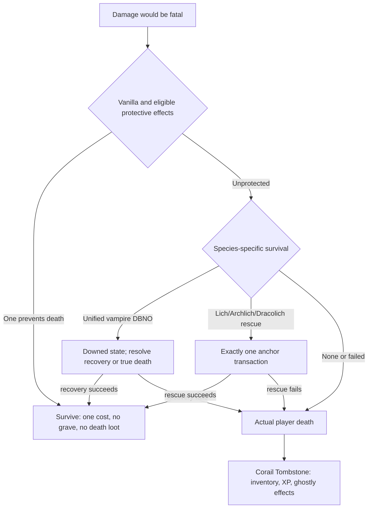

# Player death and resurrection mechanics — multi-mod audit

**STATUS: audited from published documentation/source, but not combined-playtested.** Date 2026-11-13. Minecraft 1.21.1 NeoForge. Do not treat this as an implemented death compatibility manager. The **locked transformation target** is [TRANSFORMATION-TARGET.md](TRANSFORMATION-TARGET.md).

## What counts as modifying death?

We distinguish **fatal-damage avoidance** (normal damage never becomes death), **death cancellation** (a death event happens but is cancelled, consuming a resource), **downed/revival**, **post-death resurrection/teleport**, **inventory/grave ownership**, and **on-death soul/resource collection**. These are not equivalent and may interact at different engine events.

## Confirmed or strongly evidenced systems (NOT just six)

| Mod/system | Roster status | Classification | Mechanic and technical evidence | Priority uncertainty |
| --- | --- | --- | --- | --- |
| **Vanilla** Totem of Undying | Baseline | Prevent fatal death | Vanilla standard totem handling; inventory/off-hand; various special damage exceptions | Interaction with mods' cancellable death events must be tested |
| **Occultism** Guardian Familiar | **B3 installed** | Cancellable death rescue | 1.21.1 `FamiliarEventHandler.guardianUltimateSacrifice`: on `LivingDeathEvent` tests Guardian and `guardian.sacrifice()`; cancels event, sets HP 1, clears effects, applies regeneration and absorption. Skips `BYPASSES_INVULNERABILITY` damage. May consume ring-stored familiar. | Can consume a guardian limb and other concurrent death save if event ordering is wrong |
| **Ars Nouveau** Totem Perk | **B3 installed** | Cancellable death rescue | 1.21.x `PerkEvents.totemEvent`: active armor `TotemPerk` restores HP 1, effects, consumes its daily state, cancels death; perk resets on sleep. | Must not spend perk alongside Guardian or other savers |
| **Mahou Tsukai** Mystic Eyes of Death Collection | **B3 installed** | Soul-counter death prevention | Developer spell wiki: collect soul points near deaths, spend **one soul point** to avoid fatality, recover configured HP; the protection survives effect expiration, bypasses generic kill and out-of-world deaths. | Need to hook its actual 1.21.1 death handler; soul counter must decrement once, not twice |
| **Vampirism** vampire DBNO | **Approved, not installed** | Downed, recoverable | Vampire level 4+ normally gets Down-But-Not-Out instead of actual death for eligible damage; cooldown/recovery, neonatal vulnerability and exclusions. Exact 1.21.1 handler must be inspected. | May suppress every other `LivingDeathEvent` rescue, or the reverse; must arbitrate |
| **JAWR** vampire immortality | **B3 installed** (JAWR 0.5.11) | Potential death/revival modification | 0.5.13 changelog describes configurable vampire immortality, **later than B3 pin**. Exact method, effect and compatibility require update/inspection, **not confirmed installed** in 0.5.11. | Compare/merge with Vampirism DBNO as part of unified vampire physiology; never double rescue |
| **JAWR: Forbidden Magic** lich | **B3 installed** | Phylactery-associated lich resurrection | Official mod feature: 10 lich levels, phylactery. The actual 1.21.1 fatal-hit / soul-transfer trigger, charges and conditions are **not confirmed from source**. | For standalone lich, Archlich and Dracolich, only one death arbiter may resolve a hit |
| **Goety — The Dark Arts / 1.21.1 port** | **Approved, not installed** | Arca/soul-energy death rescue | Official lichdom description: lich is saved via its Arca; older Goety code canceled death events. **Port implementation and exact 1.21.1 event priority unverified**. | Must coordinate with JAWR phylactery, especially Archlich |
| **Corail Tombstone** | **B3 installed** | **Actual-death inventory/grave/XP and recovery**, not a fatal-hit saver | Grave stores inventory when death actually proceeds, soulbound item preservation and post-respawn effects such as Ghostly Shape; Ankh prayers are NOT evidence that Ankh prevents fatality. | Prevent grave creation/drop duplication when fatal damage is cancelled; only one grave owner |
| **Malum** Wyrd Reconstruction Geas | **Approved, not installed** | Cancellable death rescue | 1.21.1 `WyrdReconstructionGeas.incomingDeathEvent` ignores technical/void damage and exhaustion; cancels death, heals, applies cooldown/exhaustion. Another Geas (Patience Repaid) cancels **karmic** death. | Geas may spend its cooldown alongside other rescues if dispatch ordering is not controlled |
| **Relics / Reliquified addon** | Base Relics **approved, not installed**; Reliquified Ars Nouveau **not approved** | Possible item-based second chance | Published 1.21.1 **Reliquified Ars Nouveau** Ring of Last Will cancels fatal damage, restores one heart, cooldown. This is an **addon item**, not proof that currently approved base `Relics` includes the ring; don't silently add addon. | If specifically approved later, needs same arbiter |
| **EvilCraft** | **B3 installed** | *Other entities' on-death spirits*, not necessarily player rescue | Vengeance Spirits may spawn after deaths; spirit reanimator mainly revives captured mob spirits. This is a distinct on-death subsystem, not established as a player immortality mechanic. | Avoid suppressing valid soul drops if event is cancelled; only inspect player involvement if observed |
| **Enigmatic Legacy+**, other added magic | **Approved, not installed** | Unverified item/resurrection mechanics | Broad item/bauble/armor audit still required; do not infer a death-save from mod name alone. Similarly screen Neo Vitae and existing Apotheosis/Artifacts for totem-like effects. | Discover via target jar, registry and integration tests |

**Verified code/documentation sources:**
- Occultism 1.21.1 Guardian: https://github.com/klikli-dev/occultism/blob/version/1.21.1/src/main/java/com/klikli_dev/occultism/handlers/FamiliarEventHandler.java
- Ars Nouveau 1.21.x Totem Perk: https://github.com/baileyholl/Ars-Nouveau/blob/1.21.x/src/main/java/com/hollingsworth/arsnouveau/common/event/PerkEvents.java
- Mahou developer wiki: https://mahoutsukai.stepsword.com/spells/mystic-eyes-of-death-collection/
- Malum 1.21.1 Wyrd: https://github.com/SammySemicolon/Malum-Mod/blob/1.21.1/src/main/java/com/sammy/malum/common/geas/pact/infernal/WyrdReconstructionGeas.java ; Patience: https://github.com/SammySemicolon/Malum-Mod/blob/1.21.1/src/main/java/com/sammy/malum/common/geas/pact/aqueous/PatienceRepaidGeas.java
- Vampirism 1.10 DBNO: https://wiki.vampirism.dev/docs/wiki/factions/vampire/vampire-player
- JAWR 0.5.13/immortality: https://www.curseforge.com/minecraft/mc-mods/just-another-witchery-remake/files/9089145
- Forbidden Magic lich: https://modrinth.com/mod/jawr-forbidden-magic
- Goety lich: https://goety.wiki.gg/wiki/Lichdom
- Corail Tombstone death/exp/inventory: https://modrinth.com/mod/corail-tombstone
- Reliquified Ars Nouveau Ring of Last Will (NOT currently approved): https://www.minecraft-guides.com/mod/relics/wiki/ring-of-last-will/
- EvilCraft 1.21.1 items/spirit processing: https://mcmodwiki.com/evilcraft/1.21.1

## Specific conflict scenarios

1. **Guardian + Ars Totem Perk + Mahou soul points + vanilla totem:** One fatal hit triggers multiple cancellation-capable sources; if side effects precede or ignore a cancelled event, the player could lose multiple resources for one rescue.
2. **Vampirism DBNO + JAWR vampire immortality:** Unified vampire physiology requires a single downed/resurrection workflow. Two native vampire flags must NOT double-trigger death effects or grant two independent recovery windows.
3. **JAWR lich + Goety lich = Archlich:** The two immortality paths must both be genuinely acquired and retained, but **one fatal event** has exactly **one designated rescue resolution**. Deterministic anchor routing; if a fallthrough/failover is wanted, it must be explicitly designed and rate-limited rather than assuming both handlers work in arbitrary order.
4. **Dragon + one lich = Dracolich:** Dragon Survival body persists through lich death handling; only the single chosen lich anchor participates. Dragon **must not** also access the other lich's Archlich rescue.
5. **Abomination:** Unified vampire and werewolf progression and powers coexist; choose a **single** authoritative vampire DBNO/other death-save behavior, with no inherited double immunity.
6. **Corail Tombstone after a true death:** Only AFTER all prevention/DBNO/rescue opportunities are exhausted should inventory be placed in a grave. Soulbound, Curios, magical storage, dropped items, levels, respawn effects and any return-to-anchor teleport must not duplicate or delete gear.
7. **Deaths causing progress:** Malum soul harvest, Mahou death collection and EvilCraft spirits may listen for death events. If death was prevented, do we award victim-death resources? **Default proposal: no**, unless specifically a near-death mechanic.

## Proposed compatibility architecture — NOT a finalized priority order

The target is a **death arbitration layer** complementary to the locked transformation state bridge. Native mods use multiple hooks, including damage interception, `LivingDeathEvent`, `PlayerEvent.Clone`, respawn and later ticks. Merely registering one listener at `HIGHEST` priority does **not** guarantee it runs before all mod behaviors, nor that it can override upstream handlers without patches.

Conceptual lifecycle:

This is a **logical classification**, not the real event firing order or a commitment to consume item protections before blood/lich immortality. User must select the priority policy after testing. Practical design options:
- **Expendable protection first:** save consumable Guardian limbs, totems, Mahou souls, Ars perks first (with one chosen winner); permanent species resurrection is fallback. Advantages: player death anchor doesn't trigger on minor mishaps; downside: consumes limited artifacts before innate vampire/lich protection.
- **Innate immortality first:** prefer eligible Vampire DBNO or lich/Archlich anchor before generic death savers, except a player-controlled overriding choice. Advantages: protects consumables; downside: can trigger expensive anchor teleport/recovery on avoidable hits.
- **Per-player configured priority:** preserves agency but costs more UI/state work; ensure deterministic and server-validated.

**Recommend first:** refuse to make a global blanket priority promise until event-level tests reveal the hooks. Keep ordinary death saves working for living human/Hunter/dragon/werewolf, and separate *species-exclusive resurrection mechanics* from *general protective perks*. Preserve only one outcome per fatal event with a transaction ID.

## Validation plan (disposable worlds only)

1. Build a full **provider/event manifest** for exact pinned 1.21.1 jars (including JAWR update and 1.21.1 Goety port). Record handlers' event types, priority, `receiveCanceled`, damage-source exclusions, consumption/teleport side effects, clone/respawn hooks, and whether the code is open-source or needs binary inspection.
2. **B3 installed baseline first:** vanilla totem, Ars Totem Perk, Occultism Guardian, Mahou soul charge, Corail grave. Create controlled fatal damage in a disposable server/client world and capture exact event traces and post-hit state.
3. Install staged approved additions: Vampirism/Werewolves/Vampire's Delight, then JAWR updated release (if approved change), Malum, Goety. Re-run the same matrix.
4. Test **all pairwise protection overlaps** and key triples: Guardian + Ars + Mahou; vanilla totem + Guardian; vampire DBNO + totem; lich + totem; Archlich Arca + phylactery; dracolich + grave; Abomination + DBNO. Use technical/void/dimension/normal sources and effects-specific exclusions.
5. Assert at most ONE protection charge/resource/anchor is spent and ONE recovery action occurs per fatal event; no grave unless actual death happened; no extra death-credit for prevented fatalities; correct death statistic and achievements.
6. Verify preservation of all player data: both vampire/wolf trees, lich level histories, Hunter protection, Dragon Survival species/growth, Arca/phylactery bindings, Curios, armor, inventory, experience, spatial/dimensional teleport, and configurable `keepInventory`.
7. If two mods modify an event before recognizing cancellation, add narrow mixins/compat hooks or disable one provider's duplicate rescue under the shared bridge. **No retrospective inventory duplication fixes after unsafe live deaths.**

## Open design decisions

- Which rescue *class* takes precedence, protective consumables or innate vampire/lich rescue? Should it be player-configurable?
- For an Archlich, does the player select Arca/phylactery as primary anchor, with the other as fallback, or is there a different resource arbitration policy?
- Should the death-saving perk from Ars rearm on sleep for an Archlich, and should Occultism Guardian limbs remain consumable before/after immortality? Their native mechanics can remain intact if only one wins a hit.
- What happens on player `/kill`, void damage, dimension removal, or blocked resurrection anchor? Different mods exclude some death sources.
- Where should Corail's grave appear if a lich **actually dies** and respawns at an anchor rather than the death position? Default proposal: actual death position; do not create a grave for successfully **prevented** death.

**No event-order, item cost, Archlich anchor precedence or compatibility claim has been committed as executable logic.**
