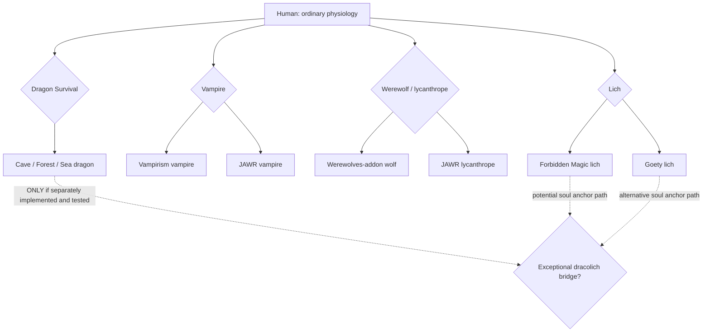

# Food systems and alternate player physiology — design survey (2026-11-13)

**Status:** Food mods approved for inclusion and registered as *planned*, not packwiz-installed. Species exclusivity and hybrid design are **proposed**, not implemented/locked. Minecraft 1.21.1 NeoForge. This document does not authorize adding unapproved species mods (including Origins) or nonselected addons.

## A. Approved food, farming and fishing roster (B7)

| Project | Target NeoForge 1.21.1 release | Gameplay |
| --- | --- | --- |
| Pam's HarvestCraft 2 — Food Core | 1.0.4 | Food recipes from mostly vanilla inputs |
| Pam's HarvestCraft 2 — Crops | 1.0.9 | 96 planted crops and garden bushes |
| Pam's HarvestCraft 2 — Trees | 1.0.9 | Fruit trees and derived ingredients |
| Pam's HarvestCraft 2 — Food Extended | 1.0.0 | Large recipe expansion depending on Food Core and using Crops/Trees ingredients |
| Farmer's Delight | 1.2.8 | Cooking Pot, Cutting Board, prepared meals, feasts and farming |
| Aquaculture 2 | 2.7.22 | Biome-dependent fish, fishing gear and seafood |
| **Harvest with Ease** | 9.4.0 | Mandatory right-click gentle harvesting/replanting across compatible crops |
| Cobweb | Exact version pending | Required Harvest with Ease library |

**Pam's HarvestCraft 2 Crops deliberately removed built-in right-click harvesting** as of 1.18.2 due to conflicts. Therefore the pack selects **Harvest with Ease** to meet the user requirement, rather than assuming native right-click behavior persists. This mod has an actual NeoForge 1.21.1 file, but **its support for Pam's and Farmer's crops is still a runtime test**, especially unusual age logic and multi-block growth. Configure/blacklist affected crops instead of duplicating special harvest mechanics.

Sources:
- https://www.curseforge.com/minecraft/mc-mods/pams-harvestcraft-2-food-core/files/all
- https://www.curseforge.com/minecraft/mc-mods/pams-harvestcraft-2-crops
- https://www.curseforge.com/minecraft/mc-mods/pams-harvestcraft-2-trees/files/all
- https://www.curseforge.com/minecraft/mc-mods/pams-harvestcraft-2-food-extended
- https://modrinth.com/mod/farmers-delight/version/1.21.1-1.2.8
- https://www.curseforge.com/minecraft/mc-mods/aquaculture/files/all?gameVersionTypeId=6&page=1&version=1.21.1
- https://modrinth.com/mod/harvest-with-ease/version/cjDrwP2Q

### Cross-mod food integrations (one approved, others under consideration)

- **[Aquaculture Delight](https://modrinth.com/mod/aquaculture-delight/version/1.2.0)** (NeoForge 1.21.1): additional fish dishes, cooking-pot and cutting-board integration, knife reciprocity. Verify rights and recipe balance; do not silently install.
- **[Pantrywork](https://modrinth.com/mod/pantrywork)** (NeoForge 1.21.1): server-side common food tag bridge among all four Pam's modules, Farmer's Delight, Aquaculture 2 and many other food systems; no items. Natural recipe-unification candidate. Do not silently install.
- **[Vampire's Delight](https://modrinth.com/mod/vampires-delight)** — **explicitly approved for inclusion** by user (2026-11-13). NeoForge 1.21.1 **beta** 0.1.12b, requires Vampirism 1.10+ and Farmer's Delight; file pin/boot pending. Approval is **this mod-specific beta exception only** and does not waive general beta gate. Test blood meals, food effects by faction, and any conflict with JAWR independent vampirism.
- **Vampirism Integrations** (NeoForge 1.21.1): potentially relevant compatibility, but specific Pam's/Farmer's functionality should be verified, not assumed.

### Required food acceptance tests

1. Harvest mature vanilla, Pam's and Farmer's Delight crops by right-click while preserving roots/seed or correctly replanting; check rice, tomato vines, fruit trees and garden bushes. Ensure no duplication or unintended crop destruction.
2. Verify food recipes accept sensible cross-mod ingredient substitutions (eg. fish/fish fillets, tomatoes, rice, dough); inspect shared tags and duplicate item paths through JEI; defer extras until warranted.
3. Confirm food generation with Tectonic worldgen; avoid excessive fruit-tree/bush population, respect protected structures.
4. In each allowed biological state, verify **at least one renewable sustenance method**, GUI/HUD integrity (including AppleSkin) and gameplay value for prepared food. A form that makes ordinary meals irrelevant may need tailored culinary effects or alternate blood/essence dishes; do **not** automatically override the mod's core hunger mechanics.
5. Do not treat right-click harvest testing, server boot, or recipe tag presence as proof that all food mechanics work in-world.

## B. Audit of persistent alternate species / body states currently reachable or planned

The following are actual mod **transformation paths**, not additional approved mods. Registry IDs and full implementation details need confirmation in installed builds.

| Code | Provider | State acquired | Gameplay identity and body | Food / life authority | Acquisition and reversal |
| --- | --- | --- | --- | --- | --- |
| H | Vanilla | Human/untransformed | Normal player body, ordinary food | Vanilla hunger | Default baseline |
| D | Dragon Survival (deferred) | Cave / Forest / Sea dragon; multiple growth/body forms | **Actual dragon body** with species traits, scale and flight/dragon powers | Dragon Survival diet **or** vanilla if config disables handling | First join/inventory choice and dragon altars; reverting to human supported; secure all entry paths |
| VV | Vampirism | Vampirism vampire | Humanoid undead with faction, sunlight, blood and skill-tree progression | Vampirism blood | Vampire infection/ritual/faction entry; check cure and skills |
| WW | Werewolves addon | Vampirism-system werewolf | Lycanthrope with human/beast modes, faction skills | Werewolves/Vampirism dietary effects require verification | Bite and faction entry; check cure |
| JV | JAWR | Witchery vampire | Separate undead vampire progression/abilities; bat is a temporary **form**, not independent species | Witchery blood; JAWR has blood-orb interaction with Neo Vitae | JAWR-specific vampire process; remove-curse ritual in modern versions |
| JW | JAWR | Witchery lycanthrope | Separate curse and werewolf/beast forms | Witchery species/food logic, to be tested | JAWR curse; remove-curse ritual in modern versions |
| JL | JAWR: Forbidden Magic | Witchery lich | Progression through **10 lich levels** with phylactery, soul abilities; temporary soul form is not a new species | Lich-specific rules; verify hunger and resurrection | Forbidden Magic ritual/quests and phylactery; verify reversal |
| GL | Goety/Goetied 1.21.1 port | Goety lich | Undead with Arca/soul-powered healing and resurrection; cosmetic human-like form still lich | Goety removes normal hunger bar / Arca resources | Drink Potion of Transformation under full moon with active Arca; normal in-game reversal not provided; commands can revoke |

Sources:
- https://github.com/DragonSurvivalTeam/DragonSurvival/blob/1.21.1/src/main/java/by/dragonsurvivalteam/dragonsurvival/common/handlers/DragonFoodHandler.java
- https://github.com/DragonSurvivalTeam/DragonSurvival/blob/1.21.1/src/main/java/by/dragonsurvivalteam/dragonsurvival/config/ServerConfig.java
- https://modrinth.com/mod/werewolves
- https://www.curseforge.com/minecraft/mc-mods/just-another-witchery-remake/files/9089145
- https://modrinth.com/mod/just-another-witchery-remake/version/0.5.10 (Neo Vitae blood compatibility)
- https://modrinth.com/mod/jawr-forbidden-magic
- https://goety.wiki.gg/wiki/Lichdom

**Other approved magical systems** (Neo Vitae, Ars Nouveau, Iron's, Malum, Occultism, Botania, Eidolon, Enchanted, etc.) can offer magical powers, equipment, soul/astral/ghostlike **temporary** forms, and status effects; current survey has **not verified any additional permanent species** among them. Re-audit their actual releases once installed. Being a mage, summoner, soul magic user or wearing draconic gear is **not by itself** a permanent species transition. An Origins-style choice system is **not approved** for this pack.

## C. Proposed combination tree (NOT final choice)

This tree has **one active long-term physiology** per player by default: human, 3 dragon species, 2 different vampires, 2 different werewolves, or 2 distinct liches. The human baseline and dragon growth/form selections are not additional transformation *stacks*. Other supernatural **abilities** can coexist.

The Dragon->Dracolich dashed branch is **required as a future playable design outcome**, but is not yet code-supported. It must use one deterministic resurrection arbiter. Abomination (Vampirism vampire+Werewolves) and dual lich (Goety+JAWR) are separate research candidates; see [HYBRID-TRANSFORMATIONS.md](HYBRID-TRANSFORMATIONS.md).

### Pairwise matrix — 7 nonhuman provider states, 21 unordered pairs

Every pair is **blocked by default** unless approved after test. Use both directions (A->B and B->A) for runtime tests.

| | D | VV | WW | JV | JW | JL | GL |
| --- | --- | --- | --- | --- | --- | --- | --- |
| **D** | Dragon species subtype choice, not 2 dragons | **Block** | **Block** | **Block** | **Block** | **Candidate dracolich ONLY** | **Candidate dracolich ONLY** |
| **VV** | — | Same provider upgrade only | **Candidate: Abomination** | **Block** | **Block** | **Block** | **Block** |
| **WW** | — | — | Same provider upgrade only | **Block** | **Block** | **Block** | **Block** |
| **JV** | — | — | — | Same provider upgrade only | **Block** | **Conditional: JAWR has some lich/vamp handler** | **Block** |
| **JW** | — | — | — | — | Same provider upgrade only | **Block** | **Block** |
| **JL** | — | — | — | — | — | Same provider upgrade only | **Candidate: dual lich (unproven)** |
| **GL** | — | — | — | — | — | — | Same provider upgrade only |

**21 unordered combinations:** 16 blocked by default; **five named candidates** (D+JL, D+GL, VV+WW, JV+JL, JL+GL). Dracoliches are an **explicit user-required playable outcome**, not yet implemented. Abomination and dual-lich remain design research, and JAWR's existing vampire+lich handler does not prove full compatibility. **Pair permissions are not transitive**: a dragon+Goety lich and Goety+JAWR lich exception does not permit a triple-lich dragon.

### The meaningful mechanics of each path

- **Human**: no species downsides; full regular food gameplay; all magic schools available.
- **Dragon**: permanent alternate anatomy, species-specific mobility and diet, dragon growth and powers. Cave/Forest/Sea are **exclusive species choices**, not simultaneous modifiers. Design possibility: keep unique dragon food diet unless it conflicts with modded food; food must remain accessible.
- **Vampire**: persistent **undead feeding and sunlight** system with distinct branch implementations. Food policy depends on one selected vampire provider; blood availability and meal compatibility matter. Never combine independent vampire providers/stack two blood bars.
- **Werewolf**: persistent **lycanthropic identity** whose wolf/beast modes are temporary shape phases of the same curse. Avoid another simultaneous alternate body model, especially dragon.
- **Lich**: choose **one** necromantic immortality system (Goety Arca or JAWR phylactery); its powers, resurrection, and hunger rules remain under that chosen provider. A Goety lich's human-looking alternate appearance is not a cure or a second species.
- **Dracolich**: required eventual hybrid with dragon anatomy and *one* lich anchor; lich governs death, hunger/essence, undead vulnerabilities; Dragon Survival governs body/flight/growth; requires explicit overrides to prevent duplicate HUD/food and body/form rendering. **Do not attempt in gameplay until an addon implements it.**
- **Hunter**: Vampirism's hunter faction is primarily a profession/faction state, not automatic nonhuman physiology. Decide later whether dragon hunters are allowed; the known Dragons and Vampires helper blocks all Vampirism faction membership at dragon altars, including hunters.

### Suggested rule architecture

- Track separately **Body species**, **Undeath/curse**, **Faction/profession**, and **Temporary shape**; derive a final, user-approved *effective physiology* from valid states rather than assuming all mods enforce shared permissions.
- **Default exclusivity** across the 7 nonhuman providers, despite separate fields. Never allow an untested pair merely because species and undeath occupy different conceptual axes.
- Preempt new transformations using mod-specific hooks/bridge at every route; do not silently overwrite another mod's player data with generic KubeJS commands. Reconcile *actual* player state on login, respawn and dimension transfer.
- Preserve already learned magical skills, unlocked spellbooks, faction-neutral crafting and equipment when a player changes valid physiology.
- Avoid involuntary deletion of vampire/lich skill trees. Reversion routes must specify removal of dietary rules, UI overlays, body scale, phylactery/Arca, stored growth and resurrection flags.
- Living human and dragon hunters should be able to benefit from new food systems. For undead who no longer have hunger, decide whether crafted meals provide nonessential enjoyment or small buffs, or whether we intentionally accept that feeding replaces culinary gameplay.

## D. Open decisions for owner review

1. Adopt **default one-primary-physiology** rule or permit specific hybrids from the start?
2. Are Goety and JAWR lichdom both offered as mutually exclusive player progression paths, or should one be canonically selected for players while leaving both magic systems' other content?
3. Do we eventually **want dracoliches**, and should they be supported with *one* particular lich provider?
4. Should Vampirism **hunter** remain human-only at first, or can dragons/werewolves be hunters?
5. For vampires and liches, do we deliberately support *prepared food enjoyment* despite replacing hunger with blood/soul-energy? If yes, define a specific mechanism without destroying each mod's survival identity.
6. Is the dragon diet part of what makes dragon play interesting? Default on for pure dragons, but allow switching it off during initial compatibility tests.
7. Consider Aquaculture Delight and Pantrywork; **Vampire's Delight is approved** (beta 0.1.12b exception). Examine whether any other cross-mod food integration is necessary.

**Implementation blocker:** A valid modpack cannot assume native transformation exclusivity is universal. Existing [Dragons and Vampires](https://modrinth.com/mod/dragons-and-vampires) covers Dragon Survival versus Vampirism and Werewolves, but not JAWR and Goety; broader prevention requires a separate dedicated bridge and bidirectional gameplay tests. See [TRANSFORMATION-COMPATIBILITY.md](TRANSFORMATION-COMPATIBILITY.md).

**No runtime tests or final pair exception decisions were made in this design note.**
