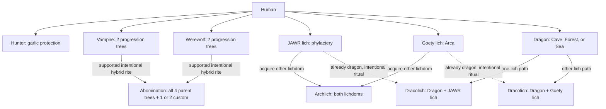

# Canonical target: supernatural physiology and transformation compatibility

**Decision: LOCKED by user on 2026-11-13.** This document **supersedes contradictory provisional exclusivity and hybrid restrictions** in `FOOD-AND-SPECIES-DESIGN.md`, `HYBRID-TRANSFORMATIONS.md`, `TRANSFORMATION-COMPATIBILITY.md`, and `HUNTER-AND-VAMPIRE-COMPARISON.md`. Those older documents remain technical evidence, but not the rule of record. **NOT IMPLEMENTED**; no jar, code, client run, or survival-feature test is implied.

Minecraft target: 1.21.1 NeoForge. Do not adopt incompatible newer Vampirism 2.x/FactionApi mechanisms from other MC versions.

## 1. Native providers versus effective species

Native providers and their *separately earnable progression*:
- `Vampirism` vampire (faction) and `JAWR` vampire (occult/quest).
- `Werewolves` addon werewolf (Vampirism faction) and `JAWR` lycanthrope.
- `JAWR: Forbidden Magic` lich (phylactery) and `Goety` lich (Arca).
- `Dragon Survival` dragon (Cave, Forest, Sea species and growth/body options); this mod remains **deferred for installation** pending bridge/food tests, but dragons/dracoliches are required *design outcomes*.
- `Vampirism` Hunter (garlic-inoculated protected human).

**Equivalence policy:** All routes to vampire yield **one effective vampire physiology**, with both native vampire recognitions/flags synchronized as required to access **two independent progression trees**. All routes to werewolf yield **one effective werewolf physiology**, with both native werewolf recognitions/flags synchronized as required to access **two independent progression trees**. Synchronization must be atomic, bidirectional, persisted, and reversible; native provider metadata is not permission to run both providers' food, blood, sun, wolf render, or death engines twice.

**Abomination:** A deliberately unlocked hybrid of **both unified vampire and unified werewolf** identities, meaning **all four underlying provider base states/recognitions and their four progressions** are available and retained, plus **one or two custom progression tracks** (final count TBD). One canonical blood/feeding model, one canonical sunlight/garlic/silver/wolfsbane consequence rule per hazard, one active shape renderer, one coherent ability/cooldown ownership. Because Vampirism 1.21 has a **single active faction**, maintaining four literal independent runtime flags without a bridge is *not* an accepted implementation: design a custom faction/attachment + helper adaptations and expose equivalent states to both parent mods.

**Lichdom:** The **two lichdoms are independent paths** and **must stack into Archlich** when the player earns both. Do not collapse them into one generic lich tree or require choosing permanently between them. Retain both progression histories/abilities; **dual actual death/resurrection backends require arbitration** rather than uncoordinated duplicate death cancellation.

## 2. Compatibility target matrix

| Primary effective state | Vampire | Werewolf | JAWR lich | Goety lich | Dragon | Hunter |
| --- | --- | --- | --- | --- | --- | --- |
| Human | Permitted acquisition | Permitted acquisition | Permitted acquisition | Permitted acquisition | Permitted acquisition | Permitted acquisition |
| Vampire | Same unified state; earn both trees | **Abomination only** (explicit progression/ritual) | **Undecided** | **Undecided** | **Not allowed** | **Not allowed concurrently** |
| Werewolf | **Abomination only** | Same unified state; earn both trees | **Undecided** | **Undecided** | **Not allowed** | **Not allowed concurrently** |
| Abomination | Already inherited | Already inherited | **Undecided** | **Undecided** | **Not allowed** | **Not allowed** |
| JAWR lich | **Undecided** | **Undecided** | Same state | **Archlich** (LOCKED) | **Dracolich** (LOCKED) | **Not allowed concurrently** |
| Goety lich | **Undecided** | **Undecided** | **Archlich** (LOCKED) | Same state | **Dracolich** (LOCKED) | **Not allowed concurrently** |
| Archlich | **Undecided** | **Undecided** | Already inherited | Already inherited | **Not allowed** | **Not allowed** |
| Dragon (any one species) | **Not allowed** | **Not allowed** | **Dracolich** (LOCKED) | **Dracolich** (LOCKED) | Same chosen dragon state | **Not allowed concurrently** |
| Hunter | **Not allowed concurrently** | **Not allowed concurrently** | **Not allowed concurrently** | **Not allowed concurrently** | **Not allowed concurrently** | Same state |

**Important:** "Undecided" is not "allowed" or "forever banned": continue default denial of unreviewed stacking until owner decides. **No transitivity**: Archlich + Dragon is prohibited, even though Dragon + one lich and the two liches together are permitted individually. Dragon + Abomination is prohibited. Dracolich means dragon + **exactly one** lich. Four source-provider vampire/werewolf flags in Abomination are equivalence/progression flags, not permission for four metabolism systems.

## 3. Intended player-facing progression graph

The graph omits undetermined vampire–lich/lycan–lich pairings; omission must not be read as either approval or permanent ban.

## 4. Hunter — protected and exclusive

Garlic injection makes Hunter a *modified-human physiology*, not merely a job. While a Hunter, prevent all **accidental/involuntary persistent supernatural conversions** (not just native Vampirism Sanguinare). A **deliberate, explicitly initiated and confirmed ritual** may replace Hunter with an allowed target physiology; clear/suspend Hunter faction, protection, progression-specific perks and UI **transactionally** before the new state takes effect. Whether Hunter skill investment is lost or refunded and what cost such a ritual requires is **not yet decided**. Hunter cannot coexist with vampire, werewolf, Abomination, either lich, Archlich, dragon or dracolich.

## 5. Implementation invariants

1. **Recognize and mirror** both vampire entry routes, both werewolf entry routes, and each lich entry route. Never award progress in a parallel tree merely by mirroring its starting state.
2. Preserve **two separate vampire trees**, **two separate werewolf trees**, **both full lich progressions** in Archlich, and **all four parent trees** in Abomination (plus 1–2 custom).
3. Define one authoritative set of **blood/hunger/diet**, **sunlight/weakness/hazard**, **attribute scaling**, **shape/render**, **death interception** and **resurrection** for every effective physiology; no passive doubling of punishments or rewards from duplicated source flags.
4. Prevent accidental vampire/werewolf acquisition that bypasses Abomination ritual progression; converting someone who is already the other type should not silently produce a hybrid.
5. Keep **Dragon + JAWR lich** and **Dragon + Goety lich** possible via supported rituals; block gaining the *second* lich on a dragon and block dragons acquiring vampires/werewolves/Abomination.
6. Track source native flags, effective physiology and pending transition as distinct, server-authoritative state. Validate against the true upstream player states, not just custom local metadata; handle failed transactions, logout, death, cure, world reload and old saves.
7. Preserve non-species school advancement unless that advancement genuinely requires excluded biology. Death-event mechanics are tracked separately in [DEATH-MECHANICS-AUDIT.md](DEATH-MECHANICS-AUDIT.md).
8. No silent conversion of prohibited combinations, no aggressive every-tick flipping of flags, no decompilation claims for JAWR source without an actual pinned artifact. Honor upstream licenses.

## 6. Open detailed design (not a reopening of the locked target)

- Which exact blood/HUD/sun/wolf-shape implementation is the single authority? Existing proposal uses Vampirism for vampire blood/sun and Werewolves for wolf forms; test JAWR differences first.
- Abomination extra progression count: **one or two custom tracks**, content and skill caps TBD.
- Archlich death arbitration and whether the Arca or phylactery takes primary priority/acts as fallback TBD.
- Which other vampire/werewolf + lich combinations, if any, are designed and approved later TBD.
- Specific reversible/cure costs and how native advancement is retained on leaving/transmuting the effective state TBD.

**This is the locked design target only; implementation requires a NeoForge compatibility mod and cross-mod test suite.**
