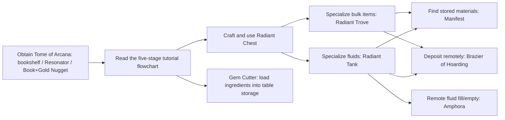

# Arcane Archives: Reborn 1.0.2 — Mod Capability Atlas, verified publisher/pin first pass

> **Status: PUBLISHER-DOCUMENTED PARTIAL / RESEARCH ONLY, NOT YET NATIVE SOURCE/JAR-MECHANICS VERIFIED.** This is the selected **Minecraft 1.21.1 NeoForge** remaster by **TechnoVision**, **not** the original 1.12.2 AranaiRa project and **not** SirEdvin's unrelated ArcaneArchivesRecrafted. The selected release's publisher description and exact file changelog document its meaningful early storage loop. The **actual version-pinned JAR classes, JSON recipes, Modonomicon page assets and exact numeric internal algorithms were not available to this Atlas pass**. Do **not** turn likely old 1.12 behavior into an asserted 1.0.2 implementation. Native released-mod features are presumed working: missing source evidence is a *research scope gap*, not a gameplay-QA defect.

| Provenance | Exact research basis |
| --- | --- |
| TMM selection | `manifest/mods.json` ID **`arcane-archives-reborn`**, `enabled_in_pack: true`, version **1.0.2**, verified release |
| Packwiz artifact | [`mods/arcane-archives-reborn.pw.toml`](../../../mods/arcane-archives-reborn.pw.toml): `ArcaneArchives-1.0.2+Neoforge-1.21.1.jar`; **SHA-1 `082f5f560981c04c487b9c1f5e5ec9976f8ec2db`** |
| Independently verified prior pin census | [PR #441](https://github.com/heatwaveqc/Too-Much-Magic-Modpack/pull/441): **3,192,671 bytes**, SHA-256 **`ad3ce7609f9de5d24387245a68a061e55726e88143b5cb9913a9f744f43bfed4`**, bundled mod ID **`arcanearchives`**, Minecraft **1.21.1**, NeoForge **≥21.1.251**, **Modonomicon ≥1.120.5**, both sides; earlier pin auditor inspected JAR metadata, **not a full mechanics disassembly** |
| Selected pack dependency | Pack's NeoForge **21.1.265** and Modonomicon **1.123.0** satisfy declared minimums (reported by #441); recheck if loader/pins change |
| Official exact file + 1.0.2 changelog | [CurseForge project 1696190, file 8985321](https://www.curseforge.com/minecraft/mc-mods/arcane-archives-reborn/files/8985321), published **2026-09-26** |
| Publisher native overview | [TechnoVision Arcane Archives: Reborn](https://www.curseforge.com/minecraft/mc-mods/arcane-archives-reborn): introduction; Tome; Radiant Chest, Trove, Tank, Amphora, Manifest, Brazier; early-game scope and upgrades |
| Owner-approved feature scope | [#387](https://github.com/heatwaveqc/Too-Much-Magic-Modpack/issues/387): preserve native features, do not trim; use **Arcane Archives → Occultism → ProjectE** as teaching *order*, not a hard research/mechanical gate |
| Existing related dossiers | [Occultism](occultism.md) (later dimensional/remote item storage) and [Primal Magick](primal-magick.md) (separate native research; not a shared crystal currency) |

## 1. Player value and initial acquisition

**Identity:** Magical **physical item and fluid storage**, plus item tracking and deposit routing, presented as an early-game storage system. The publisher explicitly states that additional crafting and automation devices are **planned**. Treat *actually described* 1.0.2 features as available; don't treat planned devices, old-game assets or thematic “crystal-powered networks” as additional implemented machines or a measurable Mana/FE fuel economy.

**Five useful native functions established by the publisher:**

1. **Radiant Chest:** 54 inventory slots, each with **four times** the normal item stack size. For items that usually stack to 64, that implies a **nominal 256 items per slot**, but actual per-item maximum, UI transport and nested-container compatibility require versioned handler source before generalizing.
2. **Radiant Trove:** one item/block *type* per Trove, advertised capacity **up to 1,024 stacks**, and capacity upgrades **up to tenfold over initial capacity**. The exact starting/max upgrade arithmetic and how stacks with different components count are not established by the overview; don't claim every Trove holds 10,240 distinct stacks out of the box.
3. **Radiant Tank + Radiant Amphora:** a fluid store and a portable bucket-like tool that can **fill and empty it remotely**. The publisher provides no exact mB capacity, fluid filtering, maximum distance, cross-dimension permission or loss/conservation algorithm.
4. **Manifest:** a tracking/locating item for stored item/block contents in Troves/Tanks; the publisher directly describes this discovery role, not universal access to every chest in the dimension.
5. **Brazier of Hoarding:** drop appropriate contents into it to **route/deposit** them remotely toward Radiant Troves and Tanks. The publisher's description is phrased broadly; exact compatibility with fluid containers, nearest-node priority, range, power requirements, failed insertion return and ownership rules are not yet code-grounded.

**Real onboarding—three supported ways to acquire the Tome of Arcana:**

- **Break a bookshelf** → publisher says this grants a Tome.
- **Craft a Radiant Resonator** → publisher says this grants a Tome; Resonator's required exact materials/functional operation are not supplied by project text.
- **Craft a Tome** directly from **one Book and one Gold Nugget**; shape, station type and exact registry recipe ID must still be checked against pinned resources.

Open/read the **Tome of Arcana**, the mod's in-game documentation powered by Modonomicon. The **1.0.2 publisher changelog** confirms **five flowchart tutorial stages**, shorter explanations, clearer dependency arrows and illustrated recipes. These **five teaching stages are not automatically five native research locks**, mandatory tiers or FTB quest nodes.

**Practical no-invented-step setup:** obtain/open Tome → follow its actual illustrated recipe for the earliest storage block (start with Radiant Chest) → store items → specialize to Trove for bulk homogeneous stock or Tank/Amphora for fluids → add Manifest/Brazier for locating and routing → follow the Tome for Gem Cutter's native crafting workflow. Do not fabricate exact crafting ingredients for storage blocks until the JAR's recipes/guide JSON are inspected.

## 2. Native storage and logistics subsystem inventory

| System | Native operating action | First usable extent | Higher extent / limits | Evidence confidence |
| --- | --- | --- | --- | --- |
| `Radiant Chest` | Place/open/store items in **54** slots with **4× per-slot** stack limits | Early-game multi-slot chest | No chest capacity upgrade asserted. Stacking exceptional Data Components and shulker/bag nesting are *integration* questions, not a claim the native chest is broken | Publisher direct |
| `Radiant Trove` | Place/store **one type** of item/block in bulk | Advertised capacity *up to* **1,024 stacks** | The publisher says Troves can be upgraded to **10× starting capacity**; actual item-stack matching and upgrade objects/order not yet source-inventoried | Publisher direct |
| `Radiant Tank` | Place/store fluids | Basic fluid storage amount **not published** | Can be upgraded to **10× starting capacity**, numerical mB and fluid types unknown from direct source | Publisher direct |
| `Radiant Amphora` | Portable bucket-like interface to **remote fill and empty** a Radiant Tank | Early tank interaction once obtained | Range, fluid transformation, inventory interfaces, travel scope unknown | Publisher direct |
| `Manifest` | Track and **locate** stored objects in Radiant Troves/Tanks | Named tracked-storage discovery | No unbounded chest scan, teleport, item withdrawal or universal cross-dimensional network established | Publisher direct |
| `Brazier of Hoarding` | Throw items/supported containers in to remotely **insert/deposit** into storage | Selective remote drop-off to Troves/Tanks | Filtering/priority, throughput, unaccepted item return and loaded-chunk requirements need actual source, **not speculation** | Publisher direct |
| `Monitoring Crystal` | **Shift-right-click to place** onto its target; normal right-click while holding it continues opening containers | Native place/attach gesture established in 1.0.2 | What its indexed container scope, network association and scan mechanics are requires the bundled Modonomicon and handler source | Exact-version release notes |
| `Manifest Lectern` | Named native UI/item recorded in 1.0.2 changelog (fixed items rendering outside slots) | Its existence is established | Actual configuration, access methods and multi-player permissions not established by publisher | Exact-version release notes |
| `Gem Cutter` | Recipes require the **ingredients in the table's own storage**; player inventory **does not count** | Select/execute a storage-fed crafting recipe | Bright recipe = currently craftable; dark recipe = unavailable; selected recipe retains **gold marker** even if ingredients run out; exact outputs/costs to inventory later | Exact-version 1.0.2 release notes |
| `Radiant Resonator` | Crafting it is one published Tome-acquisition trigger | Provides early guide access | Any further resonator abilities, recipes or physical range not established | Publisher direct |

**Registry-ID note:** The displayed names above are publisher-confirmed. The pinned actual mod ID is `arcanearchives`, but **the precise registry suffix of each item/block was not inspected**. Do **not** auto-invent `arcanearchives:radiant_chest` and similar resource IDs as authoritative code citations until the 1.0.2 registry or JAR confirms them.

### Storage semantics that matter for our other modpack goals

- **Physical inventory** is what this mod natively advertises. Neither manifest search nor Brazier deposit implies **player-saved extra-dimensional storage** like Occultism, an Ender Chest, or a ProjectE learned-EMC wallet.
- Trove is a **one-type bulk unit**, not a generic backpack; Chest is a placed multitype inventory; Tank is a placed fluid container. The pack's “no generic backpack-only mod” exclusion does **not** require removing these native storage features.
- **No cross-mod EMC, EV, FE, mana, blood-energy, fluid-unit or player-wallet conversion** can be inferred simply from this mod's crystal/network aesthetic.
- Item **Data Components**, oversize 256-count slot limits, other portable-container rules, and actual loss/dupe paths need handler/source plus *combined* integration context. The Atlas documents them as **interfaces**, not unsupported exploit accusations or ordinary gameplay-test obligations.

## 3. Crafting/progression graph and Modonomicon handoff

This is an **available-operation learning graph**, **not** a claimed native research tree:

**Mandatory entry:** getting the Tome is a *teaching goal*, not necessarily an item progression lock. **No formal mandatory power/research tier hierarchy has been demonstrated** from the currently reviewed 1.0.2 sources. Teach player-selected branches instead of enforcing every container/device as a core quest gate. The exact recipe/material dependency arrows cannot be established without the pinned recipe assets and should **not** be invented.

**1.0.2 Gem Cutter nuance worth teaching clearly:** Craftability is evaluated against **the crafting table's storage inventory**, not the player's personal inventory; bright and dark recipe presentations communicate available/unavailable, and a gold marker is retained for the selected recipe. This specific release change is much more important than trying to invent a complicated network ritual for onboarding.

### Proposed instructional quest-source records (research proposals only)

| Research ID | Optional? | What the player learns/does | Source-backed success / truthful eventual FTB signal | Exact in-game reference |
| --- | --- | --- | --- | --- |
| AA-01 | Orientation | Obtain Tome from bookshelf or crafted Tome/Resonator; open it | Tome possession is only a proxy for reading | Tome of Arcana, overview / publisher opening instructions |
| AA-02 | Core | Craft/open/use a Radiant Chest | Item possession does not prove a 54-slot storage interaction | Tome, first storage and Chest recipe |
| AA-03 | Optional | Store a repeated ingredient/item in a Radiant Trove | Trove possession ≠ configured/filled Trove | Tome, Trove bulk storage page |
| AA-04 | Optional | Upgrade a Trove | An upgrade item task ≠ upgraded capacity; actual handler observable must be researched | Tome, capacity upgrade page |
| AA-05 | Optional | Store fluid in Radiant Tank | Tank possession ≠ fluid amount | Tome, Tank / fluid page |
| AA-06 | Optional | Fill/empty the tank via Radiant Amphora | Amphora possession does not prove remote transfer | Tome, Amphora page |
| AA-07 | Optional | Locate stored material with the Manifest | Manifest possession is only a proxy for successful locator use | Tome, Manifest |
| AA-08 | Optional | Throw compatible material into Brazier of Hoarding and route it to storage | Brazier possession ≠ transfer; determine actual detection later | Tome, Brazier |
| AA-09 | Optional | Place a Monitoring Crystal with **sneak-right-click** while preserving normal container access | Holding crystal does not prove attachment | Tome, Monitoring Crystal |
| AA-10 | Optional | Put ingredients **inside** Gem Cutter table storage, choose a bright recipe, craft | Output possession may not prove Gem Cutter use; exact event/crafting data needed | Tome, Gem Cutter / five-stage tutorial diagrams |
| AA-11 | Optional | Learn Manifest Lectern function after its guide page is identified | **No reliable exact native outcome documented yet**: leave as source gap | Tome, Manifest Lectern (page identity unverified) |

**Do not instantiate these as FTB Quests.** They are quest-source prompts, with no saved GUIDs, invented recipes, rewards, unlock dependencies or implemented detection logic. Quest designers can choose the appropriate shape once native material gates and actual pages are understood.

## 4. 29-axis capability navigation

All **29 axes** are addressed; `unknown` means **not yet researched sufficiently**, *not* absence from the mod. A `present` entry points to documented native operations above. This matrix is navigation, not gameplay coverage proof.

| Axis | First-pass presence | Concrete observed/named mechanic or research boundary |
| --- | --- | --- |
| `gear` | present | Handheld Amphora, Manifest, Tome; exact equip/charge rules unknown |
| `movement` | unknown | Publisher only describes remote **item/fluid** movement; no exhaustive negative code survey of player movement exists |
| `ore_processing` | unknown | Gem Cutter is crafting; don't assume it duplicates ores |
| `storage` | **present** | 54-slot 4× Chest, single-type Trove, fluid Tank, upgrades |
| `crafting` | **present** | Gem Cutter storage-fed recipes; exact recipe outputs pending pinned JAR |
| `logistics` | **present** | Brazier deposits; Amphora moves fluids; Manifest locates |
| `buffs` | unknown | No sourced status-effect list |
| `external_compatibility` | unknown | Normal foreign inventory APIs/EMC/other mod bridges unverified |
| `mob_farming` | unknown | No native mob capture/loot feature established |
| `ore_generation` | unknown | No new ore/fresh-material production established |
| `permanent_power` | unknown | No persistent player upgrades established |
| `general_generation` | unknown | No ex-nihilo output established from presented logistics |
| `direct_damage` | unknown | No weapon/spell damage established |
| `block_breaking` | unknown | No direct magic block breaker established |
| `permanent_pets` | unknown | No pet/companion behavior established |
| `temporary_pets` | unknown | No temporary summon established |
| `defense` | unknown | No shielding/mitigation feature established |
| `healing_recovery` | unknown | No healing spell or regenerative item established |
| `debuff_control` | unknown | No hostile status-effect application established |
| `energy` | unknown | “Crystal-powered networks” is thematic; do not claim measurable FE or a Mana pool |
| `automation_control` | unknown | The Brazier automates deposits, but redstone/filter/programmable signaling not shown |
| `agriculture` | unknown | No crop/tree/farm mechanic established |
| `detection_information` | **present** | Manifest locator, Monitoring Crystal placement, recipe-availability display |
| `equipment_augmentation` | unknown | Trove/Tank upgrades concern **storage**; gear upgrade system not demonstrated |
| `world_manipulation` | unknown | No terrain/biome/weather alteration established |
| `world_content` | unknown | No verified generated structures, biomes or creatures |
| `death_respawn` | unknown | No after-death recovery or totem function established |
| `trade_economy` | unknown | No merchant/trading output established |
| `progression_tiers` | unknown (native formal tiers) | **Five Tome flowchart teaching stages** are guide content, not proof of five hard research tiers; storage-capacity upgrades exist, exact native lock order unknown |

*Negative coverage honesty:* The publisher's early-game storage description is enough to avoid proposing combat spells as research priorities. It is **not** a complete code-level negative search; do not silently upgrade `unknown` rows to `no_capability_confirmed` in the next pass without a scoped registry/source survey.

## 5. Typed resources and storage scopes

| Resource | State owner/carrier | Known capacity/flow | Confidence and known limits |
| --- | --- | --- | --- |
| Item stacks in Radiant Chest | **block inventory**, per slot | **54 slots**, **4× stack limits** | Publisher direct; no player wallet |
| Bulk one-type item stock in Radiant Trove | **block inventory** | Advertised **up to 1,024 stacks**, upgradable to 10× starting | Publisher direct; stack-component identity not established |
| Fluids in Radiant Tank | **block fluid storage** | Upgradable to 10× starting | Publisher direct; base mB, per-fluid multiplicity and capacity unknown |
| Fluid moved with Radiant Amphora | **held item/container transfer** | Remote fill/empty Tank | Publisher direct; standalone internal item capacity/mB not established |
| Item deposit via Brazier | **block-mediated routing** | Throwing item(s) provides input; storage receives accepted stock | Publisher direct; costs/filters/transfer/range unspecified |
| Stored-content discovery via Manifest | **held item query/result** | Locate tracked contents in named storage devices | Publisher direct; server/player/world scope, cache and range unspecified |
| Mana / EV / FE / soul energy | **NOT DOCUMENTED** as native storage currency | No units, producers, buffers, or conversions established | Do not invent from title or crystal texture |

**Ownership:** No packet/API/path has been inspected that would prove a direct link to a player's saved data or their Ender Chest. This mod's advertised physical storage is *not* an extra ender inventory, and should not be counted toward ProjectE capacity unless a real interface is found.

## 6. TMM-specific research handoff (not upstream mod claims)

1. **Early utility:** Arcane Archives is approved to retain its native Chests, Troves, Tanks, Amphora, Crystals and Brazier. It complements rather than replaces Occultism. Teaching order **Arcane Archives → Occultism → ProjectE** is an accessibility suggestion, *not* gating in code or a design change.
2. **Container nesting / data integrity:** TMM's generic bag-safety policy applies to all modded movable containers. Evaluate actual AA item-containing block-item Data Components and insert/withdraw APIs when the handler source is available; don't assume the mod is a backpack or arbitrarily ban nested storage.
3. **Stack normalization:** a 4× stack limit can be **outside vanilla slot expectations**. Whether other TMM tools (pipes, inventory movers, ProjectE collectors, automation or vanilla hoppers) preserve or split its slots depends on the exact NeoForge item handler and combined mods. This is an interface question, not a declared bug.
4. **Tanks and blood:** EvilCraft blood is TMM's canonical bucket fluid. Whether Amphora/Tank accepts it depends on real fluid capabilities/tags, conversion rules and versioned container implementation. No unsupported statement that cross-mod blood works or fails.
5. **EMC/economy:** ProjectE may assign EMC to AA blocks/items depending on recipes, tags and external conversions. **Do not claim innate duplication** or direct remote EMC withdrawal from this mod.
6. **Ownership/claims:** native remote routing, block attachment and search may expose an ownership boundary to inspect for TMM's FTB Chunks. Normal mod functionality is presumed working. Flag a *specific* cross-mod call path for integration review only if pinned code shows one.

## 7. What remains for source-complete Atlas, and what does not

This is a **useful publisher-verified first pass**, not a full 1.0.2 Atlas. Close the remaining **research** gaps by obtaining the exact **published JAR** (SHA-1 above) or an immutable upstream source reference and examining:

- **Exact registries:** all named and additional native blocks/items, real `arcanearchives:...` IDs, Modonomicon Tome item and **actual five stage/page IDs**, guide links and recipe categories.
- **All packaged recipes:** Chest/Trove/Tank, upgrades, Resonator, Tome, Amphora, Manifest, Monitoring Crystal, Brazier, Manifest Lectern, Gem Cutter ingredients/outputs and any auxiliary gemstones. Establish exact stage/material progression, *not* a hypothetical research tree.
- **Storage implementation:** slot inventory, Fluid handler, 4× stack semantics, Trove item matching, 1,024 stack tier/10× upgrade arithmetic, Tank base/max mB, sided automation, comparator/chunk and on-break ownership/data persistence.
- **Network implementation:** Brazier routing/priorities/failure return, Manifest and Crystal search scope/range/security, remote Amphora fill/empty conditions and what is meant by “crystal-powered.”
- **Native authoring:** full five flowchart steps and guide/JEI cross-references sufficient for actionable quests. **No manual Minecraft gameplay test required.**
- **Explicit, only-if-necessary cross-mod review:** storage components and generic nesting, canonical blood fluid adapters, EMC input/output and FTB claim hooks; this is a separate interaction evidence slice.

Do not use old 1.12.2 original Arcane Archives' Scepter of Manipulation, old Quartz blocks, exact stack algorithms, or legacy source files as **version-1.0.2 facts**. Do not assert the modern remaster has every historical device just because the name matches. The official **1.0.2 release note** itself is the reliable source for the five-stage guide, Gem Cutter inventory-only crafting and Monitoring Crystal interaction.

**Next Atlas research target after this first pass:** either obtain/inspect exact Arcane Archives 1.0.2 bytecode and resources to finish this dossier, or move to the queued **Aura Cascade Reimagined** while preserving this identified version-specific source gap. Do not file routine gameplay QA as a blocker or create new design/implementation PRs.
