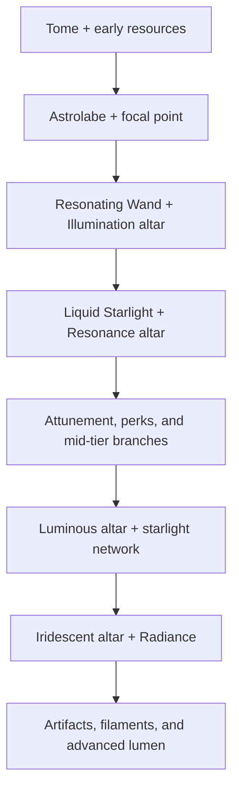

# Astral Sorcery — mechanics and gameplay profile

| Field | Value |
| --- | --- |
| Manifest ID / actual mod ID | `astral-sorcery` / `astralsorcery` |
| Category / parent or addons | magic; requires ObserverLib and Curios |
| MC / loader / pack target | 1.21.1 / NeoForge / `test/full-integration` at `880c8bfa` |
| Pinned version / artifact / hash | `AstralSorcery-2.0.3.59.jar`; packwiz SHA-1 `66f36655eae7cb404c9c16da6f33db31dff6ed9a`; inspected SHA-512 `aa3f130e1e61dccd199373b6ee39563faf7d2573090e25c36f305f247a8102338371da25a79dcf1518909b5d48de0d825c94dbcfb8a5534667906fa5b61cfb93` |
| Source snapshot | `HellFirePvP/AstralSorcery` branch `1.21.1`, commit `e5309e9cc82dfe96d0fc7b04aaa5c56692d47f55`; source declares 2.0.3 and matching dependency generations. All 1,994 source main/generated resource files exactly match the pinned JAR by path and SHA-256; compiled class equivalence is not established. |
| Guide/documentation version gap | Pinned 2.0.3.59 alpha; examined in-game Tome text and generated data from version-aligned source. No external guide assumed. |
| Profile status | researching |
| Evidence reached | exact pinned JAR identity/hash checked; source, generated research/recipe/worldgen data and localization inspected; pack-level gameplay not tested |
| Reviewed | 2026-11-15 |
| Quest ownership | `config/ftbquests/quests/chapters/astral_sorcery.snbt` is a single optional checkmark placeholder; no quest edits made |

### Pinned release notes that affect this guide

CurseForge file 9281073 identifies this artifact as the 1.21.1 NeoForge alpha built with NeoForge 21.1.252, ObserverLib 1.10.3 and Curios 9.5.1. This release adds lumen engraving on crystals, a dimension list for rendering constellation overlays without replacing a dimension's full sky render, and Jade lumen readouts. In Jade, Astral blocks exposing `ILumenHandler` display each lumen amount against its capacity. The changelog also records fixes to altar input tolerance, altar UI overflow handling, cheat-death cooldown, damage reduction, crystal-weapon damage, Infused Wood recipes, and focal-point foliage clearing. These fixes make older-version instructions unreliable for those details. [pin] [docs: CurseForge file 9281073]

## Executive gameplay map

**What the player actually does:** Find the first Astral Tome, mine Aquamarine Shale along water and buried Rock Crystal Ore deep underground, and use the Resonating Wand to locate crystals and operate star-powered devices. Discover constellations with an Astrolabe and identify focal points in the night sky. A vanilla crafting table becomes an Illuminated Crafting Table at a focal point; Liquid Starlight from a Lightwell and other early discoveries open the Resonating Crafting Table and then its Luminous and Iridescent upgrades. These crafting stations need larger marble structures, relays and nighttime operation as they advance. The later systems let players filter and route starlight, attune to a major constellation, develop a personal perk tree, make charged lumen equipment, grow crystals and gems, automate tree harvesting, travel through a starfield gateway, and pursue artifacts and artifact enhancement.

**Why it matters in TMM:** Astral Sorcery is a sky, structure and personal-advancement school. It has its own constellation-bound perk progression, starlight network and advanced crafting path; the project’s compatibility matrix deliberately exempts it from Pufferfish skill-tree conversion. It overlaps with other mods in tools, movement, farming, light and equipment, but does not use Ars Source or Botania mana in the inspected recipes. The pack’s previous early-utility audit identifies the Resonating Wand’s buried-crystal finder and focal-point transformations as early utility leads, subject to recipe and client confirmation.

**Quick start:** On first server login, the mod gives the Tome by default if the inventory can accept it. Open it, then follow **Welcome**, **Ores**, **Constellation Paper**, **Astrolabe**, and **Wand**. Search riverbeds/shallow shores for Aquamarine Shale; bring an iron pickaxe, locate deep Rock Crystal with the Resonating Wand, and keep close enough to collect the crystal drops. Make the Astrolabe and find a focal point at night. The first functioning workbench is a vanilla crafting table transformed at the focal point with the ingredients shown in Tome → **Illumination Altar**. [pin] [source: `e5309e9`, `PlayerEventHandler`, `AstralResearchNodeProvider`, `en_us.json`]

### Player-value snapshot (a quick reference for quest designers)

| Five standout capabilities | Three genuinely early practical unlocks | Three candidate integrations |
| --- | --- | --- |
| 1. A constellation-attuned personal perk tree with five major roots and many active/passive effects. 2. Starlight focal-point and altar crafting. 3. Lumen-bound gear with rechargeable effects. 4. Specialized movement/building/conversion wands. 5. A personal Celestial Gateway and artifact-hunting/enhancement loop. | **Resonating Wand:** locates buried Rock Crystal; requires focal-point crafting and its ingredients. **Liquid Starlight:** Lightwell accepts Aquamarine or crystals, but consumes its catalyst over time. **Focal-point transformations:** some items transform if left in the correct open-sky star column; exact recipes are discoverable in JEI. | **TMM construction:** Formation Wand can accelerate the large multiblocks used by Astral and other magic. **TMM progression:** preserve Astral’s independent perk tree alongside class skills. **Other utility mods:** compare Liquid Starlight and lumen interfaces with installed item/fluid automation; no FE, Ars Source or Botania-mana bridge was found in the inspected recipes. |

### Subsystem coverage at a glance

| Subsystem / progression branch | Mechanics evidence | Progression completeness | In-game guide/JEI reference | Client validation | Blocker / next action |
| --- | --- | --- | --- | --- | --- |
| Tome, early resources, focal points | [source: `e5309e9`; JAR SHA-512 above] | strong partial | Tome → Welcome, Ores, Constellation Paper, Astrolabe, Wand | not run | Verify discovery/visibility sequence and worldgen after pack terrain mods |
| Crafting tables and altar tiers | [source: `e5309e9`; generated altar recipes + `TileAltar`] | partial | Tome → Illumination Altar, Resonance Altar, Luminous Altar, Radiance Altar; each has JEI altar recipe and structure page | not run | Detailed recipe costs and exact ObserverLib pattern extents remain to inventory |
| Liquid Starlight, Lightwell, crystals | [source: `e5309e9`; recipe and lightwell data] | partial | Tome → Liquid Starlight, Lightwell, Celestial Crystals; JEI Lightwell/Infusion categories | not run | Exact drain rates and all recipe inputs not yet audited |
| Constellations, attunement and perks | [source: `e5309e9`; Tome nodes and perk source] | partial | Tome → Astrolabe, Attunement Altar, Perk Gems, Perk Tools, Shifting Star | not run | Full perk tree node/effect/cost walkthrough and attunement timing need audit |
| Lumen network, crafting and equipment | [source: `e5309e9`; lumen/recipe data] | partial | Tome → Lumen Array, Lumen Binding, Linking Tool, Lens/Prism, Starlight Focus Crystal | not run | Need exact caps, attenuation, recipes and all binding effects |
| World structures, gateway and artifacts | [source: `e5309e9`; structures, loot and research nodes] | partial | Tome → Celestial Gateway, Artifacts, Artifact Enhancements | not run | Structure spawn conditions, artifact riddle distribution, gateway travel behavior need full audit |
| Pack compatibility/configuration | integration files and docs | partial | TMM compatibility matrix and early utility audit | server boot documented; client not tested | Verify dependency loading, sky rendering with Embeddium/shaders and worldgen with Tectonic |

## Guidebook onboarding — required before the player's first complex step

- **Guide name and access:** Astral Sorcery Tome, item `astralsorcery:tome`. Server config `astralsorcery-server.toml` → `general.giveTomeOnJoin` defaults `true`; on first login the server attempts to add one if inventory space exists. Right-click opens the research screen. Shift-right-click in main hand opens its papers inventory. A Tome can be placed on a vanilla lectern. If the automatic grant is missed or disabled, JEI/Tome research includes the Tome recipe. [source: `GeneralConfig`, `PlayerEventHandler`, `TomeItem`, `research/welcome.json`]
- **Earliest attainable stage:** Login; no Astral materials or tier gate for the default grant. The Tome item stacks to one.
- **First instructional quest:** “Read the Astral Tome.” Explain the automatic grant, recovery/crafting fallback, right-click access and the Welcome/Ores pages. FTB can only safely detect Tome possession unless a genuine screen/read event is confirmed; a checkmark task should say it is a manual reading acknowledgement.
- **Reference map:** Research nodes are named in the Tome: **Welcome**, **Ores**, **Constellation Paper**, **Astrolabe**, **Wand**, **Illumination Altar**, **Resonance Altar**, **Lightwell**, **Liquid Starlight**, **Attunement Altar**, **Celestial Gateway**, **Lumen Array**, **Starlight Focus Crystal**, **Radiance Altar**, **Artifacts**, **Artifact Enhancements**, and named wand/tool nodes. Node pages embed recipes and ObserverLib structure views for altar builds. JEI supplies recipes/uses for item acquisition and recipe categories.
- **Where guide is insufficient:** A substantial guide is present, but sources do not establish that every optional recipe has a Tome page or that pages explain exact worldgen dimensions/biome odds. Where a later altar’s ObserverLib ghost is necessary, teach the wand’s structure-preview interaction. External wiki should not be needed for the initial path.
- **Other in-game help:** Astral Tome research graph and item lookup, JEI recipe categories (`astralsorcery:altar_crafting`, `focal_combine`, `lightwell`, `infusion`, `focal_transmutation`, `focal_combine`, lumen recipes), structure preview from the Resonating Wand.

## Systems and full mechanics inventory

| Subsystem | How accessed | Inputs + costs | Effects / outputs | Limits, failure conditions and source |
| --- | --- | --- | --- | --- |
| Tome/research | Login grant or recipe; right-click Tome | Item possession; per-player saved progress | Research graph, recipes, structure pages, research tier, known constellations and perk navigation | Grant is attempted only if inventory accepts it; config default true. Research content is per player. [source: `PlayerEventHandler`, `PlayerProgress`] |
| Aquamarine Shale | Overworld generation; look along riverbeds and shallow shores | Stone shovel or better to break | Aquamarine item drops | Generated features added to `#minecraft:is_overworld`; pack terrain and actual distribution not tested. Tome describes the distinctive near-water placement. [JAR; source] |
| Rock Crystal Ore | Deep Overworld generation | Iron pickaxe or better; Resonating Wand reveals ore through blocks | Rock Crystal with individual qualities; must be near drops or they are lost | Generated placement is 4–7 blocks above bottom with rarity filter 28; exact config-independent distribution is not a measured rate. [JAR `placed_rock_crystal_ore`; Tome Ores] |
| Marble | Overworld ore feature | Mining | Marble for structure and decorative blocks | Feature is added to Overworld; actual frequency and Tectonic interaction untested. [JAR worldgen] |
| Constellation Paper/Astrolabe | Find and use discovered papers; craft the glass Astrolabe | Clear night, correct moon phase, angle marker, drawn star connections while sneaking | Discover constellations; record their sky positions and focal points. The source defines five major perk-tree constellations (Aevitas, Armara, Discidia, Evorsio, Vicio) and seven minor constellations (Lucerna, Mineralis, Horologium, Octans, Bootes, Fornax, Pelotrio); minor discoveries do not create additional attunement roots. [source: `ConstellationsAS`] | Wrong tracing or unsuitable sky/phase yields no discovery. Faint constellations are unavailable until progression improves. [source Tome nodes] |
| Focal points | Find bare patch in terrain; view through raised Astrolabe at night with angle marker aligned | Open sky and star/focal-point alignment | Celestial column; enables focal combining and star-dependent devices | Exact focal-point biome and spawn distribution still need inspection. Obstructed sky prevents normal use. [source Tome] |
| Resonating Wand | Drop recipe ingredients as one pile at an open focal point | Recipe’s item inputs, starlight/time; pile must remain undisturbed | Wand; finds buried crystal; activates Astral devices; projects missing structures | Moving/interfering with the pile loses the work; wand activation is nighttime operation for altar crafting. [source Tome Wand] |
| Focal combine | Put item pile at focal point in open ground | Recipe-defined item inputs; no machine inventory | Starlight-made wand, altar and other early components | Per-recipe conditions/outputs appear in JEI and Tome where included; do not assume all items transform. [JAR recipes] |
| Crafting altar tiers | Place or upgrade crafting table at center of its required structure | Tier recipes use altar-grid/relay inputs, Liquid Starlight, dropped additional items, and sometimes lumen/constellation focus | Four altar states: Illumination, Resonance, Luminance, Radiance | Core tier recipes are nighttime; each upgrade modifies the altar block in place and its output modifier grants the crafted tier to the crafting player. Placing any later altar also advances the placer. Illumination: 4 Marble + crafting table at a focal point. Resonance: crystal tag, 4 Marble Pillars, 2 Runed Marble, 1000 mB Liquid Starlight. Luminance: Resonating Gem, 2 gold ingots and 3 Runed Marble in grid; relay pattern adds 2 gold, 2 Pillars, 5 Runed Marble; plus 3 Stardust and 3000 mB Liquid Starlight. Radiance: Celestial Crystal, Glass Lens, 4 Starmetal ingots and relay inputs; plus 2 each Stardust, Nocturnal Powder and Illumination Powder; 3000 mB Liquid Starlight; 200 units each of all five basic lumens and Armara starlight. [source recipe JSON] |
| Focus Relays / extended altar inputs | Position relays in the altar pattern; insert one item per relay | Recipe ingredients and, for larger recipes, nearby dropped items and Liquid Starlight from Containment Chalices | Table draws ingredients from relays and nearby ground; recipes can exceed main grid capacity | Item in each used relay is consumed on successful completion; placing items under obstructed space ejects them. Exact search rings/ranges should be taken from Tome/structure view, not guessed. [source Tome Focus Relay/Resonance Altar] |
| Lightwell | Set Aquamarine or crystal catalyst into well basin | Catalyst item consumed over time; bucket extraction | Slowly generates Liquid Starlight; Netherrack catalyst outputs lava; ice catalyst outputs water | Catalyst cannot be recovered and eventually crumbles. Anything over the basin breaks catalyst. Pipes may extract from below. Exact rates/durations not yet measured. [source Tome Lightwell; recipe data] |
| Liquid Starlight interactions | Fluid pool/world interaction, Lightwell or altar chalice | Dropped item plus Liquid Starlight | Grows crystal by one stage as fluid is consumed; two crystals merge with losses; logs become Infused Wood and preserve pool; water contact makes Packed Ice; lava contact makes sand, sometimes Aquamarine Shale | Already-full crystal may consume fluid with no growth; crystal merging is lossy. Do not imply every dropped item has a recipe. [source Tome Liquid Starlight; recipe JSON] |
| Celestial Crystal growth/splitting | Starlight Infuser/altar and fluid pools; crystal clusters | Rock Crystal and Liquid Starlight; Stardust and crystal; pickaxe at maturity | Celestial Crystal, crystal clusters, improved crystal quality and gem clusters | Crystal properties and timing/rates still need numerical audit; Tome warns submerged growth can spend liquid on an overgrown crystal. [source Tome Celestial Crystals] |
| Starmetal and Starmetal Chisel | Star-metal ore/transmutation and crafting | Iron Ore or Starmetal Ore focal recipes; Chisel and crystals | Starmetal; chisel splits Rock/Celestial Crystal into related child crystal, quality inherited imperfectly | Exact conversion inputs and chance not yet inventoried; inspect JEI and recipe JSON before tutorial claims. [source Tome Starmetal/Chisel] |
| Attunement and perk tree | Resonance-tier Attunement Altar; choose a discovered major constellation | Craft altar recipe (crystal, 2 Starmetal, 2 Runed Marble in main grid; 4 Stardust, 4 gold ingots and 5 Runed Marble via relay pattern); build its 19×19 structure and constellational relay pattern; stand on altar at night, not sneaking | Personal attunement and constellation-specific perk tree | Five major constellations: Aevitas (creation), Armara (defense), Discidia (combat), Evorsio (mining/destruction), Vicio (movement). Their root perks grant +10% max health, +15% armor, +10 percentage-point critical chance, +2 block reach, and +10% movement speed, respectively. [source `AstralPerkTreeProvider`, `attunement_altar.json`] |
| Perk points, gems and tools | Perks bookmark; constellation actions, materials and unlock points | Perk XP/actions; perk points; Illumination Powder + crystal in Liquid Starlight to grow gems | Passive/active perks and gem socketing; Perk Nullifier can remove a perk and return its point | XP comes from placement (`min(block hardness × 6, 200)`), incoming entity-caused damage (`min(damage, 8)`), outgoing damage (`min(damage, 60)`), block breaking (`destroy speed × 5`), and tracked movement (`distance × 0.01`); modifiers can change these. Level cap defaults 30, config range 1–100. A positive XP event is capped at 8% of that level's XP interval. Cumulative XP threshold for level n adds `150 + 100 × floor(1.2^n)` per level. [source root perks, `PerkLevelManager`, `PlayerPerkData`, `PerkConfig`] |
| Shifting Stars | Resonance altar recipe; choose normal or attuned variants | Crafted star; exact ingredients differ | Plain Shifting Star removes attunement and related progression; Attuned Shifting Star changes constellation while preserving XP | Attuned Star requires a previous attunement and discovered target constellation; 100-tick use consumes one outside Creative. XP is restored after switching, but allocated perks are cleared and the new root applied. Plain Star removes attunement and resets XP/allocations. [source `ShiftingStarItem`, `ResearchHelper`] |
| Lumen | Lumen Array, Lumen binding, lumen crystallizer | Liquid Starlight; recipe-specific world items/catalysts; networked starlight | Five primary lumens: Aevitas, Armara, Discidia, Evorsio, Vicio; complex combinations; crystalline lumen; charged enchanted equipment | Lumen recipe data and binding charge/effect breadth remain to inventory. Tome describes item-bound lumen as active only while used/worn/held and charged. [source Tome nodes, generated recipes] |
| Starlight network | Place focus crystal in correct focal-point column; link with Linking Tool; add relays/lenses/prisms/filaments | Constellation signature, open sky, direct line of sight, night/celestial timing | Focus crystal collects starlight and routes it to altars, Tree Beacon, Crystal Cluster, etc.; lens routes; prism splits | Multiple links divide flow; blocked sight/distance breaks links. Crystal purity affects attenuation. Stellar Filament further boosts source according to constellation-specific patterns. Exact throughput/lengths still unverified. [source Tome network nodes] |
| Crystal tools / Iridescent equipment | Craft from Rock or Celestial Crystal; upgrade at Radiance altar with focused constellation | Crystal quality; high-tier altar recipe and constellation-focus ingredients | Mining/combat tools, area mining, ore reveal, special attacks; iridescent tools add stronger effects | Effects vary by tool and active constellation, with cooldown/night behavior. Specific values and tool-specific requirements remain research. [source Tome Crystal Tools/Iridescent Tools] |
| Utility wands | Tome unlock nodes and altar/focal recipes | Wand-specific recipes; some effects consume inventory blocks or have cooldowns | Formation Wand builds configurable lines/planes/spheres; Conversion Wand replaces connected exposed blocks; Illumination Wand places/toggles colored light and converts eligible blocks to owner-linked translucent blocks; traversal/blink and Impulsion grapple wands provide mobility | Mode controls and reach differ. Pack construction audit says Conversion Wand is not unrestricted 3D flood fill. Confirm resource costs and exact TMM consequences before quest text. [source Tome nodes and `docs/BUILDING-CAPABILITY-AUDIT.md`] |
| Tree Beacon | Resonance-tier altar recipe; starlight network optional for its extra harvest | Sapling grown within the beacon's illuminated ring; open sky for night starlight | Captures the grown tree as a ghost/shadow and periodically releases wood, leaves and other tree drops around beacon; night starlight provides extra harvest | Works steadily without open sky; multiple captured trees increase output up to a point; shadows slowly wear and need reseeding; breaking the beacon restores captured trees to solid blocks. Exact radius/rates need test. [source Tome Tree Beacon] |
| Celestial Gateway | Resonance-tier structure and recipe | Gateway plate, discovered celestial destinations | Enter a starfield and travel to a selected active gateway, including distant gateways in other dimensions | Every gateway must have its complete structure and open sky above; no-sky dimensions treat the ceiling as sky. Close destinations are hidden. Hold right-click or sneak while looking at a destination star until transport triggers. Gateways can be named on anvil or dyed; crossing has no cost. [source Tome Gateway] |
| Artifacts | World loot; a confirmed acquisition path is shooting-star loot | One unique artifact item; drop it to awaken. Then satisfy its randomized 4–6 conditions (default config range) while it pulses | Settled artifact becomes safe to pick up; chisel can break a shard; enough shards can be crafted into an Akashic Singularity and right-clicked to release its contents | Default config asks 4–6 conditions. Conditions appear as colored light/sound clues and are revealed after solving each. Failing raises unrest; artifact can summon mobs, move/teleport nearby, and at excessive unrest destroy itself. Unsettled artifact can be lost if ignored. [source `ArtifactConfig`, Tome Artifacts, shooting-star loot table] |
| Artifact enhancement | Radiance-tier Iridescent altar | Settled artifact thrown beside altar; substantial Prismatic Lumen and Liquid Starlight; chosen target item | Consumes artifact to enhance an enchanted item (raises eligible enchantments, excluding curses and single-level enchantments), Resplendent Prism (adds bonus) or Dynamism Gem (adds quality); result becomes unique/relic rarity | Each result is unique and cannot be enhanced twice; not a reroll-safe step. Exact recipes are in JEI. [source Tome Artifact Enhancements] |
| Structures / exploration | Worldgen structure sets | Locate rotundas, focal points, columns, moon dials, dig sites, obliteration sites | Discoveries, loot, clues and research materials | Structure sets use random spread: focal points spacing 10/separation 4 chunks; columns and dig sites 24/12 and 24/6; moon dials 20/16; rotundas 40/32; obliteration 80/14. Focal points use the `#c:is_overworld` biome tag. Terrain interaction still not tested. [JAR `worldgen/structure_set`, `structure`; source biome tag] |

## Material / capability input-output contracts

| System | Input **kind** + exact ID/tag/event | Input qty/formula; consumed/remainder | Output **kind**, qty and location | Trigger/cadence; range/capacity | Automation/interface and evidence |
| --- | --- | --- | --- | --- | --- |
| Lightwell | Item stack: Aquamarine, Rock Crystal/Celestial Crystal; also Netherrack/ice recipe catalysts | Catalyst is stored/consumed over time; cannot be retrieved; eventually breaks | Fluid in basin: Liquid Starlight, lava or water; bucket extract; pipes from underside | Timer; exact rates not measured; overhead block immediately breaks catalyst | Native machine; fluid extraction interface stated by Tome. Exact fluid capability tags not audited. [source Tome/LightwellRecipe] |
| Liquid Starlight pool | Dropped item entity + fluid block; water/lava neighbor block state | Crystal growth drains pool; merge consumes both crystals; log transformation preserves liquid | Crystal state/item, Infused Wood item, ice/sand blocks, sometimes Aquamarine Shale | World interaction; per crystal stage; no global range | Dropped item/entity and neighboring fluid interactions; not an ordinary crafting inventory. [source recipes/Tome] |
| Resonating altar | Inventory item stacks, Focus Relay items, nearby dropped item entities, Liquid Starlight from Containment Chalice | Recipe-defined; relay item consumed for requested slot on success; nearby items and fluid progressively drawn | Crafted item(s) ejected atop table; research tier signal when higher altar block placed | Night; structure-specific radius; current recipe and fluid capacity not totaled | Wand activates; relay and item entity input are native. Exact interrupted-attempt consumption order not established. [source Tome/altar code] |
| Focus crystal network | Structure block/device plus sky/constellation world state and explicit Linking Tool connection | No item transfer after setup; network flow divides across links and purity attenuates | Starlight resource delivered to linked device; player flight around active crystal is described by Tome | Overhead sky, night/celestial cycle, line of sight, distance; exact capacities not audited | Native block network. No generic FE/Source/mana input in inspected recipe data. [source Tome] |
| Perk progression | Player actions/events; XP is internal player progression, not vanilla XP orb | Event-based gains and level-scaled cap; default level cap 30 (configurable 1–100) | Each level grants a point; the attuned root is free; advanced nodes have connection, constellation and research-tier prerequisites | Player progress is saved per player. Normal altar attunement resets XP/allocations. Attuned Shifting Star wraps the call, restoring XP after it clears allocations. [source roots, `PerkLevelManager`, `PlayerPerkData`, `PerkConfig`, `ShiftingStarItem`] |
| Tree Beacon | Block/tile + sapling and tree block states; open-sky starlight for bonus | Sapling is grown inside the illuminated ring and captured as shadow; shadow slowly wears | Wood/leaves and other tree drops are released around the beacon; breaking beacon restores captured tree | Steady automatic cadence; multiple trees scale to a limit; exact radius and item pickup boundary require test | Native world interaction, not a recipe-only output. [source Tome Tree Beacon] |

**Explicitly unestablished:** FE transfer, Ars Source transfer, Botania mana transfer, vanilla XP-orb ingestion, shared FTB Team perk progress, exact altar fluid draw per tick, interrupted recipe rollback, and every component’s pipe/item-handler face behavior. The Starlight Infuser guide does establish that each completed operation drains one pool block unless a reachable Containment Chalice supplies the liquid. Do not infer these from the mod’s description.

## Acquisition, renewability and output economics

- Rock Crystal and Aquamarine are world-generated resources, not documented renewable outputs. Rock Crystal quality varies individually; proximity is required to catch mined drops.
- A Lightwell is an item-to-fluid conversion that consumes its catalyst. Higher quality crystal lasts/gives more according to Tome guidance, but source-derived numerical rates are not yet recorded.
- Liquid Starlight can be preserved in some transformations, consumed in crystal growth and altar work, or lost in crystal merging. “Two crystals merge” is not a free quality upgrade: Tome explicitly warns that some properties are lost.
- Focal-point recipes operate on dropped stacks and can be lost if disturbed; altar recipes can take more than their fixed grid through relays, dropped items and chalices. These are different input channels and quest possession checks would not prove operation.
- Worldgen features are enabled in all Overworld biomes by the shipped NeoForge biome modifiers. This does not prove Tectonic’s actual distribution or that newly generated chunks always contain useful deposits.

## Complete player progression / walkthrough blueprint

This is a source-backed main-path skeleton; exact optional recipe costs and some subsystem details remain incomplete, so the profile stays `researching`.

| Path and step | Gate or choice? | Exact prerequisite / materials / world condition | Player actions: obtain, build, activate, use | Unlock / visible success / next step | In-game guide section or JEI reference | Proposed quest/how-to, detection and reward | Evidence / coverage |
| --- | --- | --- | --- | --- | --- | --- | --- |
| 0. Tome | Required teaching | First login and inventory room; fallback Tome recipe | Receive/craft; right-click; review Welcome and Ores | Research map and early instructions | Tome → Welcome/Ores | Read-onboarding quest; Tome possession proxy plus manual acknowledgement; XP + paper/observational supplies | source-backed; no read event tested |
| 1. Starter resources | Required | Aquamarine Shale by waterways; Rock Crystal Ore deep underground; iron pickaxe | Mine shale; craft Astrolabe and paper as recipes allow; obtain Resonating Wand at focal point | Aquamarine, first crystals, crystal locator | Tome → Ores, Constellation Paper, Astrolabe, Wand | Teach environment and safe crystal collection; detector may check items only; XP + mining supplies | location/worldgen rates still need Tectonic test |
| 2. Sky discovery | Required | Night, clear conditions/moon phase, papers, Astrolabe, suitable angle | Trace constellation star pattern while sneaking; align angle; locate and record focal points | Constellation knowledge and focal-point column | Tome → Astrolabe, Constellation Paper | Quest one discovery/focal-point location; do not require every mutually optional constellation; Source provides `astralsorcery:focal_point` advancement; use it if FTB can detect this trigger; manual task likely | main instructions in source |
| 3. Resonating Wand and first table | Required | Recipe items, open focal point, stable dropped pile | Leave recipe pile at focal point; combine 4 `astralsorcery:marble_raw` plus a vanilla crafting table at the focal point (400-tick recipe) to obtain Illuminated Crafting Table; place anywhere; use at night with wand | First celestial crafting station and Illumination tier via altar placement | Tome → Wand, Illumination Altar; JEI `focal_combine` | Teach dropped pile and wand operation; crafted altar is only proxy for work; XP + suitable marble/relay materials | exact inputs still JEI audit |
| 4. Liquid Starlight | Required for next tier | Lightwell recipe; Aquamarine or crystal catalyst; bucket | Craft Lightwell (2 Aquamarine, 1 crystal, 5 Runed Marble); put Aquamarine/crystal catalyst in basin; keep overhead clear; wait and draw fluid; use pool for known transformations | Liquid Starlight and Infused Wood/crystal processes | Tome → Lightwell, Liquid Starlight; JEI Lightwell/Infusion | Quest teach catalyst loss and extraction; fluid bucket is proxy, checkmark for operation; XP + useful glass/bucket materials | rates unknown |
| 5. Resonating table | Required tier | Illuminated table, Liquid Starlight bucket, marble/crystal ingredients | Upgrade in table grid; place upgraded table; build exact T2 structure shown in Tome; relay inputs; verify sparkle; wand activation at night | Resonance tier, extended recipes and new research pages | Tome → Resonance Altar (recipe and `altar_t2` structure page), Focus Relay | Full geometry/how-to in quest; altar block is proxy; XP + structure materials | extents to detail |
| 6. Mid-tier branches | Choice / useful branches | Resonance tier plus branch recipe/materials | Build Starlight Infuser; produce celestial crystals; make Attunement Altar; select one major constellation; develop perks; use shifting stars only with stated consequences | Attunement, constellation perks, lumen branches, gateway/tree beacon/wands | Tome → Attunement Altar, Perk Gems, Perk Tools, Shifting Star, Gateway, Infuser | Separate optional branches; teach that attunement is personal and stars differ; truthful detectors TBD | perk gates and exact costs incomplete |
| 7. Luminous tier and network | Required to reach end-tier; network branches chosen per recipe | Luminous structure and input materials; focus crystals; star and sky access | Raise Resonating altar in place; build T3 structure; add relays; make Lumen Array/binding; optionally link crystal sources through Linking Tool/Lens/Prism | Luminance-tier recipes and improved devices | Tome → Luminous Altar, Lumen Array, Starlight Focus Crystal, Linking Tool, Lens/Prism | Teach correct T3 structure + network line of sight; artifact/item criteria only proxies | structure/power values incomplete |
| 8. Iridescent tier | Main altar endpoint | Luminance tier; altar recipe and expanded T4 structure | Raise altar to Iridescent in place; build T4 pattern and verify wand preview; craft high-tier tools/recipes | Radiance research, advanced lumen, artifact enhancements | Tome → Radiance Altar and relevant recipe/structure page; JEI altar recipe | Demonstrate structure activation; tier placement may need a manual fallback because no altar-tier advancement was found | recipe cost/structure pattern details remain |
| 9. Endgame/optional systems | Optional capstones | Radiance tier; artifacts, stellar filaments, constellation materials | Find/wake/settle artifacts; enhance at altar; build stellar filament on focus crystals; complete lumen combinations and upgraded gear | Highest-tier Astral effects; open-ended completion | Tome → Artifacts, Artifact Enhancements, Stellar Filament, Complex Lumen | Branch quests; task detector should not claim artifact use from ownership alone | research still needed |

### Dependency graph and alternate routes

The table/altar line is the apparent required ladder. Attunement, wands, gateway, Tree Beacon, artifact hunting and specific lumen/gear choices are substantial optional branches; source-backed recipe requirements must determine which are mandatory for any particular recipe. Astral research tier is stored per player. The altar-upgrade recipe output grants its target tier to the crafting player; placing an altar block above current tier also grants it to the placer. Both routes are source-confirmed (`AltarOutputUpdateResearchTier` and `PlayerEventHandler`). [source: `PlayerEventHandler`, `ResearchHelper`]

**Native progression criteria available to future quests:** source registers triggers for `astralsorcery:constellation_discovery`, `focal_point_discovery`, `player_attunement`, `lumen_discovery`, `perk_level`, `item_attunement`, and `gem_socket`. Generated advancements include `astralsorcery:constellation`, `focal_point`, `attune_player`, `lumen` (non-elementary lumen), and `perk_level_10/20/30`. These represent actual mod events and are better quest candidates than item ownership; whether the installed FTB Quests task UI can target them is unconfirmed. No generated advancement for altar tier placement or recipe completion was found in the inspected advancement directory. [source `AdvancementsAS.java`; generated advancement JSON]

### Structures, rituals, automation and other how-to instructions

| Required setup | Placement/shape/activation and operating inputs | Guidebook page/JEI category to cite **by name** | Failure symptoms, throughput or maintenance | Quest where taught |
| --- | --- | --- | --- | --- |
| Focal-point crafting | Open ground at focal-point column; place all required item drops as one pile; do not disturb; wait for celestial effect | Tome → Wand; JEI `focal_combine` | Disturbed pile loses recipe; must have starlight alignment | Starter Wand quest |
| Illuminated Crafting Table | Transform crafting table at focal point, then place and use at night; wand starts recipe | Tome → Illumination Altar | No multiblock; no night/starlight means no completion | First table |
| T2 Resonating table | Use Tome structure ghost; sooty marble beneath, runed marble around, focus relay ring; place upgraded table; wand checks/starts recipe at night | Tome → Resonance Altar; `astralsorcery:altar_t2` | Wand ghost indicates missing/wrong block; either small or expanded T2 pattern is accepted. Small pattern: altar at center; sooty marble on the 5×5 floor; runed marble rails at x/z = ±3; eight Focus Relays at x/z = ±2 (cardinal/diagonal ring). Expanded pattern reaches ±5 and adds an upper relay ring. | Resonance tier |
| T3/T4 altars | Upgrade the existing altar in place; expand to the next ObserverLib structure pattern shown in Tome; higher relay ring is elevated | Tome → Luminous Altar and Radiance Altar; `altar_t3`/`altar_t4` observer pages | T3 retains expanded T2 base and adds corner pillars to y=4, mid-edge pillars to y=6, and marble arches. T4 expands floor to a ±7 perimeter, with additional marble/sooty-marble rails and short corner pillars. Wand checks the pattern and shows missing blocks. | Luminous/Radiance quests |
| Lightwell | Insert one catalyst in basin; keep top block clear; bucket extraction or underside pipe | Tome → Lightwell; JEI Lightwell | Block overhead destroys catalyst; catalyst has finite lifetime | Liquid Starlight quest |
| Attunement Altar | Put Focus Relays in a constellation outline; stand at altar at night without sneaking | Tome → Attunement Altar; JEI altar recipe | Observer pattern around the altar uses a sooty-marble 15×15 center floor, arch border out to ±9, and four marble-pillar columns at the ±8 corners up to y=3. The constellation-shaped relay arrangement is the attunement recipe input within that structure. | Optional attunement branch |
| Starlight Focus Crystal | Place crystal in a matching constellation focal-point column with sky view; link source to target; provide direct line of sight | Tome → Starlight Focus Crystal, Linking Tool, Lens/Prism, Stellar Filament | Flow divides among links; obstacles/distance/purity attenuate | Network branch |
| Starlight Infuser | Resonance-tier structure and recipe; use Wand to start | Insert item by right-click; all Liquid Starlight pools in structure must be full; one pool block of fluid is drained per operation; reachable Containment Chalice supplies liquid instead | Infuses item; output is ejected on top. Tome names Aquamarine → Resonating Gem as an example | Works day/night and under roofs; pools must stay supplied; empty pool stops work. Exact fluid amount beyond the one-block drain and item recipes should be checked in JEI. [source Tome Infuser] |

## Advanced and terminal objectives

- **Normal completion:** Build and operate all four crafting altar tiers, reach Radiance research tier, and complete a major Radiance recipe. This is a proposed quest endpoint; Astral itself remains open-ended.
- **Optional completion:** Choose a major constellation and develop its perk tree; construct a functional starlight network; craft a Celestial Gateway, Tree Beacon and favored wand/tools; explore artifacts and improve them; make complex lumen and advanced crystal equipment.
- **Remaining research gaps:** Finish the complete recipe/economic table for optional lumen, crystals, and equipment; map unlock prerequisites across all Tome pages and recipe JSON; enumerate each perk node’s cost/effect/prerequisites and all wand modes/costs; identify every artifact acquisition route and every worldgen structure’s loot/research interaction; check whether FTB Quests can detect native Astral triggers. Exact T2/T3/T4 and attunement structure extents, altar tier recipes, source-tier advancement, default artifact condition count, and gateway selection behavior are now source-mapped. Pack terrain, sky rendering, and in-game operation remain untested.
- **Quest coverage check:** Existing chapter does not teach any of these. It contains one optional checkmark with XP 2 and paper reward. Profile is not walkthrough-ready.

## Internal combinations and overlooked mechanics

| Internal combination | Full chain | Benefit | Limitation / exploit potential | Evidence |
| --- | --- | --- | --- | --- |
| Aquamarine → Lightwell → Liquid Starlight | Mine Aquamarine Shale → place Aquamarine in Lightwell → draw fluid → supply altar/infuser | Renewable only if Aquamarine acquisition becomes renewable; as shipped it is a finite world resource | Consumes catalyst; no rate measurement; do not call renewable without input renewal | Tome Lightwell; worldgen |
| Focal point → wand → table | Locate sky focus → leave item recipe pile → receive Resonating Wand → activate devices and inspect structures | Efficient early progression and embedded structure troubleshooting | Recipe pile interruption loses work; operation depends on sky/night | Tome Wand |
| Lumen → equipment binding | Make type-specific lumen → bind it to eligible gear → charge effect through use/wear/holding | Adds utility aligned with attuned constellation; can use gear already worn | Charge and effect depend on use and lumen type; exact drain unknown | Tome Lumen Binding |
| Focus crystal → network | Attune a crystal → place at matching focal point → link targets → relay/route or split with lens/prism | Nightly starlight supply to distant crafting/automation | Multiple links dilute flow; obstruction and crystal purity matter | Tome Focus Crystal/Linking Tool |
| Illumination powder + crystal in pool | Drop both in Liquid Starlight; harvest mature cluster at dawn/dusk for Ourium or other gems | Supplies perk gems and related advancement materials | Growth duration and environment exacts not audited; fluid is consumed | Tome Perk Gems |

## Low-hanging setups useful in ordinary survival

### 1. Crystal prospecting with the Resonating Wand — early after first focal combine

- **Goal and payoff:** Find Rock Crystal Ore without strip-mining every deep block; Tome says buried deposits sparkle through solid blocks.
- **Minimum entry and ingredients:** Astrolabe/focal-point discovery, Resonating Wand recipe ingredients, iron pickaxe, and access to deep Overworld.
- **Build/use steps:** Find a focal point at night; make the Wand by leaving its ingredients as one pile; hold it while exploring below ground; follow sparkles; mine ore with iron pickaxe or better and stay close to catch its crystal drops.
- **Sustainability and limits:** A finder tool, not a renewable source; deposit density and pack worldgen interaction untested.
- **Evidence / pack test:** Tome Ores/Wand pages; test in Tectonic-generated fresh chunks.

### 2. Lightwell fluid supply — early-mid

- **Goal and payoff:** Generate Liquid Starlight for altar upgrades, crystal growth and infusion.
- **Minimum entry and ingredients:** Craftable Lightwell, Aquamarine or Rock Crystal catalyst, bucket and safe open space over the basin.
- **Build/use steps:** Place the well; right-click catalyst into basin; do not cover it; wait for fluid; collect by bucket or pipe from underside.
- **Sustainability and limits:** Catalyst is destroyed over time, so output is input-limited; use Aquamarine or crystal as recipe allows; catalyst drain/rate unknown.
- **Evidence / pack test:** Tome Lightwell and Lightwell recipes; test catalyst duration and fluid automation.

### 3. Formation Wand for structures — midgame utility

- **Goal and payoff:** Place repeated blocks for altar builds, bases and other multiblocks with fewer manual placements.
- **Minimum entry and ingredients:** Illumination research and wand recipe; exact materials shown in Tome/JEI.
- **Build/use steps:** Craft wand; select a pattern with sneak-right-click in air; set line/plane/sphere mode and orientation as Tome describes; use while carrying target blocks.
- **Sustainability and limits:** Consumes blocks from inventory; available modes and radius may depend on lumen. Exact max range and all operating costs still need audit.
- **Evidence / pack test:** Tome → Formation Wand and TMM `BUILDING-CAPABILITY-AUDIT.md`; no client test.

## API, integration and pack-config surfaces

| Hook or customization surface | Namespace / exact file, API or serializer | Capabilities / constraints | Current TMM override? | Evidence |
| --- | --- | --- | --- | --- |
| Server config | `astralsorcery-server.toml`, `general.giveTomeOnJoin`, `general.dayLength` | Tome on first login default true; internal day cycle length default 24000; this does not change Minecraft day length | No Astral config override found in searched pack paths | [source `GeneralConfig`] |
| Client rendering config | client config section `rendering.skyRenderDimensions` (default `minecraft:overworld`) and `rendering.constellationOverlaySkyDimensions` (default empty) | Configure dimensions where Astral renders its sky or overlays only constellations; overlay dimensions listed as full sky render are ignored, and overlay mode omits solar/lunar eclipses | No TMM override found | [source `RenderingConfig`; CurseForge release note] |
| Jade integration | Jade plugin `astralsorcery:lumen`; block capability `ILumenHandler` | Shows current lumen amount/capacity for supported Astral block entities; diagnostic overlay, not an input or transfer API | Jade is pinned; no Astral-specific Jade config found | [source `ASJadePlugin`, `LumenDataProvider`] |
| Research progression | `astralsorcery:research` data; per-player `PlayerProgress`; `ResearchHelper` and NeoForge `ResearchEvent` | Adds research tiers/flags/nodes and lets source code set research state; no config-only skill conversion implied | No override found | [source] |
| Recipes | `astralsorcery:altar`, `focal_combine`, `lightwell`, `infusion`, `lumen`, world interactions | Data-driven recipes with custom serializers; relevant items and conditions can be pack/datapack-modified if supported by serializer | No Astral recipe scripts/config patch found | [pinned JAR and source] |
| Structure validation | ObserverLib structure IDs `astralsorcery:altar_t2`, `_t3`, `_t4`, attunement structures | Validates multiblock layout and can render a ghost when Wand checks the structure | No TMM override found | [source, Curios/ObserverLib pin] |
| Dependency setup | ObserverLib `1.10.3`; Curios `9.5.1+1.21.1` | Hard dependencies; Curios is used for accessory equipment hooks; actual dependency graph server boot passed per compatibility docs | Pinned | [pins; `docs/COMPATIBILITY.md`] |
| Astral perks vs Pufferfish | `docs/PUFFERFISH-COMPATIBILITY-MATRIX.md` | Deliberate exemption: retain native Astral perk tree; generic combat attributes may still affect combat | Design override/decision documented | [TMM compatibility matrix] |

### Compatibility leads

| Other mod | Candidate link and why | Native / pack-built / would require bridge | Status / source |
| --- | --- | --- | --- |
| TMM Formation Wand / altar structures | Astral already has formation and conversion wands, so avoids another redundant construction mod | Native Astral utility | Source-supported; actual costs/client use untested |
| FTB Quests | Research tier/recipe progression could support meaningful tasks if detectors expose actual events | likely needs advancement/event task or manual fallback | Profile plus placeholder chapter inspection; detector audit open |
| Pufferfish's Attributes | Compatibility decision preserves native Astral tree instead of mirroring it into generic tree | existing design decision | documented in `PUFFERFISH-COMPATIBILITY-MATRIX.md`; no gameplay test |
| Embeddium/shaders/Tectonic | Astral has custom sky visuals and overworld generation; both can change what players see | runtime/rendering/worldgen interaction | Unverified; compatibility docs mark client visual test outstanding |
| Ars Nouveau / Botania Revived / RF technology mods | No cross-resource recipe bridge seen in Astral source paths inspected | would require explicit item/fluid/energy integration | No evidence of native Source/mana/FE bridge; inspect full registered capabilities before rejecting |

## Quest and teaching opportunities (research, not actual quests)

| Stage and teaching goal | Actionable in-game instructions (prerequisites → steps → result) | Named guidebook section or JEI recipe | Intended behavior vs truthful FTB detector / fallback | Useful XP + fixed reward direction | Coverage and gating risk |
| --- | --- | --- | --- | --- | --- |
| First guide access | Receive Tome on login or craft; right-click; read Welcome and Ores | Tome → Welcome/Ores | Detect item; require manual acknowledgement for reading | XP + paper/compass | Existing chapter does not teach guide access |
| Crystal prospecting | Find shale near water; use wand deep underground; mine ore near drops | Tome → Ores/Wand | Items prove acquisition, not use of wand or discovery | XP + mining light/supply | Requires early recipe/cost and terrain QA |
| First constellation | Use paper/Astrolabe on clear correct-phase night; trace pattern while sneaking | Tome → Constellation Paper/Astrolabe | Source provides `astralsorcery:constellation` advancement on discovery; use it if FTB can detect this trigger; item proxy insufficient | XP + telescope paper | Need exact FTB event detector |
| First table | Perform focal combination; place Illuminated Table; run one recipe with wand after dark | Tome → Illumination Altar; JEI `focal_combine` | Crafted altar/item doesn’t prove operation; manual fallback until event detector identified | XP + Aquamarine/marble | Exact ingredients and detector are open |
| Lightwell | Insert catalyst, leave basin open, draw fluid | Tome → Lightwell; JEI Lightwell | Bucket proves acquisition; does not prove the player operated well | XP + bucket/infuser parts | Catalyst loss must be clearly taught |
| Resonance altar | Craft upgrade (crystal tag, 4 Marble Pillars, 2 Runed Marble, 1000 mB Liquid Starlight); place; build T2 ghost; fill relays; run a recipe at night | Tome → Resonance Altar; structure observer `altar_t2` | Crafted altar is a proxy; real recipe event preferred | XP + relays/marble | Geometry and starlight needs open |
| Attunement and perks | Select constellation; build pattern; stand at altar at night without sneaking; learn perk UI | Tome → Attunement Altar/Perk Gems/Tools | Source provides `astralsorcery:attune_player` and perk-level advancements at 10/20/30; test FTB advancement detection | XP + safe constellation items | Need exact unlock and reset rules |
| Luminous/Radiance upgrades | Upgrade at Resonance-tier altar (Resonating Gem + 2 gold + 3 Runed Marble; relay inputs 2 gold + 2 Pillars + 5 Runed Marble; 3 Stardust and 3000 mB Liquid Starlight), expand structure and run at night. Radiance also needs Armara focus and 1000 of each basic lumen, described in the altar recipe; the later ingredients are discoverable from JEI. | Tome → Luminous Altar/Radiance Altar | Item acquisition is proxy for tier and structure; use ResearchTier event if FTB supports it | XP + useful altar materials | Main progression matrix not complete yet |
| Endgame optional branches | Build network, gateway/tree beacon, artifact enhancement; explain each mechanic | Tome pages for those systems | Separate acquisition from successful activation; likely manual fallback | XP + thematic materials | Do not omit addon/pack conflict audit |

## Existing chapter / pilot reconciliation

| Walkthrough stage | Current quest ID/title and status | Intended action vs actual detector | Named in-game guide/JEI reference | Gap / next action |
| --- | --- | --- | --- | --- |
| Chapter orientation | `544D203000200000`, chapter “Astral Sorcery”; no quest links | no onboarding navigation | Tome | Empty chapter framing |
| Intro | `544D303000200001`; optional; checkmark; gives 2 XP and 1 paper | checkmark does not prove Tome access, reading or Astral operation | None | Replace only in a separate quest task; research profile must not modify it |
| Guide acquisition | absent | absent | Tome → Welcome | Add explicit early how-to in future quest work; automatic grant should be explained and Tome access taught |
| Entire resource-to-Radiance progression | absent | absent | see blueprint above | No steps, milestones or detectors exist |

No quest/runtime files were changed during this research pass.

## Conflicts, limitations and version drift

- **Alpha / early port:** Pack selects Astral Sorcery 2.0.3.59 and ObserverLib 1.10.3, both categorized as alpha in compatibility records. The current branch records dedicated-server boot success but says custom Astral sky rendering with Embeddium/shaders is not client-tested. [pin; `docs/COMPATIBILITY.md`]
- The CurseForge file page reports file 9281073 and filename `AstralSorcery-2.0.3.59.jar`; local pinned artifact bytes match SHA-1 and are SHA-512 recorded above. CurseForge marketing filename uses `2.0.3.59`, while mod metadata/source declares version `2.0.3`. Do not confuse those strings.
- Source snapshot is version-aligned. A byte-level comparison matched all 1,994 files under source `src/main/resources` and `src/generated/resources` to same-path JAR resources using SHA-256. No source-produced `.class` comparison was made, so bytecode provenance is not proven.
- TMM documentation notes a deliberate native perk-tree exemption. This is a design decision, not proof of final balance.
- Existing Astral chapter remains an optional checkmark placeholder and must not be treated as implemented instructional coverage.
- Tectonic alters overworld terrain. The shipped Astral biome modifiers target all Overworld biomes, but actual vein visibility/distribution in the current pack needs a fresh-world test.

## Evidence ledger

| Claim / section | Source URL or exact inspected `file:path` + immutable SHA | Evidence tag / version of source | Pack version gap / what it proves / remaining limits |
| --- | --- | --- | --- |
| P-001 Pinned file and dependencies | `mods/astral-sorcery.pw.toml`, `mods/observerlib.pw.toml`, `mods/curios.pw.toml`; local `AstralSorcery-2.0.3.59.jar` SHA-512 `aa3f130e1e61dccd199373b6ee39563faf7d2573090e25c36f305f247a8102338371da25a79dcf1518909b5d48de0d825c94dbcfb8a5534667906fa5b61cfb93` | [pin] [jar] | Confirms exact downloaded file matched packwiz SHA-1; not client behavior |
| P-002 Upstream version/release classification | https://www.curseforge.com/minecraft/mc-mods/astral-sorcery/files/9281073 | [docs: CurseForge file 9281073] | Official page identifies file/version line; exact source binary provenance remains unknown |
| P-003 Source snapshot | https://github.com/HellFirePvP/AstralSorcery/tree/1.21.1 ; commit `e5309e9cc82dfe96d0fc7b04aaa5c56692d47f55` | [source: SHA] [jar/resource comparison] | Source declares MC 1.21.1/mod 2.0.3 and dependency generations; all 1,994 source data/assets resources are byte-identical to JAR resources; class/bytecode equivalence remains unproven |
| P-004 Tome access | [`GeneralConfig.java`](https://github.com/HellFirePvP/AstralSorcery/blob/e5309e9cc82dfe96d0fc7b04aaa5c56692d47f55/src/main/java/hellfirepvp/astralsorcery/common/config/server/GeneralConfig.java); [`PlayerEventHandler.java`](https://github.com/HellFirePvP/AstralSorcery/blob/e5309e9cc82dfe96d0fc7b04aaa5c56692d47f55/src/main/java/hellfirepvp/astralsorcery/common/event/handler/PlayerEventHandler.java); [`TomeItem.java`](https://github.com/HellFirePvP/AstralSorcery/blob/e5309e9cc82dfe96d0fc7b04aaa5c56692d47f55/src/main/java/hellfirepvp/astralsorcery/common/item/TomeItem.java) | [source: `e5309e9`] | Default first-login grant, if inventory accepts; screen and papers behavior |
| P-005 Tier ladder | [`ResearchTier.java`](https://github.com/HellFirePvP/AstralSorcery/blob/e5309e9cc82dfe96d0fc7b04aaa5c56692d47f55/src/main/java/hellfirepvp/astralsorcery/common/research/ResearchTier.java); [`TileAltar.java`](https://github.com/HellFirePvP/AstralSorcery/blob/e5309e9cc82dfe96d0fc7b04aaa5c56692d47f55/src/main/java/hellfirepvp/astralsorcery/common/tile/TileAltar.java); [`PlayerEventHandler.java`](https://github.com/HellFirePvP/AstralSorcery/blob/e5309e9cc82dfe96d0fc7b04aaa5c56692d47f55/src/main/java/hellfirepvp/astralsorcery/common/event/handler/PlayerEventHandler.java); generated Tome research JSON | [source: `e5309e9`] | Five research tiers and four altar types; research advancement on placing a later altar |
| P-006 Progress task signals | `data/astralsorcery/advancement/{constellation,focal_point,attune_player,lumen,perk_level_10,perk_level_20,perk_level_30}.json`; `common/lib/AdvancementsAS.java` | [jar/resource comparison] [source: `e5309e9`] | Native triggers cover constellation/focal discovery, player attunement, lumen discovery and perk milestones; actual FTB detector support remains to check |
| P-007 Guide and recipe map | `src/generated/resources/data/astralsorcery/research/*.json`; `assets/astralsorcery/lang/en_us.json` | [source: `e5309e9`] | Guide node names/pages, text, embedded recipes, structure references; not whether every optional instruction is sufficient |
| P-008 Worldgen | JAR `data/astralsorcery/neoforge/biome_modifier/generate_{rock_crystal_ore,aquamarine_shale_ore,marble_ore}.json`; `worldgen/placed_feature/placed_rock_crystal_ore.json` | [jar] [source] | Overworld features and rock-crystal height/filter; does not measure pack distribution |
| P-009 Existing chapter | `config/ftbquests/quests/chapters/astral_sorcery.snbt` | [pin: current integration tree `880c8bfa`] | Exact placeholder content and no quest/runtime edits |
| P-010 Pack-level decisions | `docs/COMPATIBILITY.md`, `docs/PUFFERFISH-COMPATIBILITY-MATRIX.md`, `docs/EARLY-MAGIC-UTILITY-INVENTORY.md`, `docs/BUILDING-CAPABILITY-AUDIT.md` | [pack docs: current branch] | Boot-tested alpha pins, tree exemption, candidate utilities; client usage still unverified |

## Disposable-world test plan

| Test | Positive/boundary case and disposable-world setup | Expected observable result (actual mechanic AND quest credit separately) | Performed? / evidence |
| --- | --- | --- | --- |
| First Tome | New player with empty inventory; compare config true/false and full inventory | Tome once when enabled/space available; otherwise no loss of progression; FTB task must not claim reading from item ownership | Not run |
| Early world resources | Fresh Tectonic world; traverse river/shallow shoreline and mine at y = bottom+4–7; wand versus no wand | Shale and crystal findability; crystal drops caught only when player nearby | Not run |
| Focal combine boundary | Valid recipe under an exposed focal point, then repeat while obstructing sky and disturbing pile | Valid one completes; blocked/removed pile does not; record any ingredient loss | Not run |
| Lightwell | Aquamarine versus higher-quality crystal, open top vs block above; bucket and pipe extraction | Measure fluid rate and catalyst lifetime; blocked top breaks catalyst as guide says; verify pipe face | Not run |
| Altar structures | Build exact Tome T2/T3/T4 ghost; remove one block at a time; activate day versus night | Correct pattern validates; wand identifies defect; tier and recipe start match source; task credit checked separately | Not run |
| Attunement/perks | Correct and incorrect relay constellation pattern, at night/day, sneaking/not sneaking | Correct only should attune; measure progress and FTB event availability | Not run |
| Lumen network | Focus source with one versus multiple outputs; blocked line; different crystal purity | Measure flow splitting/attenuation and device response | Not run |
| Client visual compatibility | Current pack client with Embeddium and each shader configuration | Astral sky/focal visuals work and remain readable | Not run; compatibility document already flags this |
| Multiplayer state | Two players with different research/attunement; place higher altar and read perks | Research, tier and perk progression are per-player as source indicates; establish any shared effects | Not run |

**Completion boundary:** Astral Sorcery remains `researching`, not `source-complete`: the main progression, tier recipes, core structure shapes, native progression signals, and broad optional systems are mapped, but complete recipe economics, node-by-node perk coverage, all advanced pathways, and quest-detector mapping remain open. No client or world test was run; this profile records source behavior and explicit validation gaps.
