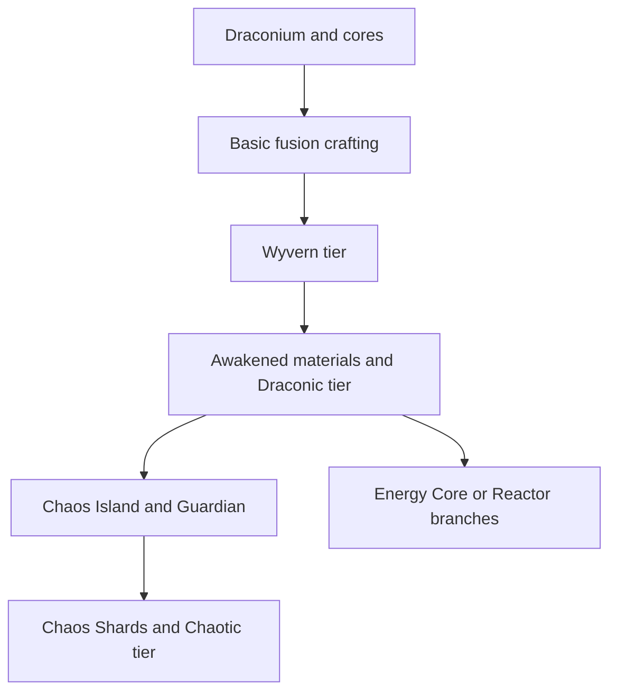

Warning: truncated output (original token count: 6147)
Total output lines: 100

# Draconic Evolution — mechanics and gameplay profile

| Field | Value |
| --- | --- |
| Manifest ID / actual mod ID | `draconic-evolution` / `draconicevolution` |
| Category / parent or addons | Technology, power and endgame progression / Brandon's Core, CodeChicken Lib and other required libraries |
| MC / loader / pack target | 1.21.1 / NeoForge / TMM integration snapshot `e2caf08d6188bf36a5b859f99bc4d6baa2d8073b` |
| Pinned version / artifact / hash | `Draconic-Evolution-1.21.1-3.1.4.633.jar` / packwiz SHA-1 `42ccf634a2a167db9cda533507909dd0524f2798` |
| Source snapshot | [Draconic-Inc/Draconic-Evolution `6251e32bc93eb4bfcd910236ec1eaa6546516229`](https://github.com/Draconic-Inc/Draconic-Evolution/tree/6251e32bc93eb4bfcd910236ec1eaa6546516229), branch `1.21`. Release notes overlap with this source's fixes; binary equivalence is not proven. |
| Guide/documentation version gap | Current 1.21 source commit is identifiable; Project Intelligence is not in TMM's mod roster. DE's Information Tablet calls Project Intelligence and otherwise reports that the dependency is required, so it is not a usable guide in this pack as currently selected. |
| Profile status | researching |
| Evidence reached | Exact pack pin, immutable 1.21 source snapshot, source-generated recipes/config/structures, current quest file and pack integration notes. No exact pinned JAR bytes or client validation. |
| Reviewed | 2026-11-16 |
| Quest ownership | [Draconic Evolution chapter](../../../config/ftbquests/quests/chapters/draconic_evolution.snbt) in the Endgame category; currently one optional manual checkmark. |

## Executive gameplay map

**What the player actually does:** Find Draconium and build up a chain of ordinary recipes, fusion crafting, power storage and modular equipment. Draconium Cores and the Basic Fusion Crafting setup lead to Wyvern components; fusion then produces Awakened Draconium and Awakened Cores, which unlock Draconic-tier gear and energy equipment. Chaotic components require Chaos Shards from the Chaos Island/Chaos Guardian endgame branch. Separate systems include Energy Cores, generators and transfer crystals, mob grinders and Stabilized Spawners, the volatile Draconic Reactor, dislocators, and powered tools/armor. Most higher-tier recipes consume large amounts of stored power and use a tiered Injector/Crafting Core structure. The mod is a broad tech progression, with its own late-game boss and significant world-generation effects; it is not a conventional spell school.

**Why it matters in TMM:** The Chaos Guardian is a selected endgame gate for ProjectE and Project Expansion in the pack's progression design. Draconic Evolution also adds the biggest power-storage and power-generation systems in the selected roster, potentially affecting every other FE-consuming mod. The Chaos Island worldgen actively replaces End terrain around its spawn grid, which must be evaluated with the pack's End-changing mods. The current quest chapter is only a placeholder, so players do not yet have a truthful guide to fusion crafting, energy-core assembly, reactor operation, or the Chaos Guardian.

**Quick start:** The wiki-free first steps are to use JEI to find Draconium Ore and Core recipes, obtain Draconium, make a Draconium Core, then craft the Fusion Crafting Core and Basic Crafting Injectors. Place injectors in the documented ring, use JEI's fusion recipe transfer, and verify the Injector tier before starting a costly craft. The in-game build guide can show Energy Core structures, but its tier selection, four-stabilizer requirement, and activation must still be taught. Treat reactor and Chaos Guardian work as late-game branches and do not use the Information Tablet as the only instruction source.

### Player-value snapshot (a quick reference for quest designers)

| Five standout capabilities | Three genuinely early practical unlocks | Three candidate integrations |
| --- | --- | --- |
| 1. Fusion Crafting with four injector tiers; 2. modular powered armor, weapons and tools; 3. tiered multiblock Energy Cores; 4. automated mob grinding and configurable Stabilized Spawners; 5. Chaos Guardian, Chaos Shards and the Chaotic tier. | 1. Draconium Ore → dust/ingot processing; 2. Draconium Core and the Basic Crafting Injector/Core; 3. basic generator and early powered machines. Exact worldgen, processing yields and generator fuel rates remain to be checked against the pinned build. | 1. Chaos Shard as the boss-earned progression token for ProjectE/Project Expansion's planned gate; 2. DE power network and other FE consumers, while retaining the distinction between DE OP and Neo Vitae EV; 3. Chaos Island generation and End replacement with BetterEnd/other End worldgen. Each pack interaction needs a separate live build test. |

### Subsystem coverage at a glance

| Subsystem / progression branch | Mechanics evidence | Progression completeness | In-game guide/JEI reference | Client validation | Blocker / next action |
| --- | --- | --- | --- | --- | --- |
| Draconium, Cores and tier materials | [RecipeGenerator.java at source SHA](https://github.com/Draconic-Inc/Draconic-Evolution/blob/6251e32bc93eb4bfcd910236ec1eaa6546516229/src/main/java/com/brandon3055/draconicevolution/datagen/RecipeGenerator.java) | partial | JEI; Information Tablet is unavailable without Project Intelligence | not run | Reconcile all recipes and ore worldgen to the exact jar/JEI export. |
| Fusion Crafting | source recipe provider and config in `DEConfig.java` | partial | JEI transfer; core/injector interface | not run | Audit every tier, range, timing, cancellation and item recovery rule. |
| Energy Core and crystals | `TileEnergyCore.java`, `TileEnergyCoreStabilizer.java`, `DEConfig.java` | partial | Built-in core build guide; JEI | not run | Capture every tier layout/capacity, stabilization branch and actual input/output routes. |
| Modular tools and armor | Source registry/language/config; dedicated module APIs and recipe provider | partial | JEI / item GUI; tablet unavailable | not run | Audit module installation/removal, energy drain, stat caps and Curios behavior. |
| Mob Grinder and Stabilized Spawner | `DEConfig.java`, recipe provider, module/spawner handlers | partial | JEI and machine GUI | not run | Full mob eligibility, soul sources, drops, range, owner/team and spawn throughput remain open. |
| Draconic Reactor | `TileReactorCore.java`, `ReactorMenu.java`, recipe provider | partial | Reactor GUI/JEI; no usable PI documentation confirmed | not run | Diagram full stabilizer/injector geometry and all fuel/chaos conversions, outputs and failure thresholds. |
| Chaos Island and Guardian | `ChaosIslandFeature.java`, `GuardianFightManager.java`, `DraconicGuardianEntity.java`, DE config | partial | Boss arena, config, JEI; no usable tablet in TMM | not run | Validate worldgen in actual End, fight phases, death/reward state, respawn and claim behavior. |
| Existing Endgame quest chapter | `config/ftbquests/quests/chapters/draconic_evolution.snbt` | incomplete | none in current task | not run | Single checkmark only; quest edits explicitly out of scope. |

## Guidebook onboarding — required before the player's first complex step

- **Guide name and access:** DE registers `draconicevolution:info_tablet`, but source `items/InfoTablet.java` checks `PIHelper.isInstalled()`. Without Project Intelligence, right-clicking it shows “Project Intelligence is required to view DE documentation.” The selected pack does not include Project Intelligence. It is not an in-game guide for this pack. Use JEI plus taught quest instructions when quest construction resumes.
- **Earliest attainable stage:** DE's early recipes and ore are the likely entry point, but actual world-generation dimensions, height/rates, and the current JEI recipe set need the pinned client. The source includes an Ender Dragon dust-loot config, but that alone does not define early Draconium acquisition.
- **First instructional quest:** Teach the player to use JEI for Draconium and Cores; craft the Basic Fusion Crafting Core and Injectors; place injectors within their permitted range, then use a low-cost recipe and inspect its status/output. Teach the Energy Core build guide separately before the player attempts a tiered storage multiblock.
- **Reference map:** JEI recipes for `draconicevolution:crafting_core`, `basic_crafting_injector`, core tiers, components, modules, and machines; Energy Core UI → Build Guide; Reactor GUI for charge/activate/stop/failsafe status. FTB task IDs and JEI tabs have not been checked in the client.
- **Where guide is insufficient:** The Information Tablet is not functional without PI and no shipped alternate guide is present in the mod manifest. Fusion recipe material placement, injector tier, energy cost, Energy Core tier structure, reactor operation and Chaos Guardian strategy must be supplied in precise lessons.
- **Other in-game help:** Fusion crafting has JEI recipe-transfer support; the Energy Core exposes a build-guide toggle; machines expose status and configuration UIs. Source confirms these controls, but exact interface usability and detection are untested.

## Systems and full mechanics inventory

| Subsystem | How accessed | Inputs + costs | Effects / outputs | Limits, failure conditions and source |
| --- | --- | --- | --- | --- |
| Draconium materials and cores | Mine supported Draconium ore or obtain dust/ingots; follow recipes | Draconium dust/ore smelting; Core recipes consume Draconium, gold, diamonds, Nether Stars or later-tier materials | Draconium ingot/block, Draconium Core and subsequent technology tiers | Exact ores and dimension/height placement are not yet audited. RecipeGenerator at source SHA establishes that ore and dust are separate smelting inputs. |
| Fusion Crafting | Place Fusion Crafting Core with matching ingredient items around it and a catalyst on/in the core; surround with Injectors; activate through the core UI | Recipe-defined cat…1147 tokens truncated…is enabled. Exact stat and drain maxima remain open. |
| Mob Grinder | Place, power and set up entity capture/operation | Energy per health point; entity must be allowed; default denies players; blacklist applies | Damages/kills mobs and produces their supported drops | No complete range, cadence, loot ownership or custom mob exclusion audit. Do not assume player grinding. |
| Souls and Stabilized Spawners | Kill mobs with Reaper enchantment for soul item; build and configure a tiered spawner | Default soul chance 1 in 1,000 for ordinary mobs and 1 in 800 for passive animals before enchantment-level adjustments. Boss soul drops default false. | Spawner permits repeated mob output with configured tier-dependent delay: Basic 200–800 ticks, Wyvern 100–400, Draconic 50–200, Chaotic 25–100 | Blacklist by default; optional whitelist mode. Entity eligibility, spawn caps, mob griefing, chunk persistence and output drops remain open. |
| Chaos Island worldgen | End dimension generation at nearest configured grid point, excluding the origin island | Default separation 10,000 blocks, island center Y 80, rough radius 160; generation enabled by default | Large end-stone/obsidian Chaos Island with Chaos Crystal and Guardian fight manager | Source also removes/lowers End terrain within 768 blocks of the nearest grid center, then transitions over 128 blocks; this is a notable End terrain interaction. Void mode creates only the core encounter pieces. |
| Chaos Guardian fight | Find the island's Chaos Crystal; engage guardian and its crystal network | Guardian fight manager maintains 14 crystal positions, each about 90 blocks from arena origin and 40 blocks above; guardian spawns at origin +80 Y. Crystals protect the guardian. Guardian attacks can destabilize crystals; Chaotic damage can bypass crystal shields if config permits. | Guardian kill grants a Dragon Heart at a podium above the arena; breaking Chaos Crystal as a player drops default 5 Chaos Shards | Default source values: crystal shield 512, unstable window 200 ticks, Guardian shield 16,000, health 1,000. Respawn/fight persistence and multiplayer credit need client validation. |
| Chaos materials and Chaotic tier | Break the Chaos Crystal after defeating the Guardian; craft fragments/cores and Chaotic items | Default 5 Chaos Shards from player-breaking Chaos Crystal; fragments compress/decompress 3:1. Chaotic Core and injector are high-cost fusion crafts. | Chaotic components, modules, capacitor and tools; unlock tier-specific late-game progression | Boss reward and tier gates require exact event/recipe tests. Pack's ProjectE and Project Expansion restrictions are design records, not demonstrated as live enforcement here. |
| Draconic Reactor | Build reactor core/stabilizer/injector assembly, insert Awakened Draconium and chaos fuel, charge, warm, activate, monitor and shut down | Source menu maps Awakened Block=1296 fuel units, Ingot=144, Nugget=16; Chaos Large Fragment=1296 converted units, Medium=144, Small=16. At least 144 total fuel units required to begin charging. | Huge OP/FE generation while consuming fuel and converted chaos; output scales with saturation, temperature and fuel conversion | Missing shield at high temperature transitions to critical state/explosion. Charging/activation thresholds are source-enforced. Default failsafe only operates when enabled; catastrophic failure can damage terrain over a large area. Do not present as a simple generator. |
| Dislocators, portals and utility | Craft dislocator items and bind locations/players; craft portal/receptacle as applicable | Ender Pearls provide teleport fuel; default Advanced Dislocator fuel cap 1024 and 4 blinks per pearl; blink range default 32 and cooldown 5 ticks. Portal defaults: area 65,536 blocks, max distance 256. | Teleport, blink, player/item links, portal travel | Player teleport requires consent per item localization; dimension boundaries, access and protections require testing. |

## Material / capability input-output contracts

| System | Input **kind** + exact ID/tag/event | Input qty/formula; consumed/remainder | Output **kind**, qty and location | Trigger/cadence; range/capacity | Automation/interface and evidence |
| --- | --- | --- | --- | --- | --- |
| Fusion Crafting | Item stacks, recipe catalyst and surrounding ingredient entities/slots; DE OP power | Recipe-owned ingredients and energy; exact consumption/refund order on cancel not established. Default injector search range 16, min distance 2. | Recipe item output from Fusion Crafting Core | Charge and craft phases; default times 300/220/140/60 ticks per tier | JEI recipe transfer is documented by changelog; source `RecipeGenerator`, fusion recipe serializer and core GUI. Exact automation inputs remain open. |
| Energy Core | OP energy capability; stabilization multiblock; pylon IO mode | Capacity chosen by tier list; list length is fixed at 8 entries | OP stored in Energy Core; input/output from configured pylons | Eight tiers; four stabilizers; tier 5+ advanced stabilizer requirement | Native OP storage capability and pylon links. FE cross-compatibility and chunk/network scope not yet demonstrated. |
| Mob Grinder | Living entity + OP energy | Default 80 OP per entity health point; blacklist + allowGrindingPlayers=false | Damage/death and native entity drops in world/inventory path | Entity range and per-tick throughput not audited | Native machine and entity damage. Exact output location and fake-player interactions remain open. |
| Stabilized Spawner | Mob Soul item from Reaper kill + spawner tier/energy | Soul drop base chances 1/1000 and 1/800 passive, modified by Reaper level; no boss souls by default | Spawned entity in world | Tiered default random delay ranges as in config; exact radius/cap not audited | Native handler; no claim of generic spawner-item or FTB team binding. |
| Chaos Island | End chunk position and seed/worldgen | Feature picks nearest multiple of default 10,000-block separation; origin position excluded for actual island creation | Blocks and a `TileChaosCrystal`, then `GuardianFightManager` world entity | Island area roughly 160 radius; Y 80; terrain overrides span 768-block clear radius +128 transition | Native configured worldgen, not an ordinary recipe or item drop. BetterEnd/capability behavior not tested. |
| Chaos rewards | Chaos Crystal block/player break and Guardian death event | Chaos Crystal default yields five Chaos Shards when player-broken; guardian death creates invulnerable Dragon Heart item at arena origin +20 Y | Item entities in arena; Dragon Heart and shards | Boss fight event; exact pickup/claim/team attribution untested | Source `GuardianFightManager`, `TileChaosCrystal`, `DEConfig`; quest credit not inferred from item ownership. |
| Reactor fuel | Exact item stacks inserted into GUI | Awakened block 1296; ingot 144; nugget 16 reactable units. Chaos large/medium/small fragments add 1296/144/16 converted units. | Reactable and converted internal fuel pools; power output in machine network | Must total at least 144 fuel units to charge; generation varies with saturation, temperature and conversion fraction | Source `ReactorMenu` and `TileReactorCore`; GUI insertion only is confirmed in this research. No throughput measurement. |
| DE manuals | Player right-clicks `draconicevolution:info_tablet` | No item cost for opening | PI documentation GUI if Project Intelligence installed; otherwise client chat states PI is required | Client-only | `items/InfoTablet.java`; no external document mod selected in TMM. |

Not established: DE OP to Neo Vitae EV; Draconic power exchange with Mahou, Ars Source, Astral Starlight or Botania mana; all sided capability faces and transfer rates; exact power unit conversion to other mod systems; owner/team credit for mob drops, boss rewards or multiblock ownership; all recipe rollback/cancel paths.

## Acquisition, renewability and output economics

- Draconium progression is component-intensive: Wyvern uses Nether Stars; Awakened and Draconic tiers need fusion recipes; Chaotic tier requires Chaos Fragments and high-tier Injectors. Exact stack totals should be calculated from JEI's tag-expanded recipes after the pinned build is available.
- Fusion costs are recipe-specific and can be enormous. Injector tier selects the slowest charge/craft profile; running a higher-power recipe through an under-tier Injector may not satisfy its tech requirement.
- Awakened Draconium is a reactor feedstock as well as a component material. Chaos Fragments are both a crafting ingredient and the reactor's converted-fuel source. Reactor operation converts the two pools through a nonlinear saturation/temperature system; energy can be lost with the reactor if the field fails.
- Chaos Shards compress/decompress to Large, Medium and Small Chaos Fragments at 3:1 steps per source recipe. The source explicitly makes the Chaos Crystal's player-break reward configurable; default is five shards. The first boss encounter, repeat kills, respawn state and shard sustainability should be measured separately.
- Reaper-based Soul acquisition is probabilistic and enchantment-level adjusted. Spawner output depends on mob-list policy and tier delay; changing the server config to whitelist behavior changes the allowed set. This is not a guaranteed one-kill/one-soul route.
- The Draconic Chest advertises auto-smelt modes, but its changelog states legacy I/O-region/upgrades are not implemented. Do not infer sided machine automation from its GUI labels alone.

## Complete player progression / walkthrough blueprint

**Completion test:** This profile identifies the visible tier chain and main machine/boss arcs, but not every item recipe, worldgen source, module stat, or exact structure. It is not source-complete. The current endgame target is the Chaos Guardian → Chaos Shard/Dragon Heart → Chaotic tier and the pack's downstream gate, with reactor and Energy Core as optional power branches.

| Path and step | Gate or choice? | Exact prerequisite / materials / world condition | Player actions: obtain, build, activate, use | Unlock / visible success / next step | In-game guide section or JEI reference | Proposed quest/how-to, detection and reward | Evidence / coverage |
| --- | --- | --- | --- | --- | --- | --- | --- |
| 0. Orient in JEI | Required instruction | Mod loaded and JEI available; PI absent in selected manifest | Search Draconium, Core, Fusion Core, Injector, Stabilizer, Energy Core and Reactor items | Recipe families and components identified | JEI; tablet cannot open without Project Intelligence | Teach which item families are DE and which are TMM boss gates; manual acknowledgements until client task IDs are verified | Source and pack roster |
| 1. Obtain Draconium | Required | Actual Overworld/Nether/End ore worldgen; exact pack recipe source not yet audited | Mine ore/dust; smelt supported form; compare Fortune/Silk Touch outcomes | Draconium ingots and storage blocks | JEI; ore page if present | Teach dimension/height and tool requirement after exact pin/JEI check; ore item is only acquisition proxy | Partial |
| 2. Make Draconium Core | Required for DE tech | 4 Draconium Ingots + 4 Gold Ingots + Diamond | Craft `draconicevolution:draconium_core` | Base energy/machine component | JEI recipe | Item check can detect craft result only; XP + small gold/diamond direction | Source recipe |
| 3. Start Fusion Crafting | Required tier system | Fusion Crafting Core recipe; Basic Injector recipe; recipe inputs; power | Place core, install injectors at valid range, place catalyst/ingredients, use JEI transfer, start and wait | Basic fusion recipes and higher-tier injector chain | JEI Fusion; core GUI | How-to must cover device layout/range, output space, exact injector tier and failure status; test manual task vs resulting item | Source + validation open |
| 4. Create Wyvern Core and Injector | Required progression | Draconium Core, Draconium Ingots, Nether Star; Basic Injector and Fusion recipe | Craft Wyvern Core; fuse Wyvern Injector using Basic Injector catalyst, energy and ingredient ring | Wyvern recipes and machines | JEI; Injector GUI | Test successful craft and recipe transfer; reward ordinary intermediate component, not a bypass item | Source recipe |
| 5. Create Awakened Draconium | Required to access Awakened tier | Dragon Heart, six Draconium Cores, four Draconium Blocks, Wyvern Injector tier; 50M energy | Build fusion recipe; charge and wait | Awakened Draconium Blocks and Ingots | JEI recipe | Require explicit how-to; detect Dragon Heart/ingot only as material proxy, not proof of fusion action | Source recipe; Dragon Heart supply not fully mapped |
| 6. Awakened Core and Draconic equipment | Required for high tier | Awakened ingots, four Wyvern Cores, Nether Star catalyst; 1M energy; then Draconic fusion recipes | Make Awakened Cores/Injector; craft Draconic cores, armor/tools and energy components | Draconic tier equipment and storage | JEI, item GUI | Teach module installation/removal and energy cost only after full audit; item ownership cannot prove module operation | Source, partial |
| 7. Chaos Island exploration | Optional until Chaotic gate; required for boss rewards | End dimension; nearest 10,000-block grid point other than origin; default End overhaul enabled | Locate island; identify Chaos Crystal; establish safe approach/retreat and gear plan | Guardian arena, crystals and End boss encounter | World map/JEI; no current TMM guide | Quest must explain spatial grid and source-reported 768-block terrain clearance; use a boss event/advancement task if client supports one | Source worldgen; BetterEnd compatibility open |
| 8. Defeat Chaos Guardian | Required for first Chaos Shard, Dragon Heart and pack endgame gate | Guardian fight arena with crystal network; high-tier equipment and tactics | Survive attack phases; destabilize/destroy crystals; lower Guardian shield; defeat Guardian; collect Dragon Heart; break Chaos Crystal as intended | Dragon Heart and default five Chaos Shards from crystal | Guardian fight details; JEI | Do not use Chaos Shard item ownership as sole proof of first kill because shards may trade/duplicate; locate an actual boss-death trigger and test FTB integration | Source fight logic; exact advancement/task not audited |
| 9. Craft Chaotic Core/Injector and gear | Optional capstone; pack progression gate | Chaos Shards/fragments, Awakened materials, Draconic tech; very high fusion energy | Craft Chaotic Core, Injector, armor/tool modules | Chaotic gear and power tier; possible repeat Guardian-farming route | JEI; module GUI | Reward XP and thematically safe materials; never gift Chaos Shard/gear before progression gate | Source recipes; balance/pack test open |
| 10. Build Energy Core | Optional power/storage line | Core controller, tier-specific structure and stabilizers; four stabilizers on axis within distance; advanced stabilizers for tiers ≥5 | Set tier, toggle build guide, construct, validate, activate; configure pylons IO | Huge energy storage and routing | Energy Core UI build guide; JEI | Separate lessons for structure geometry, stabilizer placement, IO and upgrade/tier change; item ownership alone does not prove assembled core | Source mechanics; layouts/capacity incomplete |
| 11. Build Reactor | Optional hazardous endgame power line | Reactor Core, 4 Stabilizers, Injector, reactor component set; ≥144 total fuel units; Chaos materials for conversion | Assemble exact structure, bind components, insert fuel, charge, wait for thresholds, activate, monitor, failsafe and shutdown | Massive energy production or catastrophic explosion | Reactor GUI/JEI; PI unavailable | Must be a measured how-to. Never mark complete for crafting Reactor Core alone; test fail-safe and boundary failure in disposable world | Source operation partly inspected; structure incomplete |
| 12. Stabilized Spawners / grinder | Optional automation/combat utilities | Reaper enchantment, souls, tiered spawner/grinder, power | Acquire souls probabilistically; configure entity restrictions and tier; capture outputs | Repeated mob spawning or entity drops | JEI and machine GUI | Check spawn output event/loot separately; no claim that spawner block ownership means a successful spawn | Partial source/config |

### Dependency graph and alternate routes

Draconic Evolution's gear/fusion tier sequence is native. Energy Core and Reactor are optional power branches, although their materials overlap the tier sequence. In TMM, Chaos Guardian completion is designated as the gate before ProjectE/Project Expansion's main late progression; the manifest's acceptance list separately calls out Chaos Shard requirements for MK3+ Power Flowers. These are pack-design targets, not claims that all recipe and EMC bypasses are presently blocked. `manifest/progression-gates.json` explicitly lists item-learning/transform and loot/trade routes as untested bypasses.

### Structures, rituals, automation and other how-to instructions

| Required setup | Placement/shape/activation and operating inputs | Guidebook page/JEI category to cite **by name** | Failure symptoms, throughput or maintenance | Quest where taught |
| --- | --- | --- | --- | --- |
| Fusion Crafting | Place Fusion Core, recipe ingredients/catalyst, and tiered Injectors within min/max radius; interact to start | JEI fusion recipe and Fusion Crafting Core GUI | Low Injector tech, range, missing energy/ingredients or blocked output; exact failure consumption not audited | Fusion Basics lesson (current chapter has none) |
| Energy Core | Choose tier; controller GUI → Build Guide; place the tier's requested shell; four compatible Stabilizers in axis positions; activate | Energy Core GUI Build Guide; JEI core/stabilizer recipes | Core/stabilizer invalid; tier≥5 requires advanced stabilizer structures; removal/deactivation changes structure blocks | Storage Core Structure lesson |
| Energy Pylon/network | Place Pylon on valid core/energy interface; configure side IO, bind relay/wireless crystal as relevant | Pylon GUI and crystal/binder JEI | Wrong side mode, unlinked/broken crystal or network range; throughput remains unmeasured | Power Routing lesson |
| Draconic Reactor | Reactor Core + four Stabilizers on a valid axis and Injector; fuel inserted in GUI; charge and activate at shown thresholds | Reactor GUI, Reactor part JEI | Structure invalid, underfilled fuel, insufficient saturation/shield, overheating, explosion timer; do not leave unsupervised | Reactor Safety lesson only after full schematic and disposable validation |
| Chaos Guardian arena | Find island at End grid; identify crystal and 14 surrounding guardian crystals; manage target instability and fight arena | Chaos Island/Guardian chapter plus JEI Chaos items | Core position/arena unload and respawn state matter; crystal shields block player damage until destabilized unless Chaotic bypass setting applies | Boss encounter lesson; current chapter has no instructions |

## Advanced and terminal objectives

- **Normal completion:** Reach a working basic fusion craft and build/operate at least one chosen branch (powered equipment, Energy Core, grinder/spawner, or Reactor). The mod has several independent branches rather than one single quest endpoint.
- **Optional completion:** Defeat the Chaos Guardian, claim the Dragon Heart and Chaos Shards, build Chaotic-tier gear, and complete any later ProjectE/Expansion progression that is actually gated in the pack.
- **Remaining progression blockers:** Exact JAR bytes unavailable; Draconium ore dimensions/yields, full fusion recipe matrix, module stats/drain, all Energy Core tier templates/capacities, complete reactor structure and control safety, Grinder/Spawner output contract, all boss phases and advancement predicate, compatibility with BetterEnd, and ProjectE/EMC bypasses.
- **Quest coverage check:** The present FTB chapter has one optional manual checkmark with 2 quest XP and one paper. It does not teach the tech ladder, energy core, reactor, Chaos Island, Guardian fight or rewards. No quest edits were made.

## Internal combinations and overlooked mechanics

| Internal combination | Full chain | Benefit | Limitation / exploit potential | Evidence |
| --- | --- | --- | --- | --- |
| Fusion throughput progression | Basic Injector → Wyvern → Awakened/Draconic → Chaotic; charging/crafting defaults shorten from 300 to 60 ticks as tier rises | High-output recipe crafting | Lowest used Injector tier determines timing; recipe tech requirement and energy cost remain separate gates. | `DEConfig.java`; `RecipeGenerator.java` at source SHA |
| Energy Core + transfer crystals | Energy Core → pylons/relay or wireless crystals → machines/modules | Central storage and configurable power routing | Exact transfer limits/ownership/dimension restrictions not yet tested; does not imply other magic currencies. | `TileEnergyCore.java`; `RecipeGenerator.java` |
| Reactor conversion | Awakened Draconium reactable fuel + Chaos fragment converted fuel → high OP output | Chaos material changes generation modifier; fuel can scale reactor | Losing shield while hot enters critical state. This is a dangerous operation, not an infinite stable generator. | `ReactorMenu.java`, `TileReactorCore.java` |
| Guardian crystal bypass for farming | First Guardian victory → Chaos materials → Chaotic weapon → later Guardian crystal damage bypass if config enabled | Can speed repeat fights | It does not help with first Chaos-material acquisition and must not bypass the initial progression gate. | `DEConfig.java`, `GuardianFightManager.java` |
| Fusion-crafted Awakened Blocks | Dragon Heart + six Draconium Cores + 4 Draconium Block catalyst → 4 Awakened Blocks | Converts boss and tech resources into advanced feedstock | Dragon Heart provenance is a gate; don't overlook Dragon Heart from the DE Guardian itself. | `RecipeGenerator.java`, `GuardianFightManager.java` |
| End generation override | Closest grid point → Chaos Island feature + End terrain clear/transition | Creates a very distant and distinctive boss arena | Affected terrain radius is much larger than island; at origin, grid-center exclusion and mixin interaction deserve inspection with BetterEnd. | `ChaosIslandFeature.java`, `TheEndBiomeSourceMixin.java` |

## Low-hanging setups useful in ordinary survival

### 1. Basic Fusion Crafting workstation — early DE progression
- **Goal and payoff:** Learn the recurring DE crafting interface and create basic components without repeatedly guessing injector placement.
- **Minimum entry and ingredients:** Draconium Core, Basic Crafting Core, Basic Crafting Injectors, recipe ingredients and a supported OP power feed.
- **Build/use steps:** 1. Use JEI to make a cheap basic fusion recipe. 2. Place core and injectors within configured min/range. 3. Use JEI recipe transfer if supported. 4. Start craft and read status/output.
- **Sustainability and limits:** Power and item cost are recipe-defined; injector distance/tier matter. Exact stable layout and item recovery are not tested.
- **Evidence / pack test:** Source recipes and changelog identify Fusion JEI transfer; client not tested.

### 2. Tier 1–4 Energy Core storage — mid/late
- **Goal and payoff:** Buffer energy from connected input to a separately configured output.
- **Minimum entry and ingredients:** Energy Core controller, tier structure blocks, four suitable Stabilizers and Pylons; higher tiers need matching stabilizer upgrades.
- **Build/use steps:** 1. Open controller's Build Guide. 2. Build selected tier. 3. Place four aligned stabilizers within source distance. 4. Validate/activate. 5. Configure Pylon IO.
- **Sustainability and limits:** Tier selects capacity; eight-entry config list cannot be resized safely. Transfer rate, actual capacity values and power-network load are still unaudited.
- **Evidence / pack test:** `TileEnergyCore.java` source confirms build-guide toggle, structure validation, four stabilizers and tier 5 advanced requirement; no client test.

### 3. Reaper souls and spawner branch — later utility
- **Goal and payoff:** Convert hunting into renewable mob spawning for selected entities.
- **Minimum entry and ingredients:** Reaper enchantment, allowed mob kills, Souls and a Stabilized Spawner tier.
- **Build/use steps:** 1. Hunt allowed entities with Reaper. 2. Accumulate Souls and test yield probability. 3. Place/configure spawner and observe spawn timing/drop output. 4. Apply blacklist rules deliberately.
- **Sustainability and limits:** Default chance is probabilistic; boss souls are disabled by default. Spawn delays shorten with tier, so high-tier density and modded mob AI need testing.
- **Evidence / pack test:** `DEConfig.java` source; no runtime test.

## API, integration and pack-config surfaces

| Hook or customization surface | Namespace / exact file, API or serializer | Capabilities / constraints | Current TMM override? | Evidence |
| --- | --- | --- | --- | --- |
| Worldgen/config | `config/draconicevolution-common.toml`, `draconicevolution-server.toml` categories in source | Chaos Island enable/size/separation/Y/void mode; Ender Comet enable; ore generation/config; machine/boss settings | No specific DE config override identified in this pass | `DEConfig.java`, `ChaosIslandFeature.java`; exact generated config not read |
| Fusion recipes | `draconicevolution:fusion_crafting` serializer and data-generated `RecipeGenerator.java` | Catalyst, ingredients, OP cost, TechLevel, outputs; JEI transfer support | No recipe override from this pass | Source at immutable SHA `6251e32…` |
| Energy capability | DE `OPStorageOP` and `CapabilityOP.BLOCK`; Core/Pylon/Crystal network | Internal storage capability and DE network IO | No Neo Vitae/Source/Mahou adapter found | `TileEnergyCore.java`; full capability bridge audit open |
| Modular equipment | Modules and ModuleHost APIs/config | Installable energy/stat/function modules; server config controls selected behavior | No attribute or module nerf identified in this pass | Source registry, `ModuleCfg`, `EquipCfg`; full cap audit open |
| Reactor controls | `TileReactorCore`, `ReactorMenu`, config `Reactor` | Fuel values, output multiplier, fuel-use multiplier, explosion scale, optional smaller boom | No TMM reactor config override found | Exact source at pinned-branch SHA; no runtime test |
| Boss controls | `DEConfig` Guardian Fight/Chaos Island | Base shield/health, destabilize window, chaotic bypass, Chaos Shard count, island worldgen | No balance overrides identified here | Source default values; world test open |
| Documentation | `draconicevolution:info_tablet` → `PIHelper` | Opens Project Intelligence's DE docs only if PI is installed | Project Intelligence not in TMM manifest; no useful tablet documentation | Exact source `items/InfoTablet.java`; official CurseForge description warns PI is not updated for modern DE versions |
| Existing FTB chapter | `config/ftbquests/quests/chapters/draconic_evolution.snbt` | Optional manual checkmark only | Present, but not instructional | Current file read directly |

## Compatibility leads

| Other mod | Candidate link and why | Native / pack-built / would require bridge | Status / source |
| --- | --- | --- | --- |
| ProjectE | Chaos Guardian/Shard as late access token; prevent EMC-learning or transmutation bypass | Pack recipes/config required | Pack gate design explicitly lists EMC/Matter Upgrader and trade/loot bypasses as untested; gameplay not verified. |
| Project Expansion | Require Chaos Shard for MK3+ flowers and MK3 upgrade | Pack KubeJS recipe enforcement | `manifest/progression-gates.json` records the target and test requirements; current profile does not claim accepted runtime behavior. |
| BetterEnd / End generation | Chaos Island feature clears/reshapes terrain around 10,000-grid centers; overlapping generator may displace or conflict | Native feature interaction | Needs worldgen and biome-source test with final selected End mod. |
| Neo Vitae | DE stores OP; Neo Vitae rituals use EV. A shared power bridge could be valuable but currency types are separate. | Would require an explicit bridge | No transfer compatibility established. Do not count identical “energy” labels as an interface. |
| Apotheosis/Relics combat changes | High-tier DE weapons and Chaos Guardian can interact with damage/resistance event modifications | Runtime compatibility concern | Pinned release changelog specifically fixes insta-kill damage behavior under multiple damage/death event modifiers, mentioning Apothic Attributes + Relics. Verify with TMM build. |
| Occultism/other FE machines | Energy Core is a large power buffer and DE transfer network could feed eligible machines | Capability-level compatibility | Check actual 1.21.1 capabilities and energy unit conversions; not inferred here. |

## Quest and teaching opportunities (research, not actual quests)

| Stage and teaching goal | Actionable in-game instructions (prerequisites → steps → result) | Named in-game guide/JEI reference | Intended behavior vs truthful FTB detector / fallback | Useful XP + fixed reward direction | Coverage and gating risk |
| --- | --- | --- | --- | --- | --- |
| Find Draconium | Locate actual generated ore; mine with adequate tool; distinguish ore from dust/ingot | JEI Draconium Ore/Dust/Ingots | Item is a proxy, not proof of mining route; manual location lesson if needed | Small XP; mining supplies | Exact worldgen/source and Tectonic interaction pending |
| Learn Fusion Crafting | Craft core/injectors, place and validate, select a low-cost JEI recipe, energize and collect output | JEI `fusion_crafting`; core GUI | Check final recipe output or actual advancement if one exists; item ownership does not prove activation | XP and inexpensive catalyst/ingredient stock | Need exact task support and control-click behavior |
| Build an Energy Core | Use build guide, match tier shell, place four aligned stabilizers, activate and configure input/output | Energy Core GUI Build Guide | Multiblock activation state or energy movement, not controller item | XP plus structural blocks only after recipe totals | Big footprint and chunk loading; wrong tier can be expensive |
| Understand powered modules | Install one tier-matched module, charge equipment, toggle its ability, measure drain/effect | Module GUI, JEI module recipes | Check operation/energy delta, not armor possession | XP + low-cost module component | Stat caps and universal power balance not yet mapped |
| Learn Grinder/Spawner | Reaper hunt, observe Soul drop chance; configure permitted mob; verify one spawn/drop | JEI and machine GUI | A soul or spawner item alone is not functional proof | XP + ordinary mob supply | Probabilistic Soul drop can make a quest slow; all blacklist data matters |
| Find Chaos Island | Navigate End to a non-origin 10,000-block grid point and explain wide terrain suppression | Chaos Island lesson / world map | Use discovery advancement if exact source trigger found; manual discovery otherwise | Exploration XP; survival provisions | Very distant; End may be Tectonic/BetterEnd-modified |
| Defeat Chaos Guardian | Destroy/disable crystals through fight mechanic; defeat guardian; collect heart; crack crystal as player | Chaos Guardian lesson/JEI Chaos Shards | Boss death event separate from item ownership and shard count; FTB task needs client test | Large XP; no gifted Chaos shard or heart | Respawn state/team credit, gamerules, claims and item-owner needs tests |
| Build/operate Reactor | Assemble, insert fuel, charge/activate and safely stop | Reactor GUI plus written schematic | Require measured online production/shutdown rather than Reactor Core item | Large XP; appropriate structural parts only | Severe failure risk; Failsafe configured and tested first |

No quest, reward, recipe, loot, or runtime data was changed in this knowledge pass.

## Existing chapter / pilot reconciliation

| Walkthrough stage | Current quest ID/title and status | Intended action vs actual detector | Named in-game guide/JEI reference | Gap / next action |
| --- | --- | --- | --- | --- |
| Chapter overview | `544D205000100000`; chapter file has no title quest text | No instruction | None | Canonical chapter is currently a stub. |
| Placeholder checkmark | `544D305000100001`; optional; reward 2 quest XP + one paper | Manual checkmark; no mechanic is detected | None | Does not cover any stage from the walkthrough. Leave unchanged in this pass. |

`manifest/quest_content.json` and `manifest/progression-gates.json` contain later design notes about Chaos Guardian and the downstream gate; these are not current chapter tasks or proof of working progression enforcement. The tracked SNBT remains the current chapter truth.

## Conflicts, limitations and version drift

- The exact pinned jar path is a dangling symlink in the available smoke workspace. `mods/draconic-evolution.pw.toml` supplies a CurseForge file/version and SHA-1; source is available, but hash-matched source-to-binary proof is not.
- Source is pinned at `6251e32bc93eb4bfcd910236ec1eaa6546516229`, branch `1.21`. Modrinth's v3.1.4.633 release notes include fixes that also appear in this source commit, but this is corroboration rather than proof that every built resource/recipe byte matches.
- The build manifest marks Draconic Evolution an experimental release and `dependencies_verified: false`. Reconcile required BrandonsCore/CodeChickenLib/EnderStorage and source-to-pack loader compatibility before promoting to verified-in-pack.
- The official project description says Project Intelligence has not been updated for modern DE; DE source still has an Info Tablet item, but it is merely a caller for PI. The pack does not include PI.
- End world-generation behavior is large: 768-block clear radius around grid centers plus a 128-block transition, with a feature island near each 10,000-block point except the origin. The interaction with the selected End worldgen mod remains a serious unknown.
- Source defaults reported here are not TMM's effective configs until `defaultconfigs`/world config and exported recipes are checked. Reactor, Chaos Guardian, Core capacity and equipment module values are particularly balance-sensitive.
- Newer DE mod versions may change individual recipes or values; only the pinned version should determine quest text.

## Evidence ledger

| Claim / section | Source URL or exact inspected `file:path` + immutable SHA | Evidence tag / version of source | Pack version gap / what it proves / remaining limits |
| --- | --- | --- | --- |
| P-001 Pack pin and status | `mods/draconic-evolution.pw.toml`, SHA-1 `42ccf634a2a167db9cda533507909dd0524f2798`; `manifest/mods.json` | [pin] pack metadata | Exact selected file/version; bytes not locally available and metadata marks experimental/dependencies unverified. |
| P-002 Source snapshot | [commit `6251e32bc93eb4bfcd910236ec1eaa6546516229`](https://github.com/Draconic-Inc/Draconic-Evolution/commit/6251e32bc93eb4bfcd910236ec1eaa6546516229) | [source] official public GitHub, 1.21 branch | Source mechanics and generated recipes/config. Release-to-source mapping supported by overlapping release notes; binary equivalence not verified. |
| P-003 Fusion, cores and injectors | `src/main/java/com/brandon3055/draconicevolution/datagen/RecipeGenerator.java`; `DEConfig.java`; `blocks/tileentity/TileEnergyCore.java` at source SHA above | [source] source-generated recipes/config and controller | Proves listed recipes/default ranges/controller behavior; recipe exports and GUI tests still open. |
| P-004 Chaos Island/fight | `src/main/java/com/brandon3055/draconicevolution/world/ChaosIslandFeature.java`; `entity/guardian/GuardianFightManager.java`; `blocks/reactor/tileentity/TileChaosCrystal.java`; `DEConfig.java` at source SHA | [source] source code | Proves grid/terrain/arena coordinates, crystal logic, Dragon Heart spawn and config defaults. No world/client fight test. |
| P-005 Reactor | `src/main/java/com/brandon3055/draconicevolution/inventory/ReactorMenu.java`; `blocks/reactor/tileentity/TileReactorCore.java`; `datagen/RecipeGenerator.java` at source SHA | [source] menu, controller, recipes | Proves selected fuel conversions and threshold/state logic; exact complete structure and measured output not audited. |
| P-006 Documentation dependency | `src/main/java/com/brandon3055/draconicevolution/items/InfoTablet.java`; [official Project Intelligence project](https://github.com/Draconic-Inc/ProjectIntelligence); [official mod page](https://www.curseforge.com/minecraft/mc-mods/draconic-evolution) | [source] optional PI call and upstream doc note | Confirms the item requires Project Intelligence; exact selected pack excludes PI. Tablet remains unusable here. |
| P-007 Quest/chapter | `config/ftbquests/quests/chapters/draconic_evolution.snbt`; `manifest/quest_chapters.json`; `manifest/progression-gates.json` | [pack-file] current integration commit `e2caf08d` | Confirms placeholder quest and design/gate notes only; no successful runtime enforcement implied. |

## Disposable-world test plan

| Test | Positive/boundary case and disposable-world setup | Expected observable result (actual mechanic AND quest credit separately) | Performed? / evidence |
| --- | --- | --- | --- |
| Pin/source and JEI reconciliation | Build exact 1.21.1 pack; hash the jar and export DE recipes/config; compare to source SHA and packwiz | Confirm actual recipes/material tags and effective defaults; do not infer from source if they differ | not run — exact jar target unavailable |
| Fusion crafting | Test basic, upgraded, under-tier, too-close, too-far, no-energy, blocked output and cancel cases | Verify item consumption/output/refund plus JEI transfer separately from quest credit | not run |
| Energy Core tiers | Build tiers 1, 5 and 8 in valid/invalid structure; remove stabilizer; test four-stabilizer radius, tier control, IO and chunk unload | Confirm size, capacity, advanced stabilizer gate, deactivation and actual transferred energy | not run |
| Modular gear | Measure energy charge/drain and operation of armor/tools/modules; test toggles, removal, Curios, other armor and configured caps | Separate equipment behavior from item ownership and FTB completion | not run |
| Grinder/spawner | Test allowed, blacklisted and player entities; Reaper odds; boss soul config; each spawner tier and outputs | Measure damage/energy/drop/spawn cadence, caps and output location | not run |
| Chaos Island generation | Create fresh End with final End-gen mods; test nearest grid points, origin exception, terrain overwrite radius, `voidMode`, island Y/size and chunk travel | Record exact feature coordinates and terrain edits; ensure island-generation override does not erase intended End structures | not run |
| Chaos Guardian/rewards | Run first fight with standard gear; test crystals stable/unstable, Guardian attacks and Chaotic bypass; kill, restart, respawn, break crystal | Confirm death event, Dragon Heart, default Shard count, repeat behavior, claim/team behavior and quest task separately | not run |
| Reactor safety and output | Valid reactor; underfilled and boundary fuel; failsafe on/off; shield loss and shutdown; connect metered consumer and measure ticks | Verify fuel conversion/output, threshold logic, safe shutdown, explosion footprint and config | not run |
| TMM progression gate | Test recipes, EMC learning, Matter Upgrader, shop, loot and trades before/after actual boss completion | Confirm all declared gate bypasses independently; item ownership, recipe visibility and task credit are distinct | not run; manifest says gameplay testing false |

