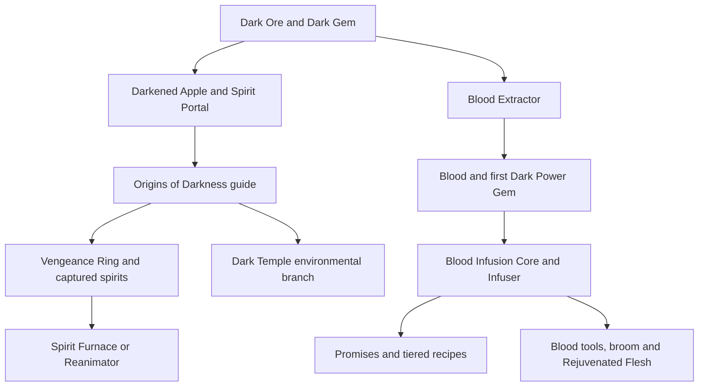

# EvilCraft — mechanics and gameplay profile

| Field | Value |
| --- | --- |
| Manifest ID / actual mod ID | `evilcraft` / `evilcraft` |
| Category / parent or addons | Magic; related profiles: [JAWR Forbidden Magic](forbidden-magic.md), [Botania Revived](botania-revived.md), [Dragon Survival food policy](../../MAGICAL-FOOD-EXCEPTIONS-2026-11-14.md) |
| MC / loader / pack target | 1.21.1 / NeoForge / `test/full-integration` at `b9e41333623817926dd165802be4c6e7985e8ef9` |
| Pinned version / artifact / hash | `evilcraft-1.21.1-neoforge-1.2.100.jar`; SHA-512 `14bdd2ae8e0b8c25883c8046c9ee2d3d7f8993e479c2d974d31940acf9d07aa13e4e42f6be993be56b1b7b53a169383e84f82c5fbe4a642f946880617226cb56` (`mods/evilcraft.pw.toml`) |
| Source snapshot | Tag `1.21.1-1.2.100`, commit [`aa8122019d5888381d40f30e6e4be5503abdd542`](https://github.com/CyclopsMC/EvilCraft/tree/aa8122019d5888381d40f30e6e4be5503abdd542); source version aligns, binary build equivalence not tested |
| Guide/documentation version gap | Exact pinned JAR's `data/evilcraft/info/book.xml` and English localization inspected. Public HTML guide was generated from EvilCraft 1.2.98, so use pinned JAR for exact entries and recipes. |
| Profile status | researching |
| Evidence reached | Exact pinned JAR SHA-512 verified and inspected; immutable matching source inspected; tracked quest, food policy, compatibility and config trees reviewed; no client test |
| Reviewed | 2026-11-15 |
| Quest ownership | `config/ftbquests/quests/chapters/evilcraft.snbt` is an optional one-checkmark placeholder; no actual walkthrough tasks. Not edited in this pass. |

## Executive gameplay map

**What the player actually does:** EvilCraft progresses through two narrative “Ages.” Mine Dark Ore, use Dark Gems and an animal-targeted Darkened Apple to create a Vengeance Spirit Portal, then throw an ordinary book into the portal to receive the Origins of Darkness guide. The First Age covers Dark Gems, Vengeance Spirits, capture/protection, temples and environmental effects. Crafting a Blood Extractor is the actual Second Age advancement trigger. Blood is a fluid resource obtained through kill-triggered extractors and fall-death stains; the Blood Infuser turns tagged/declared items into machines, tools, materials and progression upgrades. The later branches use Vengeance Spirits for captured storage, mob-drop processing or one-use eggs; blood-powered tools, modular broom flight; and environmental manipulation. [JAR/source below; public guide description is version 1.2.98.]

**Why it matters in TMM:** Its defining loop combines entity deaths, fluid logistics, processing, flight and environmental manipulation. It is also a distinct source of werewolf mobs, blood and renewable Rejuvenated Flesh; it overlaps JAWR transformation/faction work and the pack's explicit magical-food exceptions. It is not a substitute for JAWR lich/vampire abilities and no general-purpose mana or FE conversion was found.

**Quick start:** Find Dark Ore in Overworld caves, mine with at least an iron pickaxe, and obtain Dark Gems. Craft a Darkened Apple from an apple and Dark Gem. Right-click a living animal with it: source code applies the Paling effect; if that effect kills the animal, a short-lived portal appears near the death spot. Toss an ordinary book into the portal before it fades to obtain the Origins of Darkness. Read its First Age and Second Age sections; the book's recipe appendices link to JEI. Craft a Blood Extractor from the guide's recipe, carry it while killing eligible mobs or collect a Blood Stain with sneak-right-click, then craft a Blood Infusion Core and Blood Infuser. For the first Dark Power Gem, the guide requires throwing a Dark Gem into one of at least five source Blood blocks; the Blood Infuser recipe is the cheaper repeatable method. [JAR `GameTestsOriginsOfDarkness`, `ItemDarkenedApple`, `BlockSpiritPortal`, `BlockEntitySpiritPortal`; source commit above; guide pages `Dark Ore`, `Darkened Apple`, `Blood Extraction`, `The Powers of Blood`, `Blood Infuser`]

### Player-value snapshot

| Five standout capabilities | Three genuinely early practical unlocks | Three candidate integrations |
| --- | --- | --- |
| Blood-powered repair, item infusion and utility; captured mob-spirit processing; configurable modular broom flight; weather/biome containers and temple machinery; Blood as a sustained food cost/resource loop | Dark Gem/Darkened Apple entry after cave mining; Vengeance Ring and spirit awareness/protection; Blood Extractor once an eligible mob is killed | Dragon Survival diets accept Rejuvenated Flesh with zero synthetic food values, retaining its own handler; JAWR faction/hostility mapping for EvilCraft werewolves and spirits; Ars/Botania mana systems have no verified native Blood bridge |

### Subsystem coverage at a glance

| Subsystem / progression branch | Mechanics evidence | Progression completeness | In-game guide/JEI reference | Client validation | Blocker / next action |
| --- | --- | --- | --- | --- | --- |
| Guide acquisition and Ages | [source: `aa812201`] + exact JAR game test | strong; portal sequence and advancement triggers located | Origins of Darkness → Structure; First Age; Second Age | not run | Test portal timing and ordinary-book conversion |
| Dark Ore, first-age items, relics | [jar: SHA512] recipes/worldgen/loot and guide XML | partial; catalogued core and representative items | A Strange New World → Dark Ore; Relics; Items | not run | Exact structure loot and ore rates/dimension limits |
| Vengeance Spirits / capture / protection | [source: `aa812201`] config, events, entities; exact book | partial; capture and processing paths mapped | First Age → Vengeance Spirits | not run | Measure drops/spawn rate and test special mob handling |
| Blood acquisition and core fluid network | [source: `aa812201`] + recipe JSON | strong source map | Second Age → Blood Extraction; The Powers of Blood | not run | Confirm eligible entity list, capacities and pumps in client |
| Blood Infuser / promises / outputs | [jar: SHA512] 36 infuser recipes and source tick actions | broad recipe family mapped; progression incomplete for every output | Second Age → Blood Infusion; JEI Blood Infuser | not run | Audit each promise level, output and automated fluid/item sides |
| Blood tools, brooms and weapons | guide, recipes and source classes | feature inventory; per-item costs/flight control incomplete | Second Age → Tools; Weapons | not run | Measure control, cost and item activation in client |
| Environmental Accumulator / temple | guide, recipe and worldgen | partial; weather/biome operation described, all outputs not audited | A Strange New World → Dark Temple, Weather Container Benefits, Biome Extract; JEI Environmental Accumulator | not run | Test degradation, world effects and target-biome bounds |
| Spirit Furnace / Reanimator / Garmonbozia | recipes, guide and relevant block entity sources | partial; setup constraints identified | Second Age → Abusing Spirits; After Death | not run | Per-mob allowlist, exact cost, output and safety tests |
| Food and species compatibility | exact item handler + current Dragon data map + food-design note | code contract clear; pairwise physiology behavior untested | Second Age → Tools → Rejuvenated Flesh; JEI recipe | not run | Test hunger gate and 250 mB drain across forms |

## Guidebook onboarding

- **Guide and access:** The item is `evilcraft:origins_of_darkness`, an in-game Cyclops Core InfoBook with 2 book stages and a public HTML copy. It is not an ordinary crafting recipe. The exact pinned source game test simulates the following access path: apply the Darkened Apple/Paling effect to an animal; when Paling damage kills it, a Spirit Portal is placed nearby; throw a normal `minecraft:book` into the portal before it expires and it converts to the guide.
- **Earliest attainable stage:** After obtaining the first Dark Gem and an apple. The dark-ore guide says iron pickaxe minimum; Darkened Apple is an apple plus gem. Portal placement attempts nearby replaceable spaces and the portal is temporary (source ticker advances progress by 0.005 per update and removes it after progress exceeds 1; exact playable lifetime depends on ticks/ticker).
- **First instructional quest:** “Get the Origins of Darkness.” Teach cave mining for Dark Ore, the apple+gem recipe in JEI, use on an animal, watch for the Paling death/portal, throw one ordinary book into the portal, and open the resulting book. FTB can detect the book item but cannot prove the player opened it; the native `evil_source` advancement also detects book possession only.
- **Reference map:** First Age → A Strange New World (Dark Ore, Darkened Apple, Evil Dungeon, Dark Temple, Weather Container Benefits, Biome Extract, Poisonous Libelle, Werewolf, Nether Fish); Relics (Humanoid Flesh, Enchantments); Items (Dark Tank, Spikes, Spiked Plate, Spikey Claws, Potentia Sphere, Dull Dust, Obscured Glass, Exalted Crafter, Display Stand); Vengeance Spirits (After Monsters Die, Catching Spirits, Spirit Protection). Second Age sections cover blood, tools, weapons, spirit processing and after-death materials. Pinned XML includes named recipe/environmental-accumulator appendices; exact recipe/loot data is in JEI.
- **Guide limits:** The narrative is not always an operation manual. It often omits exact cost, timing, eligible mob list, transfer face, safety area, and failure/retry behavior. The InfoBook recipes are pointers, not proof that the construction operated; later quests need the recipe and operating action.
- **Other in-game help:** JEI handles the 184 declared EvilCraft recipe files (127 crafting, 36 Blood Infuser, 10 special, 7 Environmental Accumulator, 2 smelting, 2 stonecutting). Blood Infuser recipe viewers show item+fluid input, duration, output and tier; other custom blocks also have their own recipe types. No Patchouli book is used.

## Systems and full mechanics inventory

| Subsystem | How accessed | Inputs + costs | Effects / outputs | Limits, failure conditions and source |
| --- | --- | --- | --- | --- |
| Dark Ore and Dark Gems | Overworld feature; mine with iron-tier minimum per guide | Dark Ore block; Fortune improves odds of Crushed Dark Gem | Dark Gems and Fortune-dependent crushed material | Exact JAR adds the two features to `#minecraft:is_overworld`; pins are 12 and 6 placements per chunk for upper/lower features, configured heights differ. Worldgen is only for new chunks. No TMM ore blacklist/override found. |
| Darkened Apple / Spirit Portal / guide | Apple+Dark Gem; right-click animal; ordinary book thrown into portal | Darkened Apple is consumed; Paling effect damages animal over time | Portal from Paling-caused death; normal book item converts into Origins of Darkness | Portal must be close enough for dropped book detection and expires. The guide test verifies conversion; exact game test injects the event rather than human interaction. Animal only is enforced by handler. |
| Evil Dungeons and Dark Temples | Overworld generation | Dungeon mobs and loot; temple's Environmental Accumulator | Blood-stained dungeon; altar-like structure to collect weather/biome states | Exact JAR includes dungeon underground in Overworld and Dark Temples as structures; template loot/spawn and placement need world test. Altered-worldgen compatibility with Tectonic is untested. |
| Darkened Apple’s other use | Target living entities | Entity receives Paling; applies periodic damage | Killing entity creates portal | Treat portal trigger as damage source, not generic death. No boss or protected-entity success claimed. |
| Other first-age content | JEI recipes and worldgen/mob drops | Dark Gem materials, weather states, player/creature drops, mob loot | Tanks, spikes/plates, claws, potions, relics, environmental tools, undead wood, Poisonous Libelles, Netherfish, EvilCraft werewolf villagers/mobs | Guide categories are broad; many one-item recipes are conveniences or collectibles, not sequential gates. Threat/hostility values need entity test. |
| Dark Tanks | Craft one; combine tanks in grid to expand; place/hold | Any accepted fluid; installed max default capacity stated by guide as 16 buckets for base (actual value configurable) | Stores and auto-supplies fluid into valid containers below; held mode fills held container | Container has fluid capability. Exact default capacity from source config was not fully reconciled in this profile; do not rely on 16-bucket value until config is extracted. |
| Vengeance Ring and spirits | Craft ring; activate to see/aura-trace eligible deaths | Entity deaths; ring's active power creates attraction/anger; mining with Vengeance tools can spawn degraded spirits | Spirit entities follow/attack; captured with Focus, avoided by protection/glasses/torch, or consumed by processing | Defaults: 5-spirit cap in 32-block spawn-limit area; spirits can arise from non-player kills; `spawnOnNonPlayerKills=true`; list blacklists EvilCraft spirit, controlled zombie, werewolf, Ender Dragon and a farming merchant. Spawn and kill semantics are configurable; default mob blacklist is not an alliance system. |
| Spirit capture / closure | Vengeance Ring and Vengeance Focus; target spirit and use focus; Box of Eternal Closure stores it | Existing/caught spirit entity; boxes have data/capacity/persistence semantics per source | Captured spirit becomes an item; piercing focus later damages/kills spirits, causing spirit-related loot | Old boxes from worldgen may contain degraded/distorted spirits. Exact capture cooldown and caught entity-state persistence not tested. Recent release fixes opened boxes retaining player data. |
| Spirit protection | Burning gemstone, spectral glasses, Gemstone Torch, layout choices | Torches absorb spirits spawning within covered light area; spectral glasses hide player from spirits unless already targeted; gem/fire defensive behavior reduces harm to hunger per book | Reduced spirit threat / sight without removing outside spirits | Radius config + light; spirits can walk into a protected area from outside. Book recommends wall/lighting coverage; boundary needs world check. |
| Blood Extractor | Craft with Spikes; carry while killing eligible creatures; sneak-right-click Blood Stains | Mob death can fill extractor; fallen mob creates blood stain proportional to configured max HP; stain interaction transfers blood to extractor | Internal blood tank; right-click releases one bucket as a world Blood source | `[source]` config `bloodMBPerHP=20`; extractor entity eligibility and per-mob amount are not inferred here. Combine extractors and dark tanks by crafting to increase capacity. Blood is fluid in mB; no mana/FE semantics. |
| Dark Power Gems | Throw Dark Gem into pool of at least five source Blood blocks once; later recipe/infuser | Dark Gem item + world fluid source; later 250 mB recipe | Dark Power Gem; powers upgrades and blood machinery | Book specifically requires aim at source blocks for first manual conversion. Recipe data: Infuser Dark Gem + 250 mB Blood, 200 ticks, 0.5 XP. |
| Blood Infusion Core / Infuser | Craft core then Infuser; feed input item and Blood | Declared input item + exact `evilcraft:blood` fluid amount, tier, duration | Recipe-specific infused item or fluid-container fill; output slot/XP | 36 pinned recipes include core, convenience transforms and advanced outputs; not arbitrary item transmutation. Redstone pauses active processing. Example: Dark Power Gem 250 mB/200 ticks; Blook 500 mB/500 ticks at tier 1; Corrupted Tear 10,000 mB/500 ticks tier 3; Garmonbozia 50,000 mB/1,200 ticks tier 3. Values are JSON recipe values, not measured throughput. |
| Blood Chest / Purifier | Blood Chest repair slot + Blood; Purifier crafted separately | Damaged tools/armor and Blood; chest has small base throughput/tank | Repairs durability; Purifier removes curses/bad enchantments, transfers a random enchantment to Blook at full Blood tank + 3 buckets, extracts a living creature potion effect to bottle, reverts Infuser-corrupted heads | Blood Chest can randomly add bad enchantments; current config has a chance and Blood-per-durability settings. Purifier operation depends on full fluid amount and compatible entity/head/item; test boundary. |
| Promises and upgraded Infuser | Make Empty Promise Bowl, dust it, infuse with tier recipe; use reactant + Iron/Gold/Diamond Promise Acceptor | Blood, Crushed Dark Gems, organic/metal reactant; Tier 0–3 Promise Bowl | Promise of Tenacity increases Infuser storage and recipe-tier capacity; Velocity speeds processing; Productivity reduces Blood use | Tier/rank recipes have item-specific stages and exact recipe costs; not a universal player level. The machine only uses installed promise upgrades; never imply Blood Chest accepts them (book says it does not). |
| Undead Tree | Blood Infuser: sapling → Undead Sapling; grow | Infused sapling; growth/world random ticks | Undead logs/planks and Blood Stains generated by natural growth; special sticks from wood+Dark Gem | Exact location/yield of generated stains and tree growth time are not measured. Can provide passive/event blood route; distinguish random growth ticks from item-consuming process. |
| Sanguinary Pedestal | Place beside/above Blood Stains and tanks; optional Spiked Plate atop | Absorbs Blood Stains; plate kills mobs and sends their Blood to pedestal; Dark Power Gem can improve efficiency | Blood piped into adjacent valid tanks | Source guide states both modes; throughput/radius/efficiency config not measured. A kill farm can affect Vengeance Spirit spawning and mob-drop economy. |
| Environmental Accumulator | Found in Dark Temple; collect weather bottle, insert supported item; follow dedicated JEI recipe | World weather/biome as machine context; recipe items; custom bottle state | Weather effects stored in bottles; Biome Extract Bottle fills with local biome and can be thrown to change area biome; items empowered | The standard machine degrades its biome and can have bad effects (including danger near temple per guide). Some recipes need time/cooldown. Biome extraction's output can degrade/become useless over repeated processing. Sanguinary variant uses Blood, needs eight surrounding tanks, and avoids standard accumulator side effects. Exact target-size/world persistence not tested. |
| Broom | Craft bare rod/brush/cap then combine materialized parts into a broom; Blood infused and mounted/controlled | Modular part materials establish base modifiers; blood per tick and per block break | Player-controlled flight, with optional smash, damage, projectile shield, fire, wither, sticky, swimming, etc. modifiers | Modifiers are crafting-applied and irreversible. Some are incompatible/limited by part slots; flight degrades markedly with empty Blood. Need source-derived control binding and in-game test before instruction. |
| Blood-powered utility | Infused/charged item; top up in Infuser, or enable auto-supply and hold in hand; may drain inventory fluid containers | Blood plus item-use events | Reusable Blood Pearl teleport; Invigorating Pendant removes harmful effects/fire; Primed Pendant applies stored potion repeatedly; Kineticator attracts/repels items and XP orbs; Maces of Distortion/Destruction; Necromancer Staff summons controllable zombies; Vein Sword boosts extracted Blood; Vengeance Pickaxe Fortune behavior | Costs are item/config-specific. Sceptre of Thunder is single-use. Tooltips/guide are not enough to assert exact range/cost. |
| Rejuvenated Flesh | Blood Infuser: Flesh + Garmonbozia → Rejuvenated Flesh; charge using Blood | Single item fluid container (10,000 mB default); each bite costs 250 mB default and requires the player can eat | Eating restores 3 hunger and 0.5 saturation; item is reusable while it retains sufficient Blood | Direct handler calls `player.canEat(false)` before use, drains the configured amount on completion, and calls `FoodData.eat(3,0.5F)`. No vanilla FoodProperties; retain original Blood economy. Dragon species selectors currently allow the item with synthetic 0 nutrition/0 saturation and `retain_effects`; live species interaction is unverified. |
| Spirit Furnace | Capture mob in Box of Eternal Closure; construct dark-blood-brick enclosure sized for entity; include one Spirit Furnace block | Captured spirit, large Blood cost; valid enclosure volume and machine | Reanimates and instantly kills contained mob; copies its drops to inventory | Red glow is guide's successful-structure cue. Can potentially replay drops without ordinary mob spawn; test entity whitelist, boss/resource drops, Blood cost and spirit reuse. `Box` is stated reusable in furnace. |
| Spirit Reanimator | Capture eligible spirit and feed an empty egg to Reanimator | One spirit + empty egg + substantial Blood | Mob spawn egg | Spirit is completely consumed; some mobs reject egg conversion, permanently losing that spirit. Eligibility list not established. Do not promise every spirit can produce an egg. |
| Garmonbozia / after-death materials | Upgrade/capture/kill spirits with late tools and infuse essence | Captured/caught spirit state, Blood, Dark Gems; Vengeance Essence; tier-3 recipes | Ghastly/vengence drops and Garmonbozia; used for Rejuvenated Flesh and advanced Infusions | Full chain from spirit type through essence/materialization is only partially mapped; exact recipe path must be completed before source-complete. |
| Other configurable mobs/effects | Overworld river Poisonous Libelles; Netherfish in Soul Sand Valley; EvilCraft werewolf villager/mob generation | Biome/tag/worldgen and creature interactions | Poison sacs, Netherfish drops, werewolf flesh/trades | Mob AI, neutral/hostile faction behavior, spawn context and compatibility with JAWR are not tested. They are distinct EvilCraft entities, not the TeamLapen Werewolves transformation. |

## Material / capability input-output contracts

| System | Input kind + exact ID/tag/event | Input qty/formula; consumed/remainder | Output kind, qty and location | Trigger/cadence; range/capacity | Automation/interface and evidence |
| --- | --- | --- | --- | --- | --- |
| Dark Ore | World block from `evilcraft:ore_dark` feature, overworld biome placement | Block broken with iron-tier tool; Fortune changes drops | Item stacks in player/drop inventory | Chunk generation; new chunks only | Vanilla mining; 12 high + 6 lower placements/chunk in data; actual deposit count not tested [JAR] |
| Guide portal | `minecraft:book` item entity + `evilcraft:spirit_portal`; portal created by death source `evilcraft:paling` | Book entity consumed and replaced at equal count | `evilcraft:origins_of_darkness` item entity at portal | Portal AABB and short lifetime | Entity collision scan in `BlockEntitySpiritPortal`; exact source [SHA]; no ritual/API input |
| Blood extraction | Entity death event, extractor inventory or Blood Stain block | Config formula stain mB = max health × 20 mB/HP; extractor fill formula still requires mob-specific review | `evilcraft:blood` fluid in item/tank/world source | Event-based; stains dry in dry area and can be reclaimed; extractor default capacity config | Fluid capability and item use; `FluidUtil`, tank adapters; extractor automation not tested |
| Infuser | Item stack + `evilcraft:blood` fluid | Exact recipe `input_item`, `input_fluid.amount`; item consumed/remainder recipe-specific | Item output + recipe XP in output/inventory | Recipe duration ticks; tier check; machine redstone pause | Native recipe serializer, item/fluid slots. Example Dark Gem → Power Gem: 250 mB/200t/0.5 XP [JAR] |
| Blood container tool | Item with fluid handler + Blood | Per-use item config; auto-supply drains nearby eligible inventory container when item empties | Tool action (flight, effect removal, teleport, etc.) | use/event/tick varies | Fluid capability. Not an FE, mana, or generic player blood conversion |
| Blood Stain / Undead Tree | Fall death entity event; tree random growth tick | Source config max-health formula; undead-leaf per random tick cap config | Blood Stain block with internal amount; Sanguinary Pedestal transfers to tank | Event and world random tick; pedestal radius/limit configurable | Block fluid handler and machine transfer; rate unmeasured |
| Environmental Accumulator | Item stack plus weather/biome environment; special Environmental Accumulator recipe | Recipe item inputs and weather predicate; biome recipe takes 1000 ticks, cooldown 500 ticks (JAR JSON) | Output item with weather/biome component; thrown biome extract changes world-biome state | Machine context, local environment, cooldown | Dedicated recipe serializer; no inference of generic world editing |
| Spirit Furnace | Captured entity state in closure box + Blood | Spirit and Blood consumed/charged per class config | Original mob drop table items in furnace inventory | Triggered activation; enclosure is entity-size-dependent | Inventory/tank transfer; reuse statement is from guide; recipe/furnace pair not runtime tested |
| Kineticator | Nearby item entities and XP orbs | Blood cost rises with attraction distance; item/orb itself is moved, not consumed | Moved item entity/XP orb toward or away from player/item | Configurable radius/interval; sneaking excludes target | Native item mode; no general storage or XP conversion |
| Rejuvenated Flesh | Item with EvilCraft Blood fluid capability; player hunger state | 250 mB Blood per bite (default); custom food handler, no registered vanilla FoodProperties | +3 food points and +0.5 saturation on player completion; same item remains | Use only if `canEat(false)` and ≥250 mB; 32-tick use animation | Custom item use/finish handler; current Dragon selector with 0/0 maps does not itself prove successful consumption |

**Unsupported or not established:** no general FE, XP point, Source/mana, ritual API, or arbitrary living-entity input channel was found. XP orbs can be moved by the Kineticator; Infuser recipe XP is an output; neither makes EvilCraft an XP battery. Spirits are entity-derived persistent item data and can later be consumed as a machine input, egg, or spirit interaction. Blood is explicitly a fluid, not a player stat. **Do not infer EvilCraft Blood converts to Blood Magic LP or JAWR Vampire Blood.**

## Acquisition, renewability and output economics

- Dark Ore is renewable only by continued chunk exploration/worldgen or any separate pack path; exact ore count per chunk is configuration and placement-dependent. Crushed Dark Gem increases with Fortune, so do not quote a fixed yield.
- Blood from ordinary entity kills is event-produced into the carried extractor for only eligible creatures; falling deaths create a Blood Stain using `20 mB × maximum HP` by default. This creates a farmable but kill-source- and spawn-cap-sensitive resource. Default Vengeance cap is five within 32 blocks; default non-player kill spawning is on, so spiked-plate farms can also create threat. The exact per-mob blood lookup remains open.
- Dark Power Gems have a high-manual-cost tutorial route (five source Blood blocks plus a Dark Gem) and a cheaper Infuser recipe (250 mB each, 200 ticks). This is a clean first automation target.
- Rejuvenated Flesh is reusable, but not free: 10,000 mB default capacity / 250 mB per bite = 40 bites at default values, subject to reaching the hunger threshold and successful handler behavior. It restores 3 hunger points and 0.5 saturation each. This internal item capacity calculation does not show dragon/werewolf compatibility.
- Spirit Furnace outputs use the captured mob's drop rules and therefore need an entity-by-entity gate audit before the machine is used for boss drops or gated materials. The Spirit Reanimator explicitly consumes eligible spirits once and creates at most one egg per spirit.
- No TMM EvilCraft config, datapack or KubeJS override was found in the tracked config trees. The existing food data map is a separate intentional species override.

## Complete player progression / walkthrough blueprint

This profile is **not source-complete**: it gives the verifiable start and main mechanical chain, but the complete Infuser tier/recipe tree, Garmonbozia construction path, all machine inputs and late unlocks still need auditing. The rows below are the supported chapter outline; side entries are optional rather than mandatory.

| Path and step | Gate or choice? | Exact prerequisite / action | Unlock / success | Guide / JEI | Quest/how-to and truthful detector | Evidence / coverage |
| --- | --- | --- | --- | --- | --- | --- |
| 0. Enter the First Age | Gate | Mine Dark Ore in Overworld with iron pickaxe or better; obtain Dark Gem | native `first_age` triggers on holding Dark Gem | First Age → Dark Ore | Teach cave search, tool tier and Fortune note; detect Dark Gem possession, which does not prove mining personally | JAR worldgen + `first_age.json`; exact count configuration incomplete |
| 1. Produce the guide | Gate | Apple+Dark Gem → Darkened Apple; right-click animal; allow Paling to kill; toss ordinary Book into portal | `origins_of_darkness`; native `evil_source` triggers on book inventory | Darkened Apple; Origins of Darkness | Teach hazardous animal sequence, book throw, then open book; book possession task cannot detect opening | Source `ItemDarkenedApple`, `BlockSpiritPortal`, `BlockEntitySpiritPortal`, `GameTestsOriginsOfDarkness` |
| 2. Explore First Age | Choice | Learn Dark Tanks, Spikes/Plate/Claws, Enchantments, relics; test one selected utility. Encounter dungeon/temple or river mob if found | utility item or location; `evilcraft:closure` only after a Box capture | Items, Relics, Evil Dungeon, Dark Temple, Vengeance Spirits | Optional quests should teach each mechanic if used; JEI recipe tasks can detect craft only; no progression need to craft all items | Pinned guide category map, 127 crafting recipes; details partial |
| 3. See/capture spirits | Optional branch | Craft and activate Vengeance Ring; craft Focus and Box; focus on spirit and capture | stored spirit item; can protect with spectral glasses / light | Vengeance Spirits → After Monsters Die, Catching Spirits, Spirit Protection | Teach ring risk, capture controls and wall/light limits; detector can use closure advancement or box possession, but not containment details | Advancement trigger plus source entity config; gameplay untested |
| 4. Enter Second Age | Gate | Craft Blood Extractor | `second_age` triggers on crafted Blood Extractor; starts Blood path | Second Age → Blood Extraction | Quest explains eligible kills, stain sneaking, extractor bucket placement, capacity expansion; task detect crafting item only | Advancement JSON + test names; mob list/values partial |
| 5. First Blood power | Gate for blood infusion | Extract Blood; obtain 5 source Blood blocks; throw Dark Gem into a source block to make one Dark Power Gem; craft Core and Infuser | first Infuser-ready Dark Power Gem | The Powers of Blood; Blood Infuser | Teach first manual high-cost gem then the cheaper recipe; infuser success task preferred over crafted block | Guide + exact `dark_power_gem.json` recipe |
| 6. Run a Blood Infuser recipe | Gate/branch | Supply input item and exact fluid amount; build machine and put in slots; wait duration; optional redstone pause | recipe output/XP | Blood Infusion Core, Blood Infuser; JEI custom recipe | Quest should require one named representative recipe and teach item/fluid readout; FTB recipe/item detector does not prove input was paid or machine cycled | 36 recipe JSONs; only representative recipes reviewed |
| 7. Expand Blood supply/storage | Optional automation | Expand Extractors/Dark Tanks; Blood Chest; grow infused Undead Sapling; gather stains; later build Sanguinary Pedestal under Spiked Plate | automated mob kill/stain fluid into adjacent tanks | Blood Extraction; Undead Tree; Sanguinary Pedestal | Teach harvest/run, tank transfer and safety; detector should test tank contents or manually verify operation | Source guide and config; rates/radius untested |
| 8. Upgrade infusion | Choice/late gate | Make Dust and Empty Promise Bowl; Infuser to tiered bowl; craft acceptor/reactant and appropriate Promise; use Tenacity to access larger recipes | Tenacity/Velocity/Productivity upgrades | Advanced Blood Infusion; More Blood Infusion Recipes; JEI | Teach one actual Promise application; do not require every tier or imply every machine takes promises | Book and core recipes found; full gated recipe audit outstanding |
| 9. Build utility branch | Choice | Choose repair/purification, Broom flight, teleport, pendants, items/XP retrieval, weapons, head corruption, etc. Follow the respective recipes and keep each charged | utility effect after actual activation | Tools, Weapons, Purifier; JEI | Quest chosen to teach user's practical utility; detector should check use/operation where possible | Guide map complete; operational costs/timing partial |
| 10. Process spirits | Late optional branch | Capture mob spirit; choose furnace with valid-size Dark Blood Brick enclosure plus one furnace, or Spirit Reanimator with eligible empty egg | Furnace converts mob spirit into its drop inventory; Reanimator creates one egg and consumes spirit | Abusing Spirits → Spirit Furnace / Spirit Reanimator | Teach enclosure sizing and red glow; test target mob against whitelist and verify exact drop. No quest may promise every mob works | Guide structure directions; no exact entity boundary list |
| 11. Reach later spirit/Blood outputs | Optional endpoint | Build exact Vengeance Essence → materialization → tier-3 Infuser Garmonbozia route, then choose late recipes | Garmonbozia, Rejuvenated Flesh and other tier-3 outputs | After Death → Spirit-Killing 101, Garmonbozia; JEI tier-3 | This required branch cannot be written end-to-end until all source recipes and Spirit kill states are traced. A food quest should teach filling/draining Rejuvenated Flesh and retain cost. | Known recipe `garmonbozia` is 50,000 mB/1,200 ticks tier 3; precursor path incomplete |

### Dependency graph and alternate routes

This order separates game-enforced native advancements from the guide's narrative. `first_age` is parented by `root` and requires Dark Gem inventory; `second_age` is child of First Age and requires a crafted Blood Extractor. `evil_source` is a separate root child and requires guide item possession, not reading. Exalted Crafter and closure are First Age side children; spirit furnace is a Second Age child. `master_distorter` requires the custom `evilcraft:distort` trigger with at least 10 entities, then player distortion and player necromancy descendants have separate custom predicates. None of this implies an FTB dependency; the TMM chapter currently has a single optional checkmark.

### Structures, rituals, automation and other how-to instructions

| Required setup | Placement/shape/activation and operating inputs | Guide/JEI reference | Failure/maintenance | Quest where taught |
| --- | --- | --- | --- | --- |
| Guide portal | Trigger Paling death of an animal; toss regular book as an item entity within portal's detection AABB | Darkened Apple; Guide acquisition | Portal is brief; blocked space can prevent placement; only portal death damage source creates it | First Age guide onboarding |
| Blood Infuser | Craft block/core, insert recipe item and Blood; read exact recipe tier/amount/time; redstone pauses | Blood Infuser; JEI Blood Infuser | Wrong tier/insufficient Blood/no valid recipe prevents processing; source light and status must be observed in client | First Blood infusion |
| Sanguinary Pedestal | Place with Blood Stain(s) in reach, adjacent tank(s), optional Spiked Plate directly on top; allow kills or stains | Sanguinary Pedestal | Tank side/capacity and plate placement need client check; no fabricated rate | Blood automation option |
| Colossal Blood Chest | Hollow 3×3×3 Reinforced Undead Plank frame; exactly one Colossal Chest block in wall, not in center | Colossal Blood Chest (image) | Must be hollow and complete; bulk use is more Blood-efficient for many repairs; not Promise-boostable | Repair capacity option |
| Sanguinary Environmental Accumulator | Special machine with exactly 8 Blood tanks in surrounding documented positions | Sanguinary Environmental Acc. (image) | Missing tank positions produce visible smoke at expected spots; high blood appetite; configuration and operation need test | Environmental bypass option |
| Spirit Furnace | Entity-sized sealed Dark Blood Brick cube; one Spirit Furnace block; insert spirit box; connect inventory/tank; look for red glow | Spirit Furnace (image) | Wrong cavity size or block placement prevents valid formation; target mob can be unsupported; source guide says large Blood cost | Spirit-processing option |
| Broom | Combine a rod, brush and cap into material parts; combine part choices into broom; charge with Blood; mount and use controls | Broom Basics, Broom Modifiers, Broom Parts | Modifier crafting is irreversible; empty Blood greatly reduces flight speed; verify controls and collision in client | Flight option |
| Environmental Accumulator | Find Dark Temple; extract machine; use weather container/biome bottle and matching JEI recipe in its environment | Dark Temple; Weather Container Benefits; Biome Extract; JEI category | Standard machine can degrade local biome and cause dangerous effects; recipe cooldown and world change need boundaries tested | Environment option |

## Internal combinations and overlooked mechanics

| Internal combination | Full chain | Benefit | Limitation / exploit potential | Evidence |
| --- | --- | --- | --- | --- |
| Vengeance kill → blood | Mob death → Blood Extractor or stain → Sanguinary Pedestal → tank network | Less manual Blood collection | Kill farm also spawns spirits by default; cap/radius and mob whitelist matter | Exact config + guide |
| Dark Gem first-use route → Infuser loop | Five source Blood blocks + Dark Gem → first Power Gem → Infuser turns each Dark Gem + 250 mB into next gem | Converts costly one-off initiation into automated material progression | Requires first gem/core/machine; source recipe time 200 ticks | Pinned JAR recipes + guide |
| Undead wood → blood/power construction | Infuse/grow sapling → wood and stains → structures / pedestal | Renewable Blood and structural components | Growth is random and no measured yield; wood is also used for Blood machinery | Guide and Infuser recipes |
| Box → Furnace | Freeze spirit in Box → correctly sized Furnace → captured mob drop rules into connected inventory | Resource drops without leaving live mobs in the farm | Potential gate bypass or boss farm; exact entity outcomes are not established | Guide and machine code |
| Blood Infuser → charged tools / food | Blood fluid → per-item storage → activated effect or bite; tank/chalice may auto-supply | Portable flight, effects, repeatable food, utility | Item storage/cost varies; player species and containers need exact test | Item source classes + config |
| Vengeance Essence → Garmonbozia → Rejuvenated Flesh | Spirit death/essence path → materialization and 50,000 mB tier-3 Infusion → flesh+Garmonbozia craft | Reusable food with explicit Blood cost | Full essence recipe/kill predicate still not audited; avoid treating as cheap or self-sustaining | Guide + exact tier recipe; partial path |

## Low-hanging setups useful in ordinary survival

### 1. Early spirit awareness — first age

- **Goal and payoff:** See Vengeance Spirit threats and learn why they follow kills.
- **Minimum entry and ingredients:** Dark Ore/Dark Gem, mined Crushed Dark Gem and ring crafting components; no boss gate found.
- **Build/use steps:** Follow First Age → Vengeance Spirits → After Monsters Die and JEI Vengeance Ring. Activate it deliberately in a safe area, observe a spirit, deactivate it, then add protection if desired.
- **Sustainability and limits:** Defensive utility is ongoing; the ring itself changes threat. Do not activate it in an unlit base or mob farm before testing.
- **Evidence / pack test:** Book, item source and entity config inspected; not tested in client.

### 2. Dark Power Gem loop — early second age

- **Goal and payoff:** Replace repeated world Blood block setup with 250 mB Infuser crafts.
- **Minimum entry and ingredients:** Blood Extractor, 5 source Blood blocks for first manual gem, Blood Infusion Core, Infuser and Dark Gems.
- **Build/use steps:** Complete one manually per guide; craft/assemble Core and Infuser; load one Dark Gem + Blood; wait 200 ticks and observe one gem and 0.5 recipe XP.
- **Sustainability and limits:** Blood input remains a real fluid; automation and throughput need test. The measured/source recipe ratio is not a per-minute guarantee.
- **Evidence / pack test:** Pinned `data/evilcraft/recipe/blood_infuser/base/dark_power_gem.json`; not tested.

### 3. Reusable Blood food — later second age

- **Goal and payoff:** Portable food that can be replenished with Blood.
- **Minimum entry and ingredients:** Vengeance Essence/Garmonbozia branch and a tier-3 Infuser route; exact upstream precursor cost not yet mapped.
- **Build/use steps:** Make the Infuser recipe for Rejuvenated Flesh, fill its fluid handler with Blood; when hunger allows eating, hold-use until complete and verify one bite's hunger, saturation, Blood delta and item persistence.
- **Sustainability and limits:** Default 10,000 mB tank and 250 mB/bite; 3 hunger/0.5 saturation. Dragons have an explicit zero/zero selector to allow custom handling, but humanoid and transformation behavior still needs the exact pair test.
- **Evidence / pack test:** JAR handler/config and dragon map inspected, not client tested.

### 4. Vengeance Spirit safety — early optional

- **Goal and payoff:** Prevent spirits from entering a work area.
- **Minimum entry and ingredients:** Dark Gem progression plus Burning Gemstone/Gemstone Torch or Spectral Glasses; exact oreotherworld costs are recipe-listed.
- **Build/use steps:** Place torch to cover the area, test a spirit spawned within and outside the lit radius, add a physical barrier for external spirits.
- **Sustainability and limits:** Torch absorbs only covered spawn events; outside spirits may path in. Radius config and geometry need in-world validation.
- **Evidence / pack test:** Guide page and config exist; not run.

## API, integration and pack-config surfaces

| Hook or customization surface | Namespace / exact file, API or serializer | Capabilities / constraints | Current TMM override? | Evidence |
| --- | --- | --- | --- | --- |
| Blood Infuser | `evilcraft:blood_infuser`; `data/evilcraft/recipe/blood_infuser/**` | Typed item + Blood fluid recipes, duration, XP, tier; 36 recipes in selected jar | None found | JAR hash and source serializer |
| Environmental Accumulator | `evilcraft:environmental_accumulator` and `evilcraft:environmental_accumulator_biome_extract` | Item recipes plus current world weather/biome; can mutate biome around throw target | None found | JAR recipe files and guide |
| Fluid storage | `evilcraft:blood`; Dark Tank, Blood Extractor, Infuser, Pedestal, chalices, blood tools | Fluid capability/tags and item/tank transfer | None found | JAR registry, item handler source |
| Vengeance Spirit config | EvilCraft server config classes including spawn defaults, blacklist and non-player death setting | Spawn cap/radius, blacklist regex, non-player kills, item spawn chance | No generated tracked config found | Source `EntityVengeanceSpiritConfig` |
| Blood/food item config | `ItemRejuvenatedFleshConfig`: default container 10,000 mB, bite 250 mB | Handler custom item-use; no FoodProperties; use requires player can eat | Dragon diet data map includes a 0/0 retained-effects selector; no runtime behavior proven | Pinned JAR handler/config + KubeJS map |
| Worldgen | `data/evilcraft/neoforge/biome_modifier/*`, `worldgen/*` | Dark ore + Evil Dungeons add to Overworld; Infested Nether ore in Soul Sand Valley; River Libelle spawns | No EvilCraft disable/alter modifier found | Pinned jar JSON |
| Integrated Dynamics / Cyclops | Required Cyclops Core dependency; EvilCraft uses Cyclops recipe/config/fluid utilities | Internal API and UI registration; no general mana/FE conversion found | Cyclops Core 1.30.1 pinned | pack pin + source metadata |
| Native advancements | `data/evilcraft/advancement/*.json`, custom triggers `evilcraft:distort`, `necromance`, box capture | Native chapter hints can trigger on craft/item/state; FTB native support not proven | One placeholder FTB chapter only | Pinned JAR criteria + SNBT |

## Compatibility leads and recorded issues

| Other mod/system | Candidate link and why | Status / evidence |
| --- | --- | --- |
| Dragon Survival food data map | Explicit selector for `evilcraft:flesh_rejuvenated` on all three dragon species, with zero/zero synthetic food values and retained effects; preserves custom cost/handler in principle | **Source-supported, client unverified.** See [interaction report](../interactions/evilcraft--dragon-survival--rejuvenated-flesh.md) and food policy. Test `canEat`, resource delta, hunger/saturation and selector behavior per form. |
| JAWR Forbidden Magic / faction bridge | EvilCraft has its own `evilcraft:werewolf`, controlled zombie and hostile Vengeance Spirits; TMM is already designing faction/hostility and transformation behavior | **Unresolved pack compatibility.** These mobs are not the separate TeamLapen Werewolves transformation. Current alliance assignment has not been checked or implemented in this knowledge pass; see future alliance audit. |
| Blood Magic | EvilCraft 1.2.100 changelog fixes random disconnects caused by Blood Magic soul-network packet race | **No active dependency/conflict in TMM:** Blood Magic is not selected. Record as upstream bugfix, not a present TMM incompatibility. Source: [pinned release changelog](https://github.com/CyclopsMC/EvilCraft/blob/aa8122019d5888381d40f30e6e4be5503abdd542/CHANGELOG-1.21.1.md). |
| Tectonic/worldgen | EvilCraft adds new Overworld ore, underground dungeons and surface Dark Temples; TMM has Tectonic | **Unverified worldgen compatibility:** new chunks, structure spacing/density, temple placement and ore distribution need disposable-world check. No direct collision or crash found in source review. |
| Botania Revived / Ars Nouveau | These mods coexist in pack; EvilCraft exposes a distinct `evilcraft:blood` fluid and custom Blood Infuser, not an identified native Source/Botania conversion | **No native bridge found.** Do not infer a cross-resource recipe from common recipe support. |
| Food input conventions | Rejuvenated Flesh does not register normal `FoodProperties`; source handler checks hunger and Blood, then feeds custom hunger values. Several species/addons gate eating by food data/tags | **Integration risk:** data-map inclusion alone may not make every transformation/provider call the custom handler; test Dragon Survival, Werewolves, JAWR and lich as separate consumers. |
| Vengeance mobs and automated kills | Spirits can spawn on non-player kills by default and are limited in an area; Tinkers blacklist string exists though TConstruct is absent | **Operational risk:** farms can spawn hostile spirits; `spawnOnNonPlayerKills` may be set false through config if later approved, but this pass makes no config change. |
| Guide version | Online HTML guide is generated against EvilCraft 1.2.98 while TMM pins 1.2.100 | **Minor documentation gap:** use matching pinned book XML/localization and exact JAR recipe data for item-level claims. Site is useful for page rendering, not pin equivalence. |

The selected source tag changelog for 1.2.100 also reports an undead-wood log-tag addition; the tag was inspected in JAR. Prior release notes mention a Curios integration repair (1.2.86), but current pairwise Curios behavior has not been tested. Do not report these historical fixes as current failures. Source/release: [EvilCraft 1.21.1 changelog](https://github.com/CyclopsMC/EvilCraft/blob/aa8122019d5888381d40f30e6e4be5503abdd542/CHANGELOG-1.21.1.md).

## Quest and teaching opportunities (research, not actual quests)

| Stage and teaching goal | Actionable in-game instructions | Named guide/JEI reference | Intended behavior vs truthful detector / fallback | Reward direction / gating risk |
| --- | --- | --- | --- | --- |
| Obtain the guide | Mine Dark Ore, make Darkened Apple, apply to animal, retrieve portal/book | Dark Ore; Darkened Apple; guide Structure | `evil_source`/item task detects guide in inventory but not opening; require checklist text to open it | XP + Dark Gem/animal-safe note; teach non-player target and portal expiry |
| Understand Vengeance | Craft/activate ring in safe enclosure; capture one spirit using Focus/Box | After Monsters Die; Catching Spirits | Native closure trigger fires when actual capture event; item possession is weaker | XP + safety consumable; warn ring attracts spirits |
| Collect Blood | Carry extractor through eligible kill; sneak-right-click a stain; place one Blood source | Blood Extraction | `second_age` proves craft only; task is item proxy. Manual operation checklist or fluid tank screen is more truthful | XP + empty Dark Tank; don't reward Blood so much as to skip system |
| Infuse item | Load named input and Blood; wait for output; show tier and recipe readout | Blood Infuser; JEI | Output item alone cannot prove use of Infuser; source advancements don't detect generic infusion | XP + related recipe ingredient; task may be manual confirmation |
| Choose a utility | Pick a specific real payoff; teach charging and operation | matching Tools/Weapons section | Quest should detect effect/action where task support exists; crafting only must be labelled setup | XP + a safe fuel/item; do not give end product that skips unlock |
| Process a spirit | Capture, build size-valid sealed furnace, insert box, verify red glow and output | Spirit Furnace | `spirit_cooker` detects furnace craft only; no operation proof; require manual operation or verified trigger | XP + dark brick; high gated-drop/boss bypass risk |
| Feed with Rejuvenated Flesh | Infuse recipe, fill Blood, eat one valid bite, inspect food/blood deltas | Rejuvenated Flesh; JEI | Craft/map inclusion does not prove consumption; runtime task support unknown, manual QA fallback | XP only until species-specific cost verified; never reward free full Blood-filled flesh |

### Existing chapter / pilot reconciliation

| Walkthrough stage | Current quest ID/title and status | Intended action vs actual detector | Gap / next action |
| --- | --- | --- | --- |
| Whole chapter | `config/ftbquests/quests/chapters/evilcraft.snbt`; optional checkmark placeholder, 2 XP and one paper | Does not detect any EvilCraft item or operation | Replace during the authorized later quest pass; this pass leaves chapter untouched |
| Root/guide | Native advancement `evil_source` is inventory possession; TMM has no matching quest | Does not prove the book was opened | Add guide acquisition/how-to milestone and direct player to open Origins of Darkness |
| First/Second Age | Native advancement criteria are Dark Gem inventory and crafted Blood Extractor | Strong milestone detector for these narrow item events; not actual Blood/Infuser operation | Task text should describe the event precisely; do not claim general tier completion |
| Spirit progression | native closure capture and custom distort/necromance events | Some real action triggers exist; no FTB bridge validated | Test event task support and give manual fallback until proven |
| Blood Infusion | 36 pinned recipes, no quest coverage | Not detected by current placeholder | Quest chapter should teach guide/JEI one representative recipe at a time; full optional recipe breadth stays discoverable |

## Evidence ledger

| Claim / section | Exact source | Evidence and limit |
| --- | --- | --- |
| Pin and exact artifact | `mods/evilcraft.pw.toml`; exact download SHA-512 `14bdd2ae…7226cb56` | `[pin]` + `[jar: SHA512]`; JAR contents listed and directly inspected |
| Version-aligned upstream source | [commit `aa812201`](https://github.com/CyclopsMC/EvilCraft/tree/aa8122019d5888381d40f30e6e4be5503abdd542) | `[source: SHA]`; source release tag matches version, but no binary reproducible-build comparison |
| Guide pages and recipes | Pinned JAR `data/evilcraft/info/book.xml`, `assets/evilcraft/lang/en_us.json`, `data/evilcraft/recipe/**` | Exact sections and recipe IDs; online docs are version 1.2.98 and may differ |
| Portal and guide acquisition | `GameTestsOriginsOfDarkness.java`, `ItemDarkenedApple.java`, `BlockSpiritPortal.java`, `BlockEntitySpiritPortal.java` | Exact trigger, item conversion and test setup; test uses simulated event and is not player observation |
| Blood input/output | JAR `data/evilcraft/recipe/blood_infuser/**`; `ItemRejuvenatedFleshConfig.java`, `ItemRejuvenatedFlesh.java`, Blood stain/pedestal classes | Typed items + `evilcraft:blood` mB; formula/default from code, not measured client rates |
| Spawns and worldgen | JAR `data/evilcraft/neoforge/biome_modifier/**`, `worldgen/**`, source config classes | Declared biome modifiers, placements and defaults; actual generated world not examined |
| Advancement chain | JAR `data/evilcraft/advancement/**`; `GameTestsAdvancements.java` | Criteria parent/order/custom triggers; the gametest source confirms trigger specificity but not FTB compatibility |
| TMM quest/config state | `config/ftbquests/quests/chapters/evilcraft.snbt`, tracked config/defaultconfig/KubeJS trees | One checkmark placeholder; no mod-specific config override located; no quest/runtime edits |
| Food policy interaction | `kubejs/data/dragonsurvival/data_maps/dragonsurvival/dragon_species/diet_entries.json`; `docs/MAGICAL-FOOD-EXCEPTIONS-2026-11-14.md` | Selector exists for Cave, Forest, Sea with 0/0 synthetic values; Dragon Survival behavior still untested |
| Upstream guide/changelog | [official guide](https://evilcraft.rubensworks.net/book/) and [1.2.100 release changelog](https://github.com/CyclopsMC/EvilCraft/blob/aa8122019d5888381d40f30e6e4be5503abdd542/CHANGELOG-1.21.1.md) | Guide site generated from 1.2.98; changelog confirms release fixes but cannot establish TMM pair behavior |

## Disposable-world test plan

| Test | Positive / boundary setup | Observable result | Performed? |
| --- | --- | --- | --- |
| Guide acquisition | Apply Paling to animal in clear area, wait for death, throw one book; repeat with book outside AABB / portal-blocked space | Portal spawns only for Paling death; book converts in range and before expiry | no |
| Dark Ore worldgen | Fresh chunks in Overworld at expected height and in a non-Overworld dimension; include Tectonic world | Ore appears only in pinned placement biomes/dimensions and density tolerable | no |
| Blood Extractor | Carry extractor while killing known living types vs non-living/blacklisted; collect fall stain with sneak interaction; test dry/hardened | Correct Blood mB per type, stain collection and expected failure cases | no |
| Blood Infuser | Dark Gem recipe with 249 mB vs 250 mB, tier0 vs tier3 recipe at lower/higher tier, redstone pause | Boundary blocks processing; valid inputs output after JSON duration and correct fluid decrement | no |
| Blood/Curios | Fill blood tools/chalice; test hand and inventory auto-supply, Curios slot if present | Only documented containers supply; no duplicated/shared fluid | no |
| Vengeance cap/farms | Controlled player vs non-player kills, ring active/inactive, 5 spirits inside/outside 32-block spawn area | Spawn flag, cap, ring target and safety behavior match config | no |
| Spirit Furnace/eggs | Test ordinary mob, modded passive, elite/boss and blacklist candidate; valid/invalid structure | Valid entities produce drop table or egg once; unsupported entities fail without consuming wrong items | no |
| Rejuvenated Flesh | Use with 0/249/250 mB, hunger full/depleted, each Dragon species, human, werewolf form and JAWR lich separately | Use rejected below threshold/full hunger; successful bite exactly -250 mB / +3 food / +0.5 saturation; item persists | no |
| Environmental Accumulator | Recipe under clear/rain/thunder; extract biome repeatedly; compare normal vs Sanguinary machine | Weather predicate, processing cooldown, biome degradation and mutation bounds are visible | no |
| EvilCraft werewolf alliances | Spawn EvilCraft werewolf, JAWR lycan, vampire, lich, dragon and common fae/demon/undead mobs | Actual target/neutral behavior; identify pack alliance gaps | no |

## Unknowns and next research

- [ ] Audit all tiered Infuser recipe inputs/outputs, Promise upgrade recipe costs, item leftovers and who can use each recipe tier.
- [ ] Trace the complete Spirit Killing → Vengeance Essence → materialization/Garmonbozia path and identify every mandatory prerequisite.
- [ ] Inspect exact Blood Extractor eligible-kill and blood-yield registry/tag data, Sanguinary pedestal extraction radius, Dark Tank/Blood Extractor capacities, Blood Chest speed/cost and tool-specific costs.
- [ ] Complete all mob/spawn/dimension blacklists for EvilCraft species and link to the TMM faction/hostility policy; separate EvCraft werewolf entity from player lycanthropy mods.
- [ ] Inspect dark temple template loot, dungeon room variants and associated entity spawn/loot tables; verify Tectonic placement and structure density in fresh chunks.
- [ ] Test custom Rejuvenated Flesh on Dragon Survival / werewolf / JAWR forms; exact handlers have unusual non-`FoodProperties` use and need runtime proof.
- [ ] Verify in-world book rendering/navigation and recipe appendices at the pinned Cyclops Core/EvilCraft pair.
- [ ] Reconcile the eventual quest chapter only in the later quest implementation pass; no quest data changed here.

## Revision notes

- 2026-11-15 — Inspected pinned EvilCraft 1.2.100 binary and matching tagged source. Mapped guide acquisition, Age advancement, Blood Infuser examples, core spirit/environment/food systems, current placeholder quest, Dragon Survival selector, and explicit runtime gaps. Kept status `researching`; no quest or runtime files changed.
