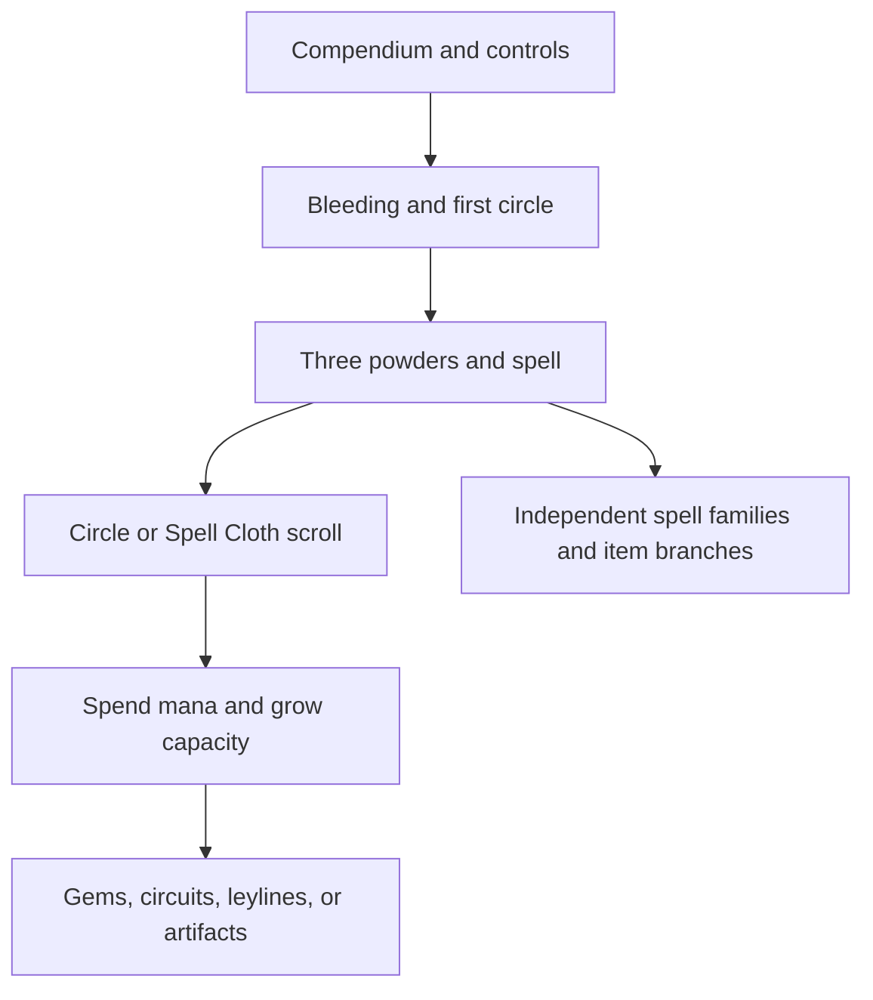

# Mahou Tsukai — mechanics and gameplay profile

| Field | Value |
| --- | --- |
| Manifest ID / actual mod ID | `mahou-tsukai` / `mahoutsukai` |
| Category / parent or addons | Magic / standalone spell and item system |
| MC / loader / pack target | 1.21.1 / NeoForge / TMM research base `cb8e2dcab59cc625500b3ca0329df1511823610b` |
| Pinned version / artifact / hash | `mahoutsukai-1.21.1-v1.36.31.jar` / SHA-512 `0c4f3bc823d681ad9cb00895d348d2b414201c4d397ca3aa6427b45b8d2b369e0bae8c1f354a9541e4205dadb58c49203d3570e2433d772c3eef1227bc8bfa5a` (packwiz pin and directly inspected local hash match) |
| Source snapshot | No public source snapshot found; ARR. Exact pinned binary inspected directly for starter recipes, native book, catalyst registrar/circle handling and draw packet; no source-build equivalence claimed. |
| Guide/documentation version gap | Official wiki documents the 1.21 feature set but its current pages are labeled 26.1.2; no 1.21.1/v1.36.31-specific page revision was identified. |
| Profile status | researching |
| Evidence reached | Mixed: official wiki plus exact pinned JAR recipes/classes/native book/circle/advancement inventory; remaining mana/item/spell mechanics and runtime configs/client acceptance unverified. |
| Reviewed | 2026-11-16 |
| Quest ownership | [Mahou Tsukai chapter](../../../config/ftbquests/quests/chapters/mahou_tsukai.snbt) (one optional manual checkmark only) |

## Executive gameplay map

**What the player actually does:** Mahou Tsukai turns controlled damage into access to a blood-circle drawing action. A player draws a blank Mahoujin on a suitable surface, spends three material powders to define its spell, and either leaves the result as an active circle or uses Spell Cloth to make a portable scroll when that spell supports scrolls. Casting and maintaining magic spends personal mana; spending gradually raises the personal maximum. Sleeping, leyline proximity, artifacts, exchanges, and mana circuits support the resource economy. The spell catalog is broad and does not have a single tier ladder: players choose among boundaries, displacement, projection, mystic effects, Mystic Eyes, familiars, exchanges, and secret spells, then pursue item and weapon branches such as Caliburn/Morgan. The Knowledge Compendium is the in-game route to catalyst recipes and instructions.

**Why it matters in TMM:** Its distinct progression currency is personal Mahou, not Ars Source, Botania mana, Astral starlight, Iron's mana, or Neo Vitae EV. It combines tangible survival setup, precise consumable recipes, persistent circles, portable scrolls, and equipment creation. The Mortar and Pestle's two-powder output is useful for Mahou catalysts, but it does not turn raw ore into two smeltable ingots. Native spells and projected gear can also affect terrain, entity control, combat, and resource loops, so they need a spell-by-spell balance review before being used as quest rewards or pack progression gates.

**Quick start:** Make or obtain the Mahou Tsukai Knowledge Compendium, Dagger, and a Hammer or Mortar and Pestle. Take controlled damage with the Dagger, face a suitable open floor, and press the default `M` key (`Draw Mahoujin`) while Bleeding is active. Apply three correct powders to the blank circle; the in-game compendium lists recipes. Start with a low-complexity spell such as Alarm Boundary. Use Spell Cloth before drawing when making a scroll. Successfully drawing the first circle unlocks the mana display and the “Become a Mahou Tsukai!” advancement. [Getting Started](https://mahoutsukai.stepsword.com/guides/getting-started/) · [Casting and scrolls](https://mahoutsukai.stepsword.com/guides/casting-and-scrolls/) · [Compendium](https://mahoutsukai.stepsword.com/items/guidebook/)

### Player-value snapshot (a quick reference for quest designers)

| Five standout capabilities | Three genuinely early practical unlocks | Three candidate integrations |
| --- | --- | --- |
| 1. Persistent boundary spells for alarms, protection, terrain shaping, or life drain; 2. on-demand scrolls for spells that support Spell Cloth; 3. projection and strengthening of eligible equipment; 4. leyline and circuit-based mana storage/distribution; 5. advanced weapon/item branches including Caliburn → Morgan, Clarent, Emrys, and Replica. | 1. Mortar and Pestle turns one eligible input material into two powders for spell catalysts; 2. Alarm Boundary can be assembled with two Powdered Iron and one Powdered Quartz and toggled by empty-hand right-click; 3. first successful circle reveals Mahou and unlocks the mana display. | 1. Native Catalyst Exchange with Mahou powdered catalysts is an input/output path; its TMM Neo Vitae dust adapter is not currently safe or integrated. 2. Projection may interact with pack weapons and gear; whitelist/blacklist and anvil semantics need a balance audit. 3. Mana generation/storage could be compared with other pack energy currencies only through an explicit bridge; no FE/Source/EV transfer is established here. |

### Subsystem coverage at a glance

| Subsystem / progression branch | Mechanics evidence | Progression completeness | In-game guide/JEI reference | Client validation | Blocker / next action |
| --- | --- | --- | --- | --- | --- |
| First circle, catalysts, and scroll creation | [Official Getting Started](https://mahoutsukai.stepsword.com/guides/getting-started/) and [Spell Creation](https://mahoutsukai.stepsword.com/guides/casting-and-scrolls/) | partial | Mahou Tsukai Knowledge Compendium; spell pages | not run | Verify recipe layout and controls in the pinned client. |
| Mana, leylines, Fae, gems, and circuits | [Official Mana guide](https://mahoutsukai.stepsword.com/guides/mana-and-leylines/) and FAQ | partial | Compendium / Mana and Leylines wiki page | not run | Audit pinned configs, Fae behavior, circuit search, storage and dimension defaults. |
| Spell families | [Official spell index](https://mahoutsukai.stepsword.com/spells/) and individual pages | partial | Compendium lists three-powder recipes; no exhaustive spell-specific book coverage established | not run | Audit all spell pages, actual recipe set, costs, targeting, persistent effects, and risky edge cases. |
| Weapons, artifacts, and special items | Official Items & Blocks catalog and advancement index | partial | Compendium and item pages | not run | Trace acquisition chains for every major item/weapon using the pinned artifact. |
| Existing quest chapter | `config/ftbquests/quests/chapters/mahou_tsukai.snbt` | incomplete | no lesson/guide references in chapter | not run | Chapter has one optional checkmark; do not treat it as coverage. Quest edits are outside this pass. |
| Neo Vitae catalyst exchange adapter | TMM integration source inventory only; adapter marked unsafe and disabled | blocked for current adapter | no in-game guide | not run | Do not restore the global dropped-item tick script. A narrow scanner patch requires exact pin/source and separate implementation work. |

See [pinned starter instructions and53-circle crosswalk](mahou-tsukai-pinned-onboarding.md) for actual book recipe, tool burden/remainders, circle placement and unordered catalyst behavior; this supplements the older wiki claims below.

## Guidebook onboarding — required before the player's first complex step

- **Guide name and access:** Mahou Tsukai Knowledge Compendium, registry `mahoutsukai:guidebook`; the official wiki shows a 3×3 recipe using red dye, paper, and leather. Right-click to open, navigate with arrows/home, and consult the three powder ingredients for spell entries. It can also be placed on a Lectern. Exact pinned grid is now recorded in [the artifact-backed onboarding](mahou-tsukai-pinned-onboarding.md): five Red Dye, three Paper and one Leather. Native client GUI class and53 named recipe-page matches are inspected; rendering remains untested. [Compendium page](https://mahoutsukai.stepsword.com/items/guidebook/)
- **Earliest attainable stage:** The book recipe uses ordinary survival materials. Drawing a circle requires the Bleeding effect, a usable floor position, and the default `M` key (rebindable under Controls). The Dagger is a reusable controlled-damage source; its exact pinned recipe is two Iron, two Gold, two Purple Dye and one Stick, with the shaped grid available in JEI. The Hammer is the cheaper powder entry; combined Mortar and Pestle costs four Diamonds.
- **First instructional quest:** Teach the player to obtain/open the Compendium, craft or obtain the Dagger and powder tool, create the first blank circle, use the Compendium to select a three-powder recipe, then complete and activate one simple spell. Separate “make a spell” from “make a scroll”; Spell Cloth must be placed first for scroll-form spells. The first circle is a reliable advancement milestone according to the wiki; test FTB's native advancement task support before using it.
- **Reference map:** Compendium → contents and spell catalyst recipes; wiki Getting Started and Casting and Scrolls for the first circle; wiki Mana and Leylines for resource storage and regeneration; item/spell pages for individual use, limits, and configuration. The official wiki has a version-differences page: its current documentation says the 1.21 version has none of the major content omissions listed for older releases, but that does not prove every value or recipe matches v1.36.31.
- **Where guide is insufficient:** The Compendium's individual spell entries are described as catalyst-recipe references. Exhaustive costs, targeting, active behavior, limits, and failure cases require each spell/item entry. Do not assume the book teaches each branch's full operating procedure.
- **Other in-game help:** The mana GUI is unlocked by the first successfully drawn circle; `/showmahou` toggles its display. `M` is the default draw control, and `Y` the default Change Mystic Code control. JEI recipe/usages and FTB advancement detection have not been inspected in the exact pack client.

## Systems and full mechanics inventory

| Subsystem | How accessed | Inputs + costs | Effects / outputs | Limits, failure conditions and source |
| --- | --- | --- | --- | --- |
| Bleeding and blood-circle creation | Take positive damage, then press `M` while facing a suitable open floor. Dagger is the controlled option. | Any positive damage; Dagger right-click inflicts 2 damage. Ordinary damage leaves about 5 seconds to draw; Dagger leaves 15 seconds according to the wiki. | Places a blank Mahoujin; the first successful circle unlocks the mana display and “Become a Mahou Tsukai!” advancement. | Solid-surface restriction defaults true; server may set dagger-only bleeding. Insufficient space, expired Bleeding, or control conflict prevents drawing. Exact timing is wiki evidence, not measured on the pinned build. |
| Powder and catalyst preparation | Craft Hammer or Mortar and Pestle; combine with supported material according to JEI/Compendium recipe. | Hammer makes one powder per material; Mortar and Pestle makes two. Recipes list materials including iron, quartz, diamond, emerald, gold, ender pearl and eye of ender. | Powdered catalysts `mahoutsukai:powdered_*` are consumed in spell recipes. | Each spell consumes three catalyst units; repeated catalysts require repeated inputs. No evidence that outputs are smeltable ore dusts or that this is general ore doubling. [Getting Started](https://mahoutsukai.stepsword.com/guides/getting-started/) |
| Spell circle creation | Right-click a blank circle with its three required powder units in any order; exact counted multiset matters. [pinned onboarding](mahou-tsukai-pinned-onboarding.md) | Three correct powder items; optional Spell Cloth must be placed before the blank circle for a scroll-capable spell. | Converts the blank circle to an active spell circle or, on cloth, to a completed scroll on empty-hand right-click. | Some spells are circle-only. Spell recipes and form are individual; a scroll may be consumed in Survival when used. Servers can blacklist spells or enforce GameStages. |
| Active circles | Use spell-specific trigger, empty-hand toggle, redstone, or passive operation. | Spell-specific Mahou payments; some spells also consume world/entity inputs or impose ongoing costs. | Persistent area, defense, damage, utility, or terrain effect. | Active-circle caps can be configured per caster/registry ID. Replacement age and redstone behavior vary by spell. Do not infer all circles tick or spend mana identically. |
| Scrolls | Create a supported spell on Spell Cloth, then right-click the completed circle with empty hand. | Spell Cloth plus three powders; casting cost and target depend on spell. | Portable one-use or spell-specific cast item. | Spell pages define target/activation. Some spells cannot be scrolls; creation can fail if cloth is not underneath before drawing. |
| Personal Mahou progression | Unlock on first circle; cast/maintain spells and spend mana. | Spell costs. Wiki defaults include base regeneration 1 mana/tick, sleep recovery 0.5 max mana, spend threshold 100, increase 1, cap 200,000. | Personal current/max mana; spending raises maximum as configured. | Hunger factor, local leylines, mana-up punishment, cap, included dimensions, and other sources modify results. Exact effective regen depends on server config and was not measured. |
| Attuned gems | Craft Attuner and attune eligible diamond/emerald according to item pages. | Gem plus Mahou; charge behavior/cost not fully audited. | Carried storage drains after personal mana and before nearby circuit supply. | Wiki says Attuned Diamond stores more than Attuned Emerald. Capacity and charging details need full item-page review and pinned validation. |
| Mana Circuits | Craft and place a circuit; first right-click claims it. Empty-hand right-click transfers personal mana; sneak-right-click toggles it. | Fae Essence + Powdered Emerald for standard circuit; iron + Powdered Emerald for Magitech. Stored Mahou. | Stores Mahou and supplies compatible nearby spells/players. Default capacities: standard 100,000; Magitech 100,000; default horizontal range 10 blocks. Fae Essence toggles sharing on standard circuit. | Redstone signal inverts selected on/off state. Ownership, chunk/loading behavior, vertical extent, scan cadence, and competing-circuit selection need pinned testing. These are not proven FE/Ars Source/Neo Vitae interfaces. [Circuit guide](https://mahoutsukai.stepsword.com/blocks/mana-circuit/) |
| Leylines and leypoints | World-spaced coordinate grid in enabled dimensions; visible with Mystic Eyes of Fay Sight. | No explicit item cost to encounter; Fay Sight scroll has a cost. | Changes mana regeneration. Wiki says local evaluation uses 7×7 horizontal area, with segment value 1, crossings 2, leypoints 3; default spacing 300 blocks. | Included dimensions, blacklist/whitelist mode, offset, factor and flat/scaling rules are server configurable. Wiki formula is documented there; verify pinned defaults and rounding. |
| Fae | Stand at a leyline intersection with three rings, with current mana below maximum; make open sky nearby. | Mana deficit and suitable location; no item consumed per attempted spawn. | Approximately 10% chance every 5 seconds for a Fae within 10 blocks at player Y, adjusted by open air per FAQ. Fae Essence supports circuits and other recipes. | Must find Fae using Mystic Eyes of Fay Sight; current spawn rate also has config multiplier. Exact chance and server load require in-world validation. [FAQ](https://mahoutsukai.stepsword.com/faq/) |
| Mahou generation and exchange spells | Spell families include Damage Exchange, Chronal Exchange, Durability Exchange, Boundary of Drain Life, Geas; William can also affect personal regen. | Spell-specific targets, durability, incoming damage, stored mana or entities. | Mana gain/loss, conversion, mitigation, regen, or other effect. Drain Life's current wiki page specifies mana/upkeep and health/hunger/mana rewards. | Each spell has exploit and balance implications; audit its full page before designing a production loop. No universal spell generation rate. |
| Mana-generation artifacts | Carry William/R'lyeh; place William or use Kodoku according to the Mana guide. | Artifact style/fame; Kodoku worm charging and fire/burning/lava kill; active nearby circuit. | William can contribute to personal regeneration or distribute to non-full owned circuits; Kodoku can add stored value to nearby active circuits; R'lyeh can reduce personal mana. | Multiple carried artifacts use strongest positive William and strongest negative R'lyeh values. Entity lifetime, exact tick/cadence and pack performance need pinned code/test. |
| Spell catalog | Official index groups entries into eight named families. | Catalyst recipe; spell-specific targeting, cost and possibly world/creature conditions. | Boundaries; displacement; projection/weapon creation; mystic utility/defense; Mystic Eyes; familiars; exchanges; secret/advanced spells. | Index includes over 50 named entries across the families, but no full per-spell mechanics audit is complete. The guide and server blacklist/GameStages are the authoring controls documented by the wiki. |
| Power Consolidation and signature weapons | Special world/item conditions, spells, advancements, or transformation recipes. | Example: Caliburn route uses a supported sword and a completed lake; Morgan transforms an eligible Caliburn after killing a whitelisted entity; Clarent/Emrys/Replica/Nobu have distinct triggers. | Progressing weapons, abilities, and item-specific combat features. | Not a single crafting tier; exact trigger predicates and item costs must be followed from individual item pages and actual advancement data. Morgan page documents villager-kill growth and mana cost; this can be a balance-sensitive branch. |
| Projectors and decor | Mahoujin/Fog Projectors and related controls. | Projector item, editable template/assets, redstone/control actions. | Visual or functional projected spell/fog field. | FAQ points to dedicated editor/field/range/asset/server-limit documentation; not researched in depth. |

## Material / capability input-output contracts

| System | Input **kind** + exact ID/tag/event | Input qty/formula; consumed/remainder | Output **kind**, qty and location | Trigger/cadence; range/capacity | Automation/interface and evidence |
| --- | --- | --- | --- | --- | --- |
| Blood-circle initiation | Player damage event; Dagger `mahoutsukai:dagger` | Any positive damage; no item consumed by ordinary damage. Dagger use causes controlled 2 damage per official guide. | Player status Bleeding, then world block/entity Mahoujin when key action succeeds | Brief timing window; suitable floor and free space in front | Player input and world placement; no recipe automation. Dagger/use and draw-packet paths now inspected; arbitrary-damage Bleeding event and effective config still need audit. |
| Catalyst processing | Item stack, e.g. supported metal/gem input + Hammer or Mortar and Pestle | Exact14 shapeless recipes: Hammer1 powder/material, combined Mortar/Pestle2. Tools return an unchanged copy through crafting remainder; see pinned onboarding. | Powdered item stack in inventory | Crafting interaction | Exact recipe JSON and tool classes inspected; client JEI rendering not tested. Not established as ore-processing or smeltable-dust conversion. |
| Spell creation | Powder item stacks applied to Mahoujin; optional Spell Cloth block | 3 catalyst powder units, exact spell recipe; consumes cloth on scroll completion | Spell circle block at placement, or a scroll item to player on completed cloth route | Player interaction, one powder click at a time | Native interaction; other automation not established. Spell index pages include IDs/forms. |
| Spell mana payment | Personal Mahou → carried attuned gem → active nearby circuit, according to official Mana guide | Spell-defined quantity and cycle; no universal rate | Spell effect, maintained circle, or ability; current/max Mahou changes separately | spell-specific target/range; circuit default 10 horizontal blocks, capacity default 100,000 each | Native Mahou network; exact selection/ordering and API capabilities not source-inspected. |
| Leyline regeneration | Player position + generated leyline/point world state | Formula depends on local grid, max mana, config, dimensions | Mahou added/removed from player regeneration | Seven-by-seven horizontal sample documented; points default spacing 300 | Native world/player tick behavior according to wiki; exact server tick overhead not measured. |
| Mana Circuit charging | Player mana and/or spell/artifact generation, circuit block `mahoutsukai:mana_circuit` or `mahoutsukai:mana_circuit_magitech` | Empty-hand right-click transfers personal mana; artifact and Kodoku routes have distinct conditions | Circuit's stored Mahou, up to configured capacity | Player input or artifact cadence; 10-block horizontal supply range default | Native block controls; no generic FE capability established. |
| Fae Essence | Fae mob/item drops and listed crafting recipes; exact acquisition routes not fully surveyed | Unknown total and drop rate | Fae Essence item, used in standard Mana Circuit recipe and access-sharing toggle | Fae discovery/spawn is leyline/mana/location dependent | Wiki lists item and spawn conditions; source and exact drop route remain open. |
| Projection | Eligible damageable held/item-entity equipment targeted by Projection scroll | Default 1,000 mana per release attempt, including failed attempts and first memorization; one scroll is retained for its copy sequence | One projected damageable equipment copy; inventory or dropped nearby if full | Aim within default 100-block global look range; first eligible item memorized; each later release creates one copy | Native scroll interaction. Default flat durability 5; enchantment blacklist and item whitelist/blacklist configure copying. [Projection page](https://mahoutsukai.stepsword.com/spells/projection/) |
| Enclosure Boundary | Three Powdered Iron applied to circle; world terrain around circle | 20 mana per stage, every 20 ticks by default; up to radius-1 layers (default radius 5), payment retries | Raised terrain remains after circle removes itself; protected/data blocks skipped | One layer attempt each cycle; radius config | Native block-changing spell; no ongoing redstone control. Review griefing/claim integration before enabling freely. [Enclosure page](https://mahoutsukai.stepsword.com/spells/enclosure-boundary/) |

Explicitly unestablished: Mahou→FE, Ars Source, Botania mana, Astral starlight, Neo Vitae EV, blood, vanilla XP, or ProjectE EMC; circuit item/fluid capabilities; team ownership semantics beyond wiki-documented player circuit sharing; and native automation of spell-circle powder input. Do not infer cross-currency compatibility from matching names such as “mana.”

## Acquisition, renewability and output economics

- Powder quantity is the most grounded early economic distinction: Mortar and Pestle doubles powder output from one supported material, while Hammer yields one. That saves catalyst inputs but does not by itself double ore or smeltable metal.
- Spell catalysts are consumed to create spells. Scroll form adds a Spell Cloth input, which the wiki says is removed when the completed scroll is picked up. The interaction is not described as preserving a reusable cloth.
- Personal mana replenishes naturally and by sleep/leyline and spell/item sources; spending also raises capacity until the configured maximum. This creates an endogenous upgrade loop whose default spending threshold and cap can be changed.
- Standard and Magitech circuits have substantial configurable storage, but filling them still requires mana generation or personal transfer; the Magitech variant is not free energy. Default values and access sharing are wiki facts pending exact-version review.
- Projection is a copier for eligible damageable items, not a general item duplicator: copies have configured durability, retain eligible enchantments, and cannot be retargeted after memorization. The blacklist/whitelist can alter eligible types, so pack balance should audit it against powerful modded tools and weapons.
- Boundary of Drain Life is a candidate recurring health/food/mana source, but accepted target types, name exclusions, mana billing, and max targets make its real yield and mob-farm interactions configuration-dependent. Do not turn it into an assumed infinite loop without a controlled test.

## Complete player progression / walkthrough blueprint

**Completion test:** Mahou Tsukai is an open spell/item system rather than a single gated ladder. The walkthrough below reaches first-circle mastery, a functioning mana-storage path, representative spell use, and an explicit optional signature-weapon branch. It does not claim all spells/items are mapped; therefore this profile remains partial.

| Path and step | Gate or choice? | Exact prerequisite / materials / world condition | Player actions: obtain, build, activate, use | Unlock / visible success / next step | In-game guide section or JEI reference | Proposed quest/how-to, detection and reward | Evidence / coverage |
| --- | --- | --- | --- | --- | --- | --- | --- |
| 0. Get/open the Compendium | Recommended | Red dye, paper and leather; exact 3×3 layout to confirm in JEI | Craft `mahoutsukai:guidebook`; right-click; navigate with arrows and home | Catalyst recipes and navigation map | Compendium; wiki Getting Started | Teach open/use rather than asking player to read an external wiki. Check book possession as proxy; XP + paper/ink only. | Wiki recipe and use; exact pinned recipe unverified |
| 1. Make a controlled damage source | Recommended | Dagger recipe shown in wiki/JEI; gold, stick, purple dye, iron are listed ingredients | Craft/equip Dagger and right-click to take controlled damage | 2 damage and longer Bleeding window than ordinary damage; practice draw becomes predictable | Compendium; Getting Started; JEI Dagger | How-to: hold Dagger, right-click once, then face a solid floor and press default `M`; no quest should award a free Dagger unless chosen balance target. | Official wiki; exact recipe pattern unverified |
| 2. Draw the first circle | Required to unlock Mahou | Bleeding active; free solid floor in front; key `M` or player-rebound control | Press `Draw Mahoujin`; observe blank circle | Mahou display unlocks; “Become a Mahou Tsukai!” advancement per official wiki | Controls; Casting and Scrolls | Use advancement task if FTB supports it in the exact client; otherwise manual acknowledgement. Item ownership is not proof. XP + low-value catalyst materials. | Wiki advancement/guide; FTB detector not tested |
| 3. Prepare powder and learn one recipe | Required for spell creation | Craft Hammer or Mortar and Pestle; supported material inputs; choose easy spell | Produce powders; Compendium's spell entry shows three ingredients. Alarm Boundary example: 2 Powdered Iron + 1 Powdered Quartz. | Correct three inputs consumed when spell completes | Compendium; Getting Started; JEI powder recipes | Teach powder quantity and repeated ingredients. Test completion via spell circle item/block or manual check; reward modest iron/quartz only. | Official getting-started example; recipe layout not exact-pin verified |
| 4. Complete and operate a first spell | Choice of spell | Blank circle plus three correct catalysts; Alarm Boundary is example; clear placement | Apply powders; empty-hand right-click toggles Alarm Boundary | Active circle; verify its effect in world | Compendium; Alarm Boundary spell page | Demonstrate the spell's actual toggle/use and removal behavior, not just recipe completion. Check advancement only if a native trigger exists; not established here. | Wiki example; no runtime test |
| 5. Learn scroll casting | Optional form choice | Spell Cloth (wiki shows 4 produced per recipe); scroll-capable spell; same Bleeding and powders | Place cloth, draw directly on it, add three catalysts, empty-hand right-click to collect scroll | Portable scroll; cloth/circle removed | Casting and Scrolls; each spell page's form label | Teach which spells support scrolls. Detector may check scroll output, but this only proves creation, not use; XP + cloth ingredients. | Official guide; no client test |
| 6. Grow mana capacity | Long-term resource progression | Spend Mahou on casts/maintenance; default threshold 100 spent for +1 max and max 200,000 per wiki; server config can differ | Use low-risk spells, observe display, replenish by natural regen/sleep | Higher maximum mana and longer spell budget | Mana and Leylines; FAQ | Explain that spending is growth, but burns resource; use manual milestone or observed mana state only if task support exists. No vanilla XP assumptions. | Wiki defaults; in-pack config not read |
| 7. Establish mana storage | Optional infrastructure | Attuner/Attuned Gem route or circuit recipe; standard circuit needs Fae Essence + Powdered Emerald; Magitech circuit uses iron + Powdered Emerald | Attune and carry gem, or claim/place circuit; transfer mana; toggle; set sharing if needed | Spell draw order personal → carried gem → active in-range circuit; storage capacity | Mana guide; Attuned Gems; Mana Circuit and Magitech pages | Teach ownership, toggle, and sharing. Reward only if craft accessibility balanced; task for circuit item does not prove charge or supply. | Wiki behavior and defaults; recipes need exact JEI check |
| 8. Find leylines / Fae | Optional exploration and supply branch | Fay Sight; leyline crossing/three-ring leypoint; current mana below maximum for Fae spawn | Follow visible line; stand at center; allow open air; listen/observe; collect Fae Essence | Ley regeneration insight, Fae Essence and later standard circuits | Mana and Leylines; Fae; Mystic Eyes of Fay Sight | Teach the seven-by-seven proximity concept and actual spawn condition. Use advancement if trigger exists; otherwise Fae Essence is only a proxy. | FAQ guide only; config/worldgen untested |
| 9. Expand spell families | Open branches | Each chosen page's catalyst inputs, Mahou cost, targeting, world and entity conditions | Create spells from Boundary, Displacement, Projection, Mystic, Mystic Eyes, Familiar, Exchange, or Secret families; read each page before use | Utility, defense, mobility, entity/familiar or combat choices | Compendium plus exact named spell pages | Separate quest lessons by practical spell, with a how-to and bounded thematic reward. Do not require every spell or present this as a tier ladder. | Index lists categories; per-spell walkthrough incomplete |
| 10. Optional signature weapon paths | Optional specialized branches | Individual conditions: Caliburn lake, Morgan transformation, Clarent/Emrys/Replica/Nobu and other item-specific triggers | Follow the exact item page and advancement trigger; for Morgan, source says transform eligible Caliburn then grow via qualifying villager kills at configured Mahou cost | Signature weapon and abilities; meaningful capstone | Items & Blocks catalog, item pages, Advancements | Each item needs a separate researched how-to and ethical/pack-balance decision. Item possession may be used as completion proxy but does not prove the acquisition process. | Wiki advancement index; full paths not audited |
| 11. Optional projector/automation branch | Optional | Projector item and documented editor/config route | Configure Mahoujin/Fog Projector; test range and controls | Reusable visual/field system | Projector documentation linked from FAQ | Not enough research to author a reliable lesson. | Open |

### Dependency graph and alternate routes

The graph shows instruction order, not native hard gates. Drawing the first circle is the main native onboarding gate documented by the wiki. Spell-family access is recipe-driven and can be server-blacklisted or GameStage-restricted, but no TMM GameStages override is established. Mana storage and weapon branches are choices, not mandatory altar tiers. Whether the installed pack exposes the same advancement IDs, registry names, and recipes must be checked against the pinned jar.

### Structures, rituals, automation and other how-to instructions

| Required setup | Placement/shape/activation and operating inputs | Guidebook page/JEI category to cite **by name** | Failure symptoms, throughput or maintenance | Quest where taught |
| --- | --- | --- | --- | --- |
| Blood circle | Take damage; face suitable solid floor with open placement area; press `M` during Bleeding | Compendium, Controls; wiki Casting and Scrolls | No circle if Bleeding ends, area blocked, solid-only condition fails, or key conflicts | First Mahou lesson (existing chapter currently has no how-to) |
| Spell circle → scroll | Put Spell Cloth down before drawing; apply exactly three powders; empty-hand right-click completed circle | Compendium, spell page, Casting and Scrolls | Wrong order/ingredients, missing cloth, or scroll-unsupported spell; Survival use usually consumes the scroll | Scroll lesson; not present yet |
| Mana circuit | Place, claim, charge, toggle; optionally use Fae Essence for sharing; circuit supply checks configured horizontal range | Mana Circuit / Magitech Mana Circuit item pages | Wrong ownership/access, inactive state, no stored Mahou, outside range, full capacity | Mana infrastructure lesson; not present yet |
| Leyline/Fae location | Use Mystic Eyes of Fay Sight; inspect crossing rings; stand on 3-ring leypoint with mana below max and nearby open air | Mana and Leylines; Fae | Sight required, mana full blocks spawn condition, open-air modifier affects probability | Exploration lesson; not present yet |
| Power Consolidation lake | Full structure/form and input conditions not yet researched; official advancement says create Caliburn by transforming an allowed sword in a completed lake | Caliburn; Power Consolidation; advancement “The Sword in the... Lake?” | Exact geometry, materials, conversion order, failure consumption and item whitelist unknown | Do not author until researched |

## Advanced and terminal objectives

- **Normal completion:** First circle, one functional spell, and a correctly explained route to scroll form and mana progression. There is no single vanilla-style final boss or tier ceiling established by the wiki index.
- **Optional completion:** Build a practical circuit/storage route, explore leylines and Fae, specialize in one spell family, then pursue one researched signature item path. Projectors and item families are substantial optional branches.
- **Remaining progression blockers:** Pinned starter/recipe/advancement inventory inspected; complete spell and item mechanics audit not done; current server/client config values not read; exact advancements/task compatibility and world/test behavior unverified; existing chapter is a placeholder.
- **Quest coverage check:** Current FTB chapter has a single optional manual checkmark with 2 quest XP and one paper reward. It contains no Compendium, circle, recipe, mana, spell, scroll, leypoint, circuit, or item path. This profile does not change that quest data.

## Internal combinations and overlooked mechanics

| Internal combination | Full chain | Benefit | Limitation / exploit potential | Evidence |
| --- | --- | --- | --- | --- |
| Mortar and Pestle catalyst economy | Material → Mortar and Pestle → two powders → three-powder spell | Cuts the raw input burden for catalysts | Powder is Mahou reagent, not evidence of ore doubling. | [Getting Started](https://mahoutsukai.stepsword.com/guides/getting-started/) |
| Mana Circuit and generated Mahou | William or Kodoku → active circuit → nearby spell/player | Moves generation into shared/remote storage; circuit sharing can serve other players | Requires item/entity-specific process and circuit ownership/range; no universal passive FE generator. | [Mana guide](https://mahoutsukai.stepsword.com/guides/mana-and-leylines/) |
| Drain Life and target farm | Active boundary → nearby living targets → damage and caster restoration | Can return health, hunger, or Mahou while operating | Entity list, caps, costs, resistance handling, target access, and claimed territory can change output; dangerous as unattended farm. | [Drain Life](https://mahoutsukai.stepsword.com/spells/drain-life-boundary/) |
| Projection and weapon families | Memorize eligible item → create configured projected copy → optional Strengthening/Weapon Projectiles/Treasury Projection interactions | Flexible equipment copies and related projectile behavior | Fixed mana per release; durability and enchantment transformations; whitelist can expose arbitrary damageable modded gear. | [Projection](https://mahoutsukai.stepsword.com/spells/projection/) |
| Caliburn → Morgan | Complete Power Consolidation lake → create Caliburn → transform with eligible kill → spend configured Mahou on villager upgrade | Growing signature sword with additional abilities | Kill condition, caps, ethics, and high configured attack caps make this a balance review target. | [Advancements](https://mahoutsukai.stepsword.com/guides/advancements/) · [Morgan](https://mahoutsukai.stepsword.com/items/morgan/) |

## Low-hanging setups useful in ordinary survival

### 1. Mortar and Pestle catalyst prep — early
- **Goal and payoff:** Make spell catalysts at twice the Hammer's material yield.
- **Minimum entry and ingredients:** Mortar and Pestle recipe plus a supported catalyst material (for example iron or quartz); exact shaped recipe requires JEI verification.
- **Build/use steps:** 1. Craft the Mortar and Pestle. 2. Use the documented material input. 3. Use the two powders on a spell's blank circle.
- **Sustainability and limits:** Material is consumed; it is a catalyst economy, not a smelting multiplier.
- **Evidence / pack test:** Official Getting Started guide; no pack test.

### 2. Alarm Boundary — early, short chain
- **Goal and payoff:** Create a simple active boundary and learn the circle toggle interaction.
- **Minimum entry and ingredients:** Bleeding, open floor, blank circle, two Powdered Iron and one Powdered Quartz.
- **Build/use steps:** 1. Draw circle. 2. Apply powders. 3. Empty-hand right-click to toggle. 4. Read the spell's page for its actual alarm behavior and removal.
- **Sustainability and limits:** Spell upkeep/effect specifics were not audited here; do not promise a detection mode not verified from the full spell page.
- **Evidence / pack test:** Official Getting Started recipe; no pack test.

### 3. Personal mana growth — medium-term
- **Goal and payoff:** Raise the maximum personal Mahou by spending it on useful spells.
- **Minimum entry and ingredients:** First circle and spells; exact server values may be overridden.
- **Build/use steps:** 1. Note current/max in display. 2. Cast a low-risk spell. 3. Regenerate via sleep/natural regen/leyline as available. 4. Observe max change at spending thresholds.
- **Sustainability and limits:** Wiki defaults: 100 spend threshold, +1 max per threshold, 200,000 cap; server config can change each. Not verified in TMM.
- **Evidence / pack test:** Official Mana guide; no pack test.

## API, integration and pack-config surfaces

| Hook or customization surface | Namespace / exact file, API or serializer | Capabilities / constraints | Current TMM override? | Evidence |
| --- | --- | --- | --- | --- |
| Server config | `mahoutsukai-server.toml` in world `serverconfig`; `defaultconfigs` can distribute initial world values | Spell blacklist, optional GameStages, spell-specific costs/limits/terrain changes, mana cap/regen, leyline dimensions, circuit values | None found in tracked pack config from this research pass | Official [Config](https://mahoutsukai.stepsword.com/config/) and FAQ; exact config not read |
| Client config | `mahoutsukai-client.toml` | HUD location/visibility, rendering and client presentation | None found in tracked pack config from this research pass | Official wiki FAQ |
| Spell gating | `SPELL_BLACKLIST`, `GAMESTAGES_ENABLED`, GameStage names | Blocks selected spell creation; server option exists | No TMM override established | Official Casting and Scrolls page; GameStages enforcement not client-tested |
| Mana circuits | `mahoutsukai:mana_circuit`, `mahoutsukai:mana_circuit_magitech` | Native proprietary Mahou storage, ownership, sharing, redstone, player/spell supply | No FE/Source/EV adapter established | Official circuit pages |
| TMM material adapter candidate | `feature/mahou-catalyst-exchange-kubejs`; manifest entry `mahou-catalyst-exchange-neo-dust` | Intended Neo Vitae dust exchange with native Catalyst Exchange behavior | Disabled/unsafe. Previous KubeJS adapter scanned dropped entities on every tick and level ticks; integration inventory says not to reinstate it. A scoped exact-circle scanner patch is proposed, not implemented/validated here. | `manifest/integration-sources.json`; design/blocker note, not live runtime evidence |
| Existing chapter | `config/ftbquests/quests/chapters/mahou_tsukai.snbt` | One manual checkmark quest only | Present but not instructional | Current tracked file read directly |

Documented server controls include active circle limits, spell blacklist/GameStages, caster damage, terrain damage for several spells, mana and leyline progression, item whitelist/blacklist, and range/capacity settings. This profile does not establish any API event, item capability, or exact registry implementation from the binary.

## Compatibility leads

| Other mod | Candidate link and why | Native / pack-built / would require bridge | Status / source |
| --- | --- | --- | --- |
| Neo Vitae | Exchange Neo Vitae dusts with native Mahou catalyst exchange | Pack bridge required | Existing KubeJS dropped-item adapter explicitly marked unsafe/disabled in integration inventory; do not restore. A scoped patch needs separate exact-pin implementation and tests. |
| Ars Nouveau / Ars addons | Compare spell-utility niches and resource costs; possible quest cross-references | Quest/editorial only unless actual capability is found | No direct mana/Source connection established. |
| Astral Sorcery | Leyline exploration can complement celestial exploration thematically | Quest/editorial only | No native integration established. |
| ProjectE | Projection's copy semantics and high-value items could affect EMC safety | Native item balance concern; no EMC interface claimed | Audit projected items against EMC only when ProjectE profile is complete. |
| Claims/protection mods | Enclosure Boundary and destructive spells modify blocks | Existing protections may exempt some blocks; compatibility not tested | Wiki says Enclosure leaves protected/data blocks unchanged, but which protection APIs are honored is unknown. |

## Quest and teaching opportunities (research, not actual quests)

| Stage and teaching goal | Actionable in-game instructions (prerequisites → steps → result) | Named guidebook section or JEI recipe | Intended behavior vs truthful FTB detector / fallback | Useful XP + fixed reward direction | Coverage and gating risk |
| --- | --- | --- | --- | --- | --- |
| Find and use the Compendium | Obtain through its recipe; right-click; navigate to spell index; locate one recipe | Mahou Tsukai Knowledge Compendium | Possession is a proxy, not evidence the player read it; manual fallback | Small XP; paper/ink | Existing chapter omits this |
| Draw the first circle | Take damage or Dagger damage; face floor; press `M` during Bleeding; see blank circle | Controls; Casting and Scrolls | Prefer native “Become a Mahou Tsukai!” advancement after client confirms FTB can detect it; otherwise manual acknowledgement | Small XP; no Dagger duplication | Timing and task detector need test |
| Prepare and use first catalyst recipe | Craft powder tool; use three recipe powders on circle; toggle spell | Alarm Boundary, Compendium | Check resultant spell block/item if stable; ownership alone doesn't prove activation | XP + low-value iron/quartz inputs | Exact registry IDs and activation need test |
| Create a scroll | Place cloth before circle; add correct powders; empty-hand right-click | Casting and Scrolls; named spell page | Scroll item proves creation only; manual task or use advancement for actual casting | XP + cloth ingredients | Only spell pages marked scroll-supported |
| Learn personal and shared storage | Charge gem or claim circuit; toggle; transfer Mahou; cast within range | Mana and Leylines; circuit pages | Circuit item is only a proxy; test actual mana draw/supply | XP + small circuit component grant | Fae Essence gate may be too late for first-week use |
| Optional exploration | Use Fay Sight; find three-ring leypoint; satisfy mana deficit/open-air condition for Fae | Mana and Leylines; Fae | Advancement if source trigger supported; Fae Essence is proxy | XP + exploration supplies | Random spawn probability can frustrate tasks |
| Advanced spell or weapon | Follow individual page and event; do not require a catalog-wide sweep | Exact spell/item page | Use native advancement where available; separate operation from item possession | Stage-appropriate XP only, no high-value gear loop | Full branch research required before authoring |

No quest, reward, loot, or runtime task data was changed in this research pass.

## Existing chapter / pilot reconciliation

| Walkthrough stage | Current quest ID/title and status | Intended action vs actual detector | Named in-game guide/JEI reference | Gap / next action |
| --- | --- | --- | --- | --- |
| Chapter intro | `544D203000C00000`; no title/content beyond layout | No player action | None | Currently one child only; authoring work out of scope |
| Optional checkmark | `544D303000C00001`; reward 2 quest XP + one paper | Manual checkmark; no detection of book, circle, spell, or advancement | None | Does not cover onboarding; retain as-is in this knowledge-only pass |

The chapter file is the canonical current authoring data inspected here. No generated quest data was changed or tested. The one-node chapter is not a completed pilot.

## Conflicts, limitations and version drift

- The manifest pins v1.36.31 for Minecraft1.21.1. The historical remote smoke link was dangling; this local continuation has the exact hash-matched JAR and directly inspects it. No public source-build equivalence is claimed; actual binary evidence now supports the selected starter sections.
- Official wiki's version table says its 1.21 version has no major content omissions relative to the feature set it documents; the current wiki page itself identifies 26.1.2. That is useful coverage context, not proof that 1.21.1 v1.36.31 has identical recipes/config values.
- Version-sensitive defaults in this file are published wiki values only. The actual pack's `defaultconfigs` and world `serverconfig` may override them; neither was found/read in this pass.
- The exact effect and control behavior of many spell families, the full Caliburn lake geometry, all item acquisition chains, and projectors remain incomplete.
- A Neo Vitae catalyst adapter is explicitly marked unsafe/disabled in repository integration notes because it registered a global dropped-item `EntityTickEvent.Pre` handler and level scans. Treating its prior script as active runtime behavior would be wrong.
- The existing FTB chapter is only a manual placeholder. No quest progression or runtime implementation was changed.

## Evidence ledger

| Claim / section | Source URL or exact inspected `file:path` + immutable SHA | Evidence tag / version of source | Pack version gap / what it proves / remaining limits |
| --- | --- | --- | --- |
| P-001 pin and artifact availability | `mods/mahou-tsukai.pw.toml`; hash `0c4f3bc8…c8bfa5a` | [pin] packwiz SHA-512 | Pin matches actual local bytes. Direct binary recipe/guide/circle/draw/19-advancement evidence is in the pinned-onboarding appendix; no runtime acceptance. |
| P-002 circle, catalyst and scroll basics | [Getting Started](https://mahoutsukai.stepsword.com/guides/getting-started/); [Casting and Scrolls](https://mahoutsukai.stepsword.com/guides/casting-and-scrolls/) | [docs] official wiki, current crawl 2026-11-16 | Teaches published behavior; exact 1.21.1 pin parity not confirmed. |
| P-003 Compendium | [Mahou Tsukai Knowledge Compendium](https://mahoutsukai.stepsword.com/items/guidebook/) | [docs] official wiki, current crawl 2026-11-16 | Registry ID, listed ingredients, access/navigation; exact recipe grid should be verified in JEI. |
| P-004 spell families / IDs | [Spells](https://mahoutsukai.stepsword.com/spells/); [Items & Blocks](https://mahoutsukai.stepsword.com/items/) | [docs] official wiki, current crawl 2026-11-16 | Category and catalog inventory, not complete mechanics audit. |
| P-005 mana, leyline, Fae, circuit behavior | [Mana and Leylines](https://mahoutsukai.stepsword.com/guides/mana-and-leylines/); [FAQ](https://mahoutsukai.stepsword.com/faq/); [Mana Circuit](https://mahoutsukai.stepsword.com/blocks/mana-circuit/) | [docs] official wiki, current crawl 2026-11-16 | Published defaults/formulas and described controls; pack overrides, runtime cadence and vertical scan not verified. |
| P-006 representative spell economics | [Projection](https://mahoutsukai.stepsword.com/spells/projection/); [Enclosure Boundary](https://mahoutsukai.stepsword.com/spells/enclosure-boundary/); [Drain Life](https://mahoutsukai.stepsword.com/spells/drain-life-boundary/) | [docs] official wiki, current crawl 2026-11-16 | Confirms selected costs, behavior, and configuration boundaries only. |
| P-007 version differences | [Version differences](https://mahoutsukai.stepsword.com/version-differences/) | [docs] official wiki says 1.21 has no listed major content omissions; current docs 26.1.2 | Establishes feature list comparison, not exact values or artifact parity. |
| P-008 advancements | [Advancements](https://mahoutsukai.stepsword.com/guides/advancements/) | [docs] official wiki, current crawl 2026-11-16 | Documents user-facing trigger descriptions. All19 pinned advancement JSONs are now crosswalked in the appendix. Only first-circle emitter is traced there; remaining custom-trigger actions remain open. |
| P-009 existing FTB chapter and pack bridge | `config/ftbquests/quests/chapters/mahou_tsukai.snbt`; `manifest/integration-sources.json` | [pack-file] current integration branch `27d927a1` | Shows one optional manual quest and disabled/unsafe adapter note; no runtime task or KubeJS behavior tested. |

## Disposable-world test plan

| Test | Positive/boundary case and disposable-world setup | Expected observable result (actual mechanic AND quest credit separately) | Performed? / evidence |
| --- | --- | --- | --- |
| Pin and JEI recipe alignment | Use exact v1.36.31 pack build; inspect Dagger, Compendium, Hammer, Mortar and Pestle, Spell Cloth, Alarm Boundary | Actual recipes match wiki; record exact grids/IDs; separately confirm no current quest credit | not run — exact artifact now source-inspected; client acceptance remains open |
| Circle initiation timing | Compare ordinary damage vs Dagger on valid and blocked floors; change keybind and server solid-only setting | Measure actual Bleeding window and successful circle; verify first-circle advancement/task independently | not run |
| Powder output and spell creation | Process one ingot/gem through Hammer and Mortar/Pestle; use correct and incorrect/duplicate catalysts; test cloth/no-cloth variants | Measure item counts/remainders and circle/scroll results; check advancement separately | not run |
| Mana growth and sources | Record config, spend known Mahou amount, sleep, compare neutral/ley/blacklisted dimension, hunger states | Measure max/current and regen; distinguish personal, gem, and circuit draw order | not run |
| Circuit limits and sharing | Place nearby/vertical/far circuits, test owned/unowned, redstone, sharing, full and depleted cases, relog/team | Observe selected circuit and exact range/ownership; no claim of FE or team wallet without evidence | not run |
| Projection safety | Test vanilla tool and modded weapon; memorization, repeated copy, failed cast, full inventory, enchantments/anvil, whitelist/blacklist | Exactly configured copies/durability/enchants, original preserved; inspect EMC and claims separately | not run |
| Drain Life/terrain safety | Test allowed/blacklisted/claimed entities and blocks, target cap, resistance, circuit depletion, chunk unload | Measure mana cost/rewards/damage and ensure protected blocks/claims remain valid | not run |
| Quest baseline | Load exact chapter in client | Confirm only one manual checkmark appears and no nonexistent advancement IDs or tasks are implied | not run; source chapter read only |

## Revision notes

- 2026-11-16 — Recovered exact local v1.36.31 artifact and hash-matched it; audited33 crafting resources,53 internal three-catalyst registrations (35 cloth-required),53 matched native book recipe pages and19 advancement definitions. Traced native guide opening, reusable tool crafting remainders, Dagger damage/Bleeding and first-circle packet. Corrected ordered-powder claim and four-Diamond Mortar/Pestle burden; documented powder consumption before eligibility checks and failed Bleeding opportunity. Full spell/mana/artifact progression remains researching; no client/runtime changes.
