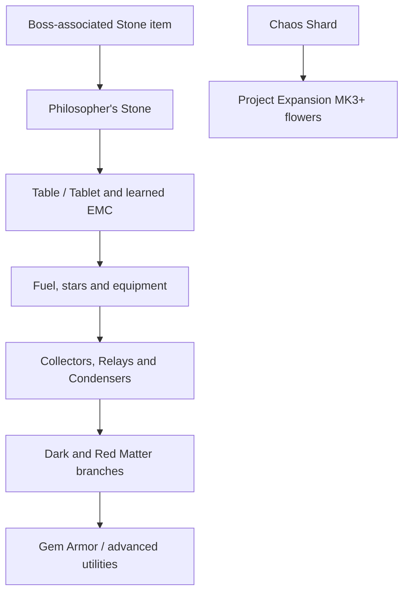

Warning: truncated output (original token count: 5831)
Total output lines: 95

# ProjectE — mechanics and gameplay profile

| Field | Value |
| --- | --- |
| Manifest ID / actual mod ID | `projecte` / `projecte` |
| Category / parent or addons | Magic progression / Project Expansion is a separate profile and mod |
| MC / loader / pack target | 1.21.1 / NeoForge / TMM integration snapshot `e6931c39af33cb9872cfd9b06f298501d3ab6f31` |
| Pinned version / artifact / hash | `ProjectE-1.21.1-PE1.1.0.jar` / packwiz SHA-1 `24fb5997727453a15e956522761a3f586e646c2a`; CurseForge file 6611984 |
| Source snapshot | [official ProjectE commit `6aea247f7056eea1521db3f0c73d656857b75423`](https://github.com/sinkillerj/ProjectE/tree/6aea247f7056eea1521db3f0c73d656857b75423), commit message `ProjectE-1.21.1-PE1.1.0`; release mapping established, pinned binary comparison not performed |
| Guide/documentation version gap | Source matches the selected Minecraft/mod version metadata. No in-mod manual/guide was identified in the examined registry and recipe sources; external wiki guidance is not verified against this build. |
| Profile status | researching |
| Evidence reached | Exact pack pin; source-matched release commit; source recipes, registries, EMC parsing, transmutation container, collectors, relays and condenser inspected; TMM gate design and chapter reviewed. Exact pinned JAR and client tests unavailable. |
| Reviewed | 2026-11-16 |
| Quest ownership | [ProjectE chapter](../../../config/ftbquests/quests/chapters/projecte.snbt) in Endgame; only a placeholder manual check is present. |

## Executive gameplay map

**What the player actually does:** ProjectE turns items with known EMC values into a player-held matter pool. The Philosopher's Stone provides reversible fuel/matter conversions and world transmutation; a Transmutation Table or portable Tablet lets the player learn eligible items, consume learned items for EMC, and create learned outputs by spending EMC. Collectors generate EMC from light or by consuming fuels, Relays move it and charge supported items, and Condensers consume it to make a selected target item. The rest of the content is a substantial equipment and utility branch: covalence repair, Alchemical Bags, fuel tiers, Klein Stars, Dark/Red Matter gear, rings, amulets, furnaces and Gem Armor. The mod has no single native research tree or boss progression; its craft recipes and player knowledge are the main progression surfaces. In TMM, the intended access gates are pack policy layered over that open-ended native economy.

**Why it matters in TMM:** EMC can replace repeated resource gathering with a learned-item economy, and its machines can automate value generation, storage, transfers and target-item production. The high-tier equipment and the ability to learn rare items can bypass other mods' resource and boss progression unless acquisition is deliberately constrained. The selected pack reserves the Chaos Guardian and ProjectE/Expansion as a late-game peak, but the current repository's recipe design is more specific: boss-associated trophies are alternatives for the Philosopher's Stone and a Chaos Shard begins the Project Expansion MK3 flower tier. These do not mean every ProjectE item is natively locked or that killing a boss grants a player entitlement.

**Quick start:** In the upstream release, use JEI to inspect both Philosopher's Stone recipes, obtain the center diamond plus the redstone/glowstone ring, and craft the reusable Stone. Use it to progress through its item-fuel recipes. Craft and open a Transmutation Table/Tablet, place an item with positive EMC in a learn/consume slot, then retrieve a learned item from the output ring after confirming its cost. The intended TMM early-game gate changes the Stone recipe to one of three boss-associated items, but this KubeJS implementation is not present on the current integration base. Do not assume the upstream diamond route has already been replaced.

### Player-value snapshot (a quick reference for quest designers)

| Five standout capabilities | Three genuinely early practical unlocks | Three candidate integrations |
| --- | --- | --- |
| 1. Learn/transmute EMC items; 2. Philosopher's Stone item and block transmutation; 3. Collector → Relay → Klein Star charging network; 4. Condenser target-item production; 5. Dark/Red Matter tools, rings, powered armor and Gem Armor. | TMM intends early ProjectE to wait for an approved magic boss-associated drop. After that gate: learn/convert an item with the Stone/Table; craft Covalence Dust for repair; build a manually fueled Collector/Relay pair. Native recipes and exact costs belong in JEI. | 1. Ars Nouveau Wilden Tribute, Botania Revived `life_essence`, or Neo Vitae `mine_key` as interchangeable Stone centers; 2. Draconic Evolution Chaos Shard for Project Expansion MK3+ flowers; 3. all-mod EMC valuation and conversion balance. These are policy/recipe candidates with source staged separately; live registry and client behavior remain unverified. |

### Subsystem coverage at a glance

| Subsystem / progression branch | Mechanics evidence | Progression completeness | In-game guide/JEI reference | Client validation | Blocker / next action |
| --- | --- | --- | --- | --- | --- |
| Philosopher's Stone and world transmutation | [PhilosophersStone.java and generated recipe provider at release SHA](https://github.com/sinkillerj/ProjectE/tree/6aea247f7056eea1521db3f0c73d656857b75423) | partial | JEI Stone recipes; Stone mode tooltip/keybind | not run | Compare the pack's effective recipe to current KubeJS integration source; verify which blocks can be converted. |
| EMC learning and Table/Tablet | `TransmutationContainer.java`, `TransmutationInventory.java`, item registry | partial | JEI for the two interfaces and recipes; GUI learning/output ring | not run | Map exact learn/consume rules, knowledge storage, table recipe, tablet recipe and player/team boundary. |
| Fuels, matter and Covalence | `PERecipeProvider.java`; generated fuel recipes | partial | JEI recipes/uses | not run | Reconcile native conversion recipes and item EMC against effective pack mappings. |
| Collector/Relay network | `EnumCollectorTier.java`, `EnumRelayTier.java`, respective block entities | partial | JEI; machine inventory/GUI; tooltips expose max rates when enabled | not run | Measure light/output/fuel and transfer paths; test automation sides and all modded items. |
| Condensers, Dark/Red Matter | `CondenserBlockEntity.java`, recipe provider | partial | JEI and Condenser target GUI | not run | Audit target locking, EMC acceptance and exact item make-rate; assess recipe gates. |
| Equipment, rings, bags, Klein Stars, Gem Armor | registry and recipe provider | partial | JEI recipes; item tooltips/controls | not run | Map every effect, activation, EMC draw and shared storage behavior for the pinned build. |
| TMM gate and current chapter | gate proposal, manifests, integration source registry, SNBT | incomplete | Current chapter has no real instructions; recipes are not in this base's KubeJS files | not run | Reconcile contradictory gate policy and test all recipe, EMC, trade, loot, and use bypasses before describing gate as enforced. |

## Guidebook onboarding — required before the player's first complex step

- **Guide name and access:** No ProjectE guidebook or Patchouli-style manual was located in the inspected release registry and recipe files. The functional references are JEI, item tooltips/keybind hints, and the Table/Tablet, Collector/Relay and Condenser interfaces. A player opens the Transmutation Table by using the block and opens the Transmutation Tablet by right-clicking it; source `TransmutationTablet.java` opens the container on the server. A key handler can also open an equipped Curios item implementing the tablet interface, but Curios slot availability is not a core requirement and should not be promised without confirming the pack integration.
- **Earliest attainable stage:** The native Stone is a shaped recipe with diamond in the center and redstone/glowstone dust in two orientations. The current TMM direction replaces that center with an item in `#tmm:philosophers_stone_boss_trophies`. The KubeJS tag/script is found on feature branch `feature/projecte-boss-trophy-stone-and-emc-audit`; it is absent from the current integration snapshot, so actual early eligibility is unresolved.
- **First instructional quest:** Teach the active gate honestly, show the actual Stone recipe by JEI, explain that the Stone is returned by crafting, then have the player learn one low-cost positive-EMC item in the Table/Tablet and create a known output. Task credit must distinguish learning/operation from merely owning the Stone or Tablet. XP and a safe covalence-repair supply are a reward direction, subject to the pack's reward rules.
- **Reference map:** JEI: Philosopher's Stone, Table, Tablet, fuels, Covalence Dust, Collector/Relay/Condenser, Klein Stars, matter and equipment recipes/uses. Stone tooltip plus keybind settings: mode controls. Collector/Relay GUI and stats: stored EMC, transfer/output, input fuel and item charge. Condenser GUI: target lock, stored/required EMC and output. Exact JEI category names, config defaults, advancement criteria and FTB predicates need in-client confirmation.
- **Where guide is insufficient:** JEI identifies recipes but not the economy model, conversion/learning distinctions, Collector sun test, Relay direction, condenser target workflow, controls, target-tier security, EMC exploit boundaries or TMM gates. Future quest text must teach those specific actions; external sources cannot be the only guide.
- **Other in-game help:** Client config can expose EMC and machine rate/storage tooltips; default value was not verified against the exact generated runtime config. The source generates recipe advancements based on inventory criteria for many crafts; these prove item possession, not successful machine operation.

## Systems and full mechanics inventory

| Subsystem | How accessed | Inputs + …831 tokens truncated…remaining EMC is sent to compatible acceptors | These are source formulas, not measured pack throughput. Shadows/sky and comparator behavior matter. Inspect Collector and fuel slots; automation has distinct sided handlers. |
| Relays MK1–MK3 | Place by EMC source/sink; open GUI; configure input/output/burn and charging slots | Relay cap/rate 64/100,000; 192/1,000,000; 640/10,000,000 EMC per tick/storage (tier values) | Move EMC to compatible acceptors or burn EMC into chargeable items; Collector can send relay bonus | Source code proves a ProjectE capability network, not FE/OP/Neo Vitae EV conversion. Adjacent blocks, loaded chunks and network throughput need client tests. |
| Condenser MK1/MK2 | Place, configure lock target through GUI, supply EMC | EMC-bearing input stacks and external EMC; target requires positive mapped EMC | Converts stored EMC into selected locked item, displaying stored/required amount | Automation allows input/output under lock-aware rules; output reuses the target slot. Target can be any valued item if eligible; item input must not match the target. Actual rate and tier differences remain to map. |
| Transmutation blocks and fuel/matter crafts | Stone, Table or standard crafting | Item-valued matter/fuel and dust inputs, Stone retained for fuel exchange | Converts fuels and makes Dark/Red Matter from specified previous matter and fuel | Recipe sources are explicit but tier progression is not a game-enforced gate. JEI recipe unlock advancements are inventory triggers rather than boss credit. |
| Equipment: Matter tools/armor | Craft with Dark then Red Matter; use item-specific controls | Matter plus vanilla diamond and predecessor equipment; charging values through Relay/Collector; exact draws not mapped | High-tier mining, combat, armor and powered actions; Red Matter Sword/Katar/Morning Star offer specialized attack/mining behavior | Tool tiers/behavior must be compared with ATM endgame benchmarks; this is not tested. TMM forbids competing Infinity gear, not ProjectE Gem Armor. |
| Rings and amulets | Craft and equip; selected rings can operate from a Dark Matter Pedestal | Ring-specific charge, EMC or cooldown; server config provides per-pedestal cooldowns | Examples include harvesting, projectile, fire/water, flight/teleport, healing, mob interaction and area effects; exact list/function families need full source audit | The Ring of the Seven Deadly Sins must not be enabled by any route; it is not a ProjectE item, but the pack explicitly forbids its normal acquisition. Feature-by-feature limits and cooldown behavior remain open. |
| Klein Stars | Shaped star recipes and sequential upgrades | First recipe uses eight Mobius Fuel around diamond; each tier increases stored EMC capacity; recipe may require a full lower-tier star | Portable EMC storage, and high-end full Omega Star participates in Tome/Gem Armor recipe variants | Exact tier capacities and filled-data component requirements need audit; a Tome of Knowledge recipe may require either full or ordinary Omega based on full-star config condition. |
| Alchemical Bags | Craft color variants and right-click to open | Colored bag inventory; same-color bags share inventory per player | Portable item storage; active Black Hole Band/Void Ring in a bag can suction eligible items via inventory provider | Not a generic pipe/logistics system. Number of slots, suction scope, Curios/Death recovery and the source hook for auto-pickup need audit. |
| Condenser target gear and Gem Armor | Condense selected targets; recipe upgrades Red Matter armor pieces | Gem piece recipe is shapeless and consumes matching Red Matter armor, one specified ring/amulet and one full Omega Klein Star when required by config | Gem Helmet/Chest/Leggings/Boots provide distinctive endgame armor abilities | Each slot requires a different high-tier ring and exact fully charged star state in the alternate recipe; source proves recipe inputs, not effect/cap/charge drain. |
| Other utilities | Recipe set includes Alchemical Chest, Matter Furnaces, Nova Catalyst/Cataclysm, pedestals, Divining Rod and more | Item-specific resources, EMC and operation costs | Storage, smelting, item attraction/interdiction, area breaking and combat effects | Full behavior list is not complete. Complete utility/effect inventory remains required before source-complete status. |

## Material / capability input-output contracts

| System | Input kind + exact ID/tag/event | Input qty/formula; consumed/remainder | Output kind, qty and location | Trigger/cadence; range/capacity | Automation/interface and evidence |
| --- | --- | --- | --- | --- | --- |
| Transmutation learning | ItemStack inserted into the Table/Tablet learn/consume slot; item must have EMC or be Tome of Knowledge | Source container consumes/sends the submitted stack to `handleKnowledge`; adds `sellValue × count` EMC. Knowledge is stored in player transmutation inventory. | Per-player knowledge and EMC balance | UI slot action, not passive collection; output ring provides mapped learned item | `TransmutationContainer.quickMoveStack`; exact NBT/component handling and target item learning event need detailed audit. |
| Transmutation output | Selected learned output and available EMC | Item EMC × requested quantity is removed from pool; output inserted to player inventory | Created item stack in player inventory | On slot pickup/quick-move; constrained by value and inventory room | Source container. Possession/transfer of an item is distinct from knowledge; tradeable items may be learned by recipient. |
| Collector light conversion | World block entity state and light; optional `projecte:collector_fuel` item or EMC-holder item | Each tick adds `tierCoefficient × sunLevel/320` partial EMC; fuel upgrades spend EMC equal to target EMC minus input EMC; fuel/charge item is consumed/charged | EMC stored, charge added to item, upgraded fuel result or emitted network EMC | Tick event; capacity/rate from tier enums; local brightness; coefficient `4/12/40`, storage `10k/30k/60k`; full-light factor 0.05 in source formula | Sided item capability separates input, output/upgrading and lock slots; source `CollectorMK1BlockEntity` at release SHA. |
| Relay transfer | ProjectE EMC capability from adjacent/supported blocks and `IItemEmcHolder` stack | Sends/receives no more than tier charge rate and available/needed EMC; relay bonus path uses fractional accumulator | Stored EMC in item or downstream accepting block | Tier cap/rate `64/192/640` EMC/t; stores `100k/1m/10m` EMC | Source `RelayMK1BlockEntity`; no FE inference. Network orientation and adjacency still need test. |
| Condenser | ProjectE EMC capability + item stack with positive sell value; selected lock target | Inputs with EMC add value to storage; when lock is set, `requiredEMC = target item value`; emits target when threshold is reached | Target item in output inventory | Tick loop; no output rate recorded yet | Source `CondenserBlockEntity`; sided automation inserts only valid valued items and extracts only locked output. |
| Stone fueled conversion | Native shaped recipe inputs: 4 lower fuel + `projecte:philosophers_stone`; reverse uses one higher fuel + Stone | Consumes fuels and retains Stone as crafting remainder | One higher fuel or four lower fuels | Crafting action | `PERecipeProvider.java`; no TMM runtime recipe claim. |
| Custom EMC | Server config JSON path `config/ProjectE/custom_emc.json`; keys encode item stacks/NSS | Non-negative long item value; configured entry overrides/feeds mapper source as implemented in full load path | EMC value visible to consumers and clients | Server config/reload path | `CustomEMCParser.java`; config alone is not full final map because native mappers and data processors also contribute. |

### Acquisition, renewability and output economics

- The Stone's normal recipe is deterministic and uses a diamond plus tagged redstone/glowstone dust. Recipe acquisition is only a craft gate; it is not personal boss-kill evidence. The current TMM boss-associated-center policy permits one of three material routes, including a Mine Key that can come from a dungeon trial-spawner in the source notes.
- Native Collector EMC generation is renewable through light, but the source formula depends on local raw brightness and the EMC cap. Fuel-based collectors turn positive EMC into higher fuel and relay surplus. Condensers are value sinks when inputs convert to target value; actual throughput and risk of positive loops need pack measurements.
- EMC mapping through normal recipes is not the full registry. TMM's declared goal is positive EMC for every item registered in the actual 1.21.1 game, excluding only the approved list of 17 cheap glass-pane IDs. The mapping audit requires same-build registry and post-mapping export; neither is present in this knowledge branch. The existing audit is explicitly `AUDIT_NOT_YET_RUN_AGAINST_FULL_GAME_REGISTRY`.
- Every positive value can enable both synthesis and duplication. Test least-cost loops through tags, recipe conversions, Fortune/Silk Touch, Mob Drops, boss items, Quest Shop sales, full/damaged/charged stacks, dynamic components and Project Expansion's huge tier values. No value assignment or exception list was changed here.

## Complete player progression / walkthrough blueprint

The pack's intended access ladder is policy-based, not native ProjectE progression. The current TMM recipe policy is documented below; it is source-staged outside this integration branch and is not client-accepted. Native release recipes remain available unless the staged integration is actually merged and effective.

| Path and step | Gate or choice? | Exact prerequisite / materials / world condition | Player actions: obtain, build, activate, use | Unlock / visible success / next step | In-game guide section or JEI reference | Proposed quest/how-to, detection and reward | Evidence / coverage |
| --- | --- | --- | --- | --- | --- | --- | --- |
| 0. Find current instructions | Required | ProjectE installed; no dedicated manual identified | Use JEI for recipes; inspect item tooltips; right-click Table/Tablet and machine GUIs | Understand the current recipe and machine controls | JEI recipes/uses, item tooltips, Table/Collector/Relay/Condenser screens | No-guide onboarding; open the UI and learn one inexpensive item. A crafted Table is not proof of learning. XP plus Covalence Dust after reward-safe review. | Partial; exact manual inventory and UI acceptance open |
| 1. Obtain Philosopher's Stone | Required by intended design | One of `ars_nouveau:wilden_tribute`, `botania:life_essence`, `neovitae:mine_key`; 8 existing ring dusts | Find one eligible boss-associated item, craft either original orientation with that center | Reusable Stone with three area modes: Cube, Panel and Line | JEI Stone recipes and Stone tooltip/keybind | Teach candidate ingredients and identify item route; detection must be recipe/advancement or manual, never infer a boss kill from the ingredient. | TMM recipe source staged on feature branch; not in current `test/full-integration` source |
| 2. Learn EMC and make output | Required | Table/Tablet and an EMC-positive item; one-time learn vs future resource | Open UI; insert learn item; inspect EMC; select known output and take a quantity | Player can retrieve learned items at EMC cost | JEI Table/Tablet recipe; transmutation GUI | Demonstrate operation; use GUI result or actual player knowledge detector if exposed. Item ownership is not operation evidence. | Container source proves basic actions; full knowledge persistence not audited |
| 3. Fuel and covalence utility | Optional utility | Stone plus vanilla coal and dust/item inputs | JEI follow Alchemical Coal/Mobius/Aeternalis conversions; craft covalence dust; repair eligible gear | Fuel ladder and repair materials | JEI fuel conversion and Covalence Repair | Teach a reversible fuel step and valid repair use; recipe output does not show the item was used. Reward repair supplies. | Partial; exact EMC values and repair formula open |
| 4. Manual Collector and Relay | Optional selected automation | Collector MK1, Relay MK1, fuel and sky/light exposure or EMC holder | Place Collector with useful brightness; feed allowed fuel; configure/use Relay; charge item or output EMC | Visible EMC accrues and transfers/charges | JEI machine recipes; Collector and Relay GUIs | Require an actual measured stored EMC or charge delta, not block acquisition. | Source coefficients/formula exact; placement and accepted blocks unknown |
| 5. Klein Star storage | Optional | Mobius Fuel and diamond; then prior stars and next-tier fuel | Craft base star and use JEI upgrades; fill/store target values | Portable EMC storage up through Omega | JEI stars and fully charged item recipe | Verify charge amount and upgrade operation; crafted-star possession alone is weak. | Partial; tier capacities and item state checks open |
| 6. Condenser automation | Optional selected machine branch | Alchemical Chest, Condenser, target item with positive EMC and input items with EMC | Craft Condenser, set lock target, feed EMC-bearing items, observe bar and output | Target item is generated from stored EMC | JEI Condenser recipe; Condenser GUI lock guide | Teach output and threshold; detector should verify output/operation, not just Condenser possession. | Source logic reviewed; throughput/target boundary test open |
| 7. Dark Matter branch | Optional gear/machine tier | Dark Matter, EMC, vanilla inputs | Use JEI for Dark Matter recipes; choose tools/armor/furnace and Dark Matter pedestal; use Klein stars | High-tier abilities and upgrades become available | JEI Dark Matter recipes/uses, gear tooltips | Representative equipment/use quest, optional branches; reward safe thematic tools. | Recipe provider partial; all effect behavior open |
| 8. Red Matter branch | Optional tier after Dark | Red Matter; Dark Matter predecessor where applicable | Use JEI for Red Matter, tools/armor, MK3 Collector/Relay and advanced equipment | Highest ordinary matter tier; project Expansion and Gem Armor inputs | JEI Red Matter/recipe pages and item tooltips | Teach one genuine Red Matter operation; ownership criteria must not claim full mastery. | Recipe provider partial; current TMM access gate unresolved |
| 9. Rings, fuel, utility and bag branches | Optional choices | Branch-specific recipes, Stone, EMC, combat/mining resources | Select useful ring/amulet/tool; test active state/cooldown; configure Alchemical Bag suction only where supported | Special movement/combat/resource/storage capabilities | JEI and tooltips/controls | Teach representative chosen utility and disclose costs; not every ring should be mandatory. | Major full effects inventory remains open |
| 10. Gem Armor / terminal PE gear | Optional late-game capstone | Matching Red Matter armor piece, specified ring/amulet, fully charged Omega Klein Star or config variant | Craft one Gem Armor slot and confirm active effects/charge | Endgame ProjectE equipment | JEI Gem armor recipe; item UI/tooltips | Separate craft and behavior validation. Safe reward is XP only or a lower supporting material, never another restricted armor item. | Inputs source-mapped; effect values and gate not audited |
| 11. Project Expansion cross-link | Separate mod and chapter | MK1/MK2 early branch per policy; Chaos Shard for MK3+ target recipes | Use Expansion's own guide/JEI for Collector/EMC link/Relay flowers and upgrades; test Matter Upgrader bypass | Power Flower progression | Project Expansion JEI plus mod guide, to be researched separately | ProjectE chapter should cross-link the Expansion chapter; do not imply it is native PE content. | `project-expansion` still queued; gate bypass unknown |
| 12. EMC coverage completion | Pack-wide, not a player quest tier | Full game item registry and final EMC mapper export | Census items, set manual values for legitimate misses, enforce policy exceptions, rerun loop audit | No missing EMC entries except listed panes and no exploit cycles | Admin/report tooling, not player guide | Build validation only; a player quest is inappropriate. | Current manifest explicitly not yet audited against full registry |

### Dependency graph and alternate routes

This is the **desired pack teaching graph**, not an already enforced game progression. The Stone policy is a material recipe with three alternatives, which allows a player to trade a boss-associated item and does not imply kill entitlement. A separate `manifest/progression-gates.json` still describes starter unlocks after a Gaia Guardian I **or** Foreman personal-boss event and advanced systems after the Chaos Guardian; it calls the decision pending and runtime enforcement `NOT_IMPLEMENTED`. Those older unlock semantics conflict with the current owner-approved recipe policy in `docs/DESIGN.md` and `docs/PROJECTE-TIERED-GATING-PROPOSAL.md`. Resolve that policy record before a quest author uses either as current. The latter also says Chaos Shard is needed for direct MK3+ flowers and the MK3 upgrade, not a universal lock on all ProjectE content.

### Structures, rituals, automation and other how-to instructions

| Required setup | Placement/shape/activation and operating inputs | Guidebook page/JEI category to cite by name | Failure symptoms, throughput or maintenance | Quest where taught |
| --- | --- | --- | --- | --- |
| Transmutation Table/Tablet | Table block: right-click; Tablet: hold and right-click. Use learn input, consume input, lock/unlearn and EMC output slots. | JEI Table/Tablet recipes; Transmutation GUI | Item has no positive EMC, item is not learned, insufficient EMC or no inventory room. Exact item component and unlearn details open. | Learn and create one item |
| Collector sunlight/fuel | Place Collector with a clear brightness path; feed fuel/chargeable item in the designated GUI slot; optionally supply upgrade/lock; connect accepting network. | JEI Collector; Collector GUI and rate tooltip | Low brightness scales rate down; full EMC halts generation; wrong item or incompatible side automation. | Measure EMC or item charge increase |
| Relay network | Place/configure relay and connect compatible EMC source and receiver; insert chargeable target if using item charging. | JEI Relay; Relay GUI/rate tooltip | Wrong input/output orientation or incompatible capability; rate capped at the relay tier. | Charge/output exercise |
| Condenser | Place Condenser, select/lock target, add EMC-bearing item stacks and EMC network. | JEI Condenser; target-lock GUI | No target value, no incoming EMC, same-as-target input rejected, target not yet funded. | Produce selected output |
| Pedestal/ring operations | Place Pedestal and interact with a valid ring, then test exact effect and cooldown. | JEI Pedestal/ring recipes and ring tooltip | Cooldown config may disable/reduce effects; required ring state/input can fail; detailed coverage absent. | Optional representative ring branch |
| Project Expansion Power Flowers | System belongs to Expansion; require collector/link/relay blocks and valid flower tier. | Expansion guide/JEI | Native EMC item conversion through Matter Upgrader can avoid recipes; failure/availability unknown. | Separate Expansion chapter |

## Advanced and terminal objectives

- **Normal completion:** Learn and spend EMC, build at least one selected production branch, and understand how the chosen utility/equipment capability operates. The source mod is broad/open-ended rather than a single finite boss tree.
- **Optional completion:** Construct a Condenser/Collector/Relay network, progress through Dark/Red Matter and Klein Stars, then craft/use selected ring or Gem Armor branches. Expansion's Power Flowers are a separate system.
- **Remaining progression blockers:** Exact pinned JAR unavailable; comprehensive item/effect inventory; full Stone conversion table; transmutation knowledge persistence/unlearn and recipe costs; full EMC mapper values and config; exact machine transfer behavior; automation boundaries; complete ring/matter item use and Gem Armor caps; TMM gate conflict and runtime bypasses.
- **Quest coverage check:** The current chapter is a placeholder check. No guidebook onboarding, transmutation how-to, operating machine walkthrough, equipment branch coverage or truthful operation detection is implemented. No quest edits were made.

## Internal combinations and overlooked mechanics

| Internal combination | Full chain | Benefit | Limitation / exploit potential | Evidence |
| --- | --- | --- | --- | --- |
| Sunlight Collector plus Relay | Sunlight → Collector EMC → Relay → chargeable item or acceptor | Passive renewable EMC without consuming fuel | Light, collector cap and network rate limit; no free resource unless EMC mapper/source economics permit it | `CollectorMK1BlockEntity.java`, `RelayMK1BlockEntity.java`, tier enums |
| Fuel automation | Collector consumes tagged fuels → EMC funds upgrade difference → higher fuel output | Turns EMC into denser fuel / fuels collector network | Check source `FuelMapper` progression and actual EMC values; lock stack can set upgrade target. Reversible fuel recipes require non-profitable EMC arithmetic. | `CollectorMK1BlockEntity.java`, `FuelMapper.java`, recipe provider |
| Relay to Klein Star | Collector produces EMC → Relay accepts portable chargeable item → Klein Star | Portable storage while collector network runs | Separate charge rate/storage, item values and pass-through; the ability does not prove the star's knowledge balance is team-wide. | `RelayMK1BlockEntity.java`, Klein Star recipes |
| Condenser feedback | EMC-bearing item inputs → target lock → output items → learn/sell back into EMC | Automated bulk production | Positive cycle if returned output EMC exceeds inputs; exact target and stacks must be tested from post-mapping final EMC. | `CondenserBlockEntity.java` |
| Player learning as gate bypass | acquire item by trade/loot/shop → learn to transmute → synthesize future copies | Intended convenience and alternative-material access | Boss associated recipe ingredient stops being scarce after learning; players can also trade it. This is consistent with one-time recipe gate intent but not personal-kill enforcement. | TMM policy docs and TransmutationContainer |
| Power Flower bypass | Recipe gate → Matter Upgrader/EMC knowledge conversion | Endgame flowers can potentially be placed/upgraded without crafting the recipe | Proposal explicitly marks this bypass unclosed; may defeat the Chaos Shard milestone. | Project Expansion `ItemMatterUpgrader` follow-up is queued/open |
| Creative or quest bypass | admin grants/quest reward/loot/trade → EMC learning or direct equipment | Useful for administration/testing | Any normal reward/loot can move gated items earlier; negative path test needed. | TMM progression docs; no implementation claim |

## Low-hanging setups useful in ordinary survival

### 1. Player-operated transmutation — post-Stone gate

- **Goal and payoff:** Convert a finite newly acquired stack into EMC and create another already learned item.
- **Minimum entry and ingredients:** Active Stone access, Table/Tablet recipe and one positive-value resource; actual TMM gated route remains unresolved.
- **Build/use steps:** 1. Open the Table/Tablet. 2. Place a positive EMC item in the learn/consume area. 3. Confirm the item appears as known and EMC rises. 4. Select an affordable known item from the output ring and collect it.
- **Sustainability and limits:** One consumed input stack supplies a fixed EMC balance; further output requires more value. Learned rare items can be duplicated later, so high-tier boss drops must be treated as one-time recipe ingredients, not ongoing kill proof.
- **Evidence / pack test:** Source container supports learn/sell and buy/remove EMC; no client or active gate test performed.

### 2. Light Collector plus Relay — early machine network after access

- **Goal and payoff:** Turn a light source into a small renewable EMC stream and use it to charge an item or send EMC downstream.
- **Minimum entry and ingredients:** MK1 Collector, MK1 Relay and a chargeable target; Collector recipe itself requires a diamond storage block, so this is not a literal first-hour setup.
- **Build/use steps:** 1. Craft the Collector and Relay with JEI. 2. Place the Collector where its top block receives light. 3. Inspect stored EMC. 4. Configure a Relay/input or charge item. 5. Observe the EMC/charge change.
- **Sustainability and limits:** Brightness scales output; at full source brightness the formula caps the MK1 coefficient at 0.2 EMC/tick; full storage stops generation; Relay rate caps transfer. Actual throughput depends on light and recipient capability.
- **Evidence / pack test:** Source provides formula and caps; no measured output.

### 3. Locked Condenser for a repeatable building material — midgame

- **Goal and payoff:** Spend otherwise idle EMC value to produce one chosen item over time.
- **Minimum entry and ingredients:** Alchemical Chest, Condenser, target with positive EMC and a sustainable input stream.
- **Build/use steps:** 1. Craft Condenser through JEI. 2. Set a lock target in its GUI. 3. Feed EMC-positive items. 4. Watch stored/required EMC and collect the target output.
- **Sustainability and limits:** Target value determines the amount needed; if output can be recirculated into higher EMC, a profitable loop may exist. Measure full cycle and inspect stack/data components first.
- **Evidence / pack test:** Source confirms target lock, EMC acceptance and output slots; rate and boundary behavior not tested.

## API, integration and pack-config surfaces

| Hook or customization surface | Namespace / exact file, API or serializer | Capabilities / constraints | Current TMM override? | Evidence |
| --- | --- | --- | --- | --- |
| Recipes | Vanilla data recipes, ProjectE serializer; native paths `data/projecte/recipe/*.json`; KubeJS `ServerEvents.recipes` | Can replace Stone recipe and adjust Expansion recipes; item registry IDs and recipe IDs must be live-confirmed | No gate script in current integration snapshot. Exact script and tag exist on feature branch, not merged | `PERecipeProvider.java`; branch file `projecte_boss_stone_and_powerflowers.js` |
| EMC data | `config/ProjectE/custom_emc.json` with codec keys through `NSSItem` | Assigns non-negative `long`; must inspect native mapper precedence/output and final exported map | Coverage policy exists conceptually, but the canonical policy file is not in current integration snapshot | `CustomEMCParser.java`; `manifest/emc-coverage-policy.json` on feature branch |
| EMC mapper API | `IEMCProxy`, `IEMCMapper`, `IDataComponentProcessor`, NSS codecs | Other mods can supply EMC values or normalize item data; every integration changes the economy | Unknown current runtime mapper roster; need same-build server dump | `MappingConfig.java`, release source |
| Player knowledge and currency | `TransmutationContainer`, `TransmutationInventory`, player capability | Knowledge and balance are per player unless capabilities prove otherwise; server authority mediates operation | No custom player/team entitlement known | Source container; player storage investigation open |
| Machine item I/O | NeoForge `IItemHandler` capabilities on Collector, Relay, Condenser, bags | Sided input/output and slot predicates define automation; not generic pipe routing | No pack side automation changes identified in current checkout | Block entity sources at release SHA |
| World transmutation | ProjectE mode functions and `WorldTransmutationManager` | Configurable block conversion and world impacts; exact mappings/range and claim protection require audit | No TMM override identified | `PhilosophersStone.java`; conversion tags/resources still to inspect |
| TMM gate proposal | `docs/PROJECTE-TIERED-GATING-PROPOSAL.md`, `manifest/progression-gates.json`, feature branch | Current owner recipe policy and old progression manifest do not say the same thing; choose one before implementation | Source is staged on separate feature branch; not present in base integration | Pack docs/manifest; no gate claim made |
| EMC census | `scripts/audit_emc_coverage.py` and policy on feature branch | Requires actual item registry and post-mapping EMC exports; then a strict positive-value audit except 17 pane IDs | Not yet run on full runtime registry | Policy states `AUDIT_NOT_YET_RUN_AGAINST_FULL_GAME_REGISTRY` |

## Compatibility leads

| Other mod | Candidate link and why | Native / pack-built / would require bridge | Status / source |
| --- | --- | --- | --- |
| Project Expansion | Power Flowers, EMC links, Matter Upgrader and Gem Armor / other EMC consumers | Separate mod; native integration expected; staged recipe policy adds Chaos Shard to direct MK3+ flower craft and MK3 upgrade | Candidate/open; own profile needed; Matter Upgrader and EMC learning bypass audit outstanding |
| Draconic Evolution | Chaos Shard is the desired MK3+ Power Flower milestone; both ProjectE and DE have EMC/power-sensitive items | KubeJS recipe source staged; no special DE→EMC bridge is proved | Recipe policy candidate only; Chaos Guardian workflow profile merged, no gate test |
| Ars Nouveau | Wilden Tribute is one eligible Philosopher's Stone center | Pack-built shaped recipe item alternative | Candidate source design; live item registry and quest/drop boundaries untested |
| Botania Revived | Gaia Guardian's `botania:life_essence` is one eligible Stone center | Pack-built shaped recipe item alternative | Candidate source design; exact name intentionally differs from colloquial Gaia Spirit |
| Neo Vitae | `neovitae:mine_key` is one eligible Stone center; its separate trial-spawner route can weaken a boss-kill interpretation | Pack-built shaped recipe item alternative; no EMC-transfer bridge to EV is shown | Candidate source design; Mine Key provenance is not an event/kill check |
| Quest Shop | EMC-generated items could become sale currency; currency can feed back into material buying if rules permit | Indirect economy loop, not native bridge | Must be measured after ProjectE unlock; fixed reward policy still applies |
| Neo Vitae EV / Draconic OP | Three named numeric resources coexist with ProjectE EMC | No shared conversion proven | Treat EMC, OP/FE and EV as separate typed channels until tested |

## Quest and teaching opportunities (research, not actual quests)

| Stage and teaching goal | Actionable in-game instructions (prerequisites → steps → result) | Named guidebook section or JEI recipe | Intended behavior vs truthful FTB detector / fallback | Useful XP + fixed reward direction | Coverage and gating risk |
| --- | --- | --- | --- | --- | --- |
| First gate and guide | Find one approved boss-associated item; use JEI to craft Stone; open its mode and GUI controls | Stone recipe, Table/Tablet recipes, Stone tooltip/keybind | Item/recipe predicate can prove acquisition/craft only. Does not prove kill or successful EMC operation. Use actual advancement/event if confirmed, otherwise manual read/check | XP + Covalence Dust or low-stage repair material | Existing quest is placeholder; current KubeJS gate absent in base |
| Learn and transmute | Submit one positive EMC item, inspect balance/knowledge, choose a known affordable output and collect it | Transmutation GUI | Need actual knowledge/EMC event; item check is only proxy. Audit task integration before selecting predicate | XP + safe small value item, no gated trophy | Must not treat transferred boss ingredient as personal victory |
| Collector/Relay work | Place machine under light, observe stored EMC, send/charge into an accepted receiver | Collector/Relay JEI and GUIs | Check EMC or charge state delta; owning blocks is not operation | XP + useful basic fuel | Base no branch quest; rate and direction untested |
| Condenser use | Set target lock, feed valued items, wait for and retrieve target | Condenser JEI and GUI | Check output and input operation; machine item alone is proxy | XP + unrelated safe building input | Check profitable EMC cycles |
| Chosen equipment branch | Craft one Dark/Red tool, ring, Matter Armor or utility; activate and demonstrate its actual effect | Exact JEI recipe plus item tooltip/controls | Recipe detector proves craft; effect needs test/manual or custom predicate | XP + matching safe utility | Many items/effects not source-mapped |
| Gem Armor capstone | Assemble matched armor, ring/amulet and fully charged Omega Star; activate and verify behavior | Gem Armor recipe and piece interface | Craft and ability operation are separate events; must not reward restricted items as grant | XP, later-stage utility only | Native recipe source seen; balance/cap not measured |
| EMC audit (builder, not player) | Export full item registry + final mapped EMC; enforce policy and run conversion-loop checks | Admin audit report | CI/build artifact; no FTB chapter task | No player reward | Universe coverage not yet run |

## Existing chapter / pilot reconciliation

| Walkthrough stage | Current quest ID/title and status | Intended action vs actual detector | Named in-game guide/JEI reference | Gap / next action |
| --- | --- | --- | --- | --- |
| Stone, guide access and first Table operation | `config/ftbquests/quests/chapters/projecte.snbt`: single optional manual check, 2 quest XP and paper | Manual task cannot detect Stone, learning, EMC or output | No instructions currently present | Rewrite only in a separate quest task; task was not edited here |
| Fuels, automation, gears and alternatives | No lesson entries found in current chapter file | No detector or behavior claim | None | Map real tasks/rewards after source and gate validation |
| Expansion/Chaos Shard | Belongs in separate Project Expansion chapter; no ProjectE cross-link content currently | Not detected | None | Expansion full profile and Matter Upgrader test needed |

## Conflicts, limitations and version drift

- Exact pinned JAR was not present in the workspace. The upstream release commit declares the pinned 1.21.1 version, but does not establish binary equivalence or prove the exact pack runtime mappings.
- `docs/DESIGN.md` and `docs/PROJECTE-TIERED-GATING-PROPOSAL.md` describe a material recipe gate: three eligible Stone-center item alternatives, then Chaos Shard at Expansion's Red MK3 direct/upgrade recipes. The older `manifest/progression-gates.json` instead describes boss-event entitlements (starter after Gaia Guardian I **or** Foreman, advanced PE after Chaos Guardian) and says runtime is not implemented. `docs/PROGRESSION.md` also retains older all-post-Chaos language after an updated-policy note. These records conflict; current implementation must not inherit the older personal-kill model silently.
- The policy chooses a Mine Key as one Stone alternative, but source notes say a mine trial-spawner can yield it. A consumed item proves provenance of the ingredient, not the player defeating the Foreman. This is compatible with the recipe-only design if explicit.
- The gate script and item tag are available on `feature/projecte-boss-trophy-stone-and-emc-audit`; they are not in the current `test/full-integration` KubeJS tree, so don't describe the proposed recipe changes as active. The full EMC audit policy is likewise source-only/not run against the full game registry.
- Project Expansion Matter Upgrader may change placed structures without invoking recipes; knowledge/EMC may learn or recreate boss-related inputs. Recipe gates alone cannot prove that a system or item is globally unavailable.
- Conversion network types remain unconnected until proven: ProjectE EMC is its own item-value pool. DE's OP (often described alongside FE) and Neo Vitae EV are different channels.

## Evidence ledger

| Claim / section | Source URL or exact inspected `file:path` + immutable SHA | Evidence tag / version of source | Pack version gap / what it proves / remaining limits |
| --- | --- | --- | --- |
| PE-001 Pin and release identity | `mods/projecte.pw.toml`; CurseForge file 6611984; SHA-1 `24fb5997727453a15e956522761a3f586e646c2a` | [pin]; official [CurseForge file](https://www.curseforge.com/minecraft/mc-mods/projecte/files/6611984) | Exact selected file metadata and official release listing for MC 1.21.1 NeoForge; binary bytes not inspected. |
| PE-002 Upstream snapshot | [release commit `6aea247f7056eea1521db3f0c73d656857b75423`](https://github.com/sinkillerj/ProjectE/commit/6aea247f7056eea1521db3f0c73d656857b75423) | [source]; upstream commit message names exact PE1.1.0 artifact/version | Version-aligned release source; not hash-to-binary validation. |
| PE-003 Stone, fuel and recipes | `src/main/java/moze_intel/projecte/gameObjs/items/PhilosophersStone.java`; `src/datagen/java/moze_intel/projecte/common/recipe/PERecipeProvider.java`; generated Stone recipe data at PE-002 | [source] | Proves recipe provider, item remainder and mode surface; target conversion map and active TMM override unverified. |
| PE-004 EMC parser and API | `src/main/java/moze_intel/projecte/config/CustomEMCParser.java`; `MappingConfig.java`; `api/mapper/IEMCMapper.java` at PE-002 | [source] | Proves non-negative EMC schema and mapper-config surface; effective loaded mapping is absent. |
| PE-005 Collector/Relay/Condenser | `gameObjs/EnumCollectorTier.java`; `EnumRelayTier.java`; `block_entities/CollectorMK1BlockEntity.java`; `RelayMK1BlockEntity.java`; `CondenserBlockEntity.java` at PE-002 | [source] | Proves listed tier caps/formula/slot acceptance paths; no measured runtime throughput or cross-mod capability tests. |
| PE-006 TMM recipe gate candidate | `kubejs/server_scripts/projecte_boss_stone_and_powerflowers.js`, `kubejs/data/tmm/tags/item/philosophers_stone_boss_trophies.json` at branch [`feature/projecte-boss-trophy-stone-and-emc-audit`](https://github.com/heatwaveqc/Too-Much-Magic-Modpack/tree/feature/projecte-boss-trophy-stone-and-emc-audit) | [pack-source]; not merged into current integration | Proves staged recipe code and tag contents only; does not prove loaded recipe removal, tag resolution, player kill or operational gate. |
| PE-007 EMC completeness goal | `manifest/emc-coverage-policy.json`; `scripts/audit_emc_coverage.py` on feature branch | [pack-source]; explicit audit-not-run status | Shows desired full-registry policy and test method; no actual full-registry values/report. |
| PE-008 Gate/quest records | `docs/PROJECTE-TIERED-GATING-PROPOSAL.md`; `docs/DESIGN.md`; `manifest/progression-gates.json`; `manifest/integration-sources.json`; chapter SNBT at integration SHA `e6931c39af33cb9872cfd9b06f298501d3ab6f31` | [pack-file] | Confirms placeholder and design mismatch; source records do not establish runtime enforcement. |

## Disposable-world test plan

| Test | Positive/boundary case and disposable-world setup | Expected observable result (actual mechanic AND quest credit separately) | Performed? / evidence |
| --- | --- | --- | --- |
| Artifact/release and recipe export | Install the exact CurseForge file, verify packwiz hash; export recipes/mappings | Confirm `projecte:philosophers_stone`, `philosophers_stone_alt`, table, fuel and machine recipes; compare with commit `6aea…` | not run — exact JAR unavailable |
| Stone gate | Try both orientations with each of the three accepted item IDs; compare diamond center and rejected ordinary diamond; verify one center consumed | Correct accepted recipe yields Stone; ordinary diamond denied only if intended KubeJS changes load; FTB criterion separately tested | not run — staged KubeJS absent from current integration |
| Learn / EMC output | Learn one item, relog, open second interface, create one item within balance and attempt one just above balance; trade learned item between players | Balance decreases by output EMC; knowledge/pool persistence and per-player boundary observed; item receipt distinct from quest credit | not run |
| Collector lighting | MK1 in raw brightness 0, partial and full; Nether/ultra-warm and blocked-sky boundary; empty/full capacity | Source formula predicts scaling; measure actual EMC/tick and GUI value; verify no generation past storage | not run |
| Relay direction and item charging | Put collector/source and EMC holder on both sides; test tiers and zero/near-capacity item | Correct transfer/charge respects tier caps and operation; no guessed FE transfer | not run |
| Condenser target | Positive-EMC input and valid target; zero-value target and input identical to locked target as boundaries | Valid target fills; invalid/locked-as-input rejected; output count equals exact paid value. Monitor actual rate | not run |
| Conversion loop/EMC positivity | Dust/fuel/block conversions, Collector fuel upgrade/reverse recipe, Condenser cycles, reversible item recipes | No positive net EMC cycle; record every consumed item and value in final map | not run — policy has no game export |
| Gate progression bypass | Before gate: JEI craft, Table learning, command excluded, loot/shop/trade, Matter Upgrader, direct MK3 recipe and upgrade; repeat after correct Shard | Only intended routes denied/allowed; separate recipe visibility, item use, EMC knowledge, and FTB credit | not run — gate policy unsettled |
| Expansion cross-mod and BigInteger boundary | Test every tier path, direct recipe and Matter Upgrader; map high-value tiers at limits | Valid progression works; no Matter Upgrader/EMC bypass; no zero/overflow values | not run — Expansion profile queued |
| Quest detector | Craft Stone, learn item, make output, operate machine with detector enabled/disabled, second player | Each task records exactly the taught action; possession proxies visibly labeled; team/personal reward behavior verified | not run — placeholder only |

## Unknowns and next research

- [ ] Inspect exact pinned JAR at SHA-1 `24fb5997727453a15e956522761a3f586e646c2a` and reconcile release-source files.
- [ ] Finish full player-usable content inventory: every ring/amulet, mode and world transmutation; Nova devices; armor/tools; bag storage; Klein Star capacities; gear charging and equipment effects.
- [ ] Map full Table recipe and learning/unlearning semantics, per-player data persistence, item-stack component normalization, and portable Tablet controls.
- [ ] Export native item recipes/EMC mapper output and same-build full registry; run the policy audit; map each manual override back to trusted item provenance.
- [ ] Reconcile `manifest/progression-gates.json` with the current owner-approved recipe policy and remove stale interpretation in the authoritative progression documents during a separately scoped documentation fix.
- [ ] Complete Project Expansion source/profile work, especially Matter Upgrader and EMC bypasses.
- [ ] Client test all meaningful tasks and integration boundaries before marking source-complete or verified-in-pack.

## Revision notes

- 2026-11-16 — Added source-backed PE1.1.0 mechanics and TMM gate reconciliation. Exact pinned JAR, effective EMC values, full item-effect inventory and gameplay remain open; no quest/runtime edits.
