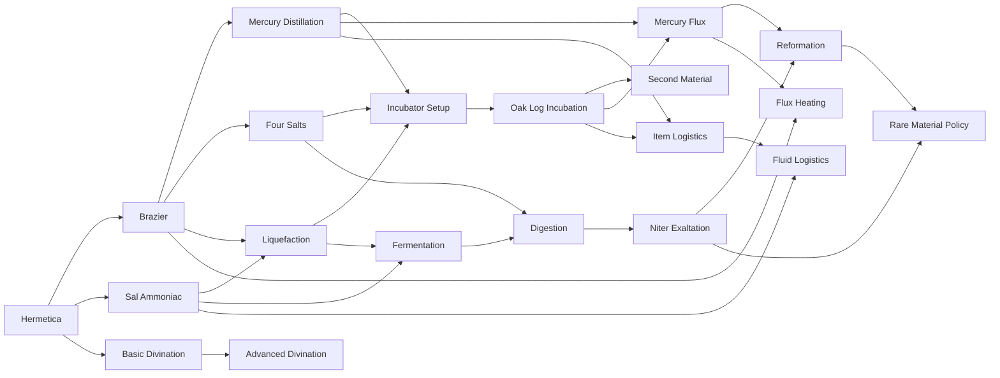

# Theurgy — Atlas-to-FTB Quest pilot

> **2026-11-22 second layout pass (reviewed source PR):** The 20 Theurgy nodes were subsequently brought into the `test/full-integration` source tree; the original opening paragraph below describes the **historical initial isolated pilot**, not the current source state. A new graph-first layout revision repositions all 20 nodes, preserves all IDs and rewards, and eliminates six transitively redundant connector arrows **without changing effective prerequisites**. Type-A geometry targets: dependency crossings **12 → 1**, total direct connector length **247.53 → 138.39** FTB coordinate units, longest connector **24.70 → 14.42**, **no lines through other nodes or positioned artwork**. Panels are relocated to frame each lane. The installed Packwiz hashes and generated SNBT are updated on the layout PR; actual in-client legibility and detailed mechanics are **not** certified by source checks. See [layout second pass](LAYOUT-SECOND-PASS-2026-11-22.md).

**Workstream:** 2026-11-22 owner request to build the first TMM chapter using the v3 presentation rules. **Status:** isolated authoring candidate; not merged into canonical quest manifest, not packaged into Packwiz, not game-tested, and not a claim that original image PNGs are already shipped.

**Dependency:** [Quest Presentation Standard v3, PR #489](https://github.com/heatwaveqc/Too-Much-Magic-Modpack/pull/489); factual basis [Mod Capability Atlas, PR #411](https://github.com/heatwaveqc/Too-Much-Magic-Modpack/pull/411), specifically `docs/mod-capabilities/mods/theurgy-quest-map.md` and the Theurgy source dossier. Pinned Theurgy target 1.79.0, with tagged-source recipe verification and remaining JAR/effective loaded-registry uncertainty disclosed in the Atlas.

## Result

- **20 authored lesson nodes:** nine **main** (`TH-00…08`) teaching Hermetica -> Pyromantic heat -> Mercury/Salt/Sal Ammoniac -> source-specific Sulfur -> three-vessel Incubator -> first Oak Log -> second material loop; eleven **optional** (`TH-09…19`) teaching Niter/Exaltation, Mercury Flux/Reformation, Divination Rod, alternate heat, independent item/fluid logistics, and post-first-acquisition rare materials.
- **Graph:** left-to-right, with early branching to parallel starting material stations, recombination at the Incubator, separate optional Niter, Divination and Logistics lanes, a protected high-tier Reformation route. No false compulsory path through side systems.
- **Icons:** chosen per objective, generally the actual machine, rod or resulting item, never generic enchanted books. The manual first chapter guide uses a normal Book (real Hermetica crafting component), not a fictional item registry key.
- **Visual hierarchy:** enlarged gear at orientation; prominent hexagons at first functioning Incubator and material-loop achievements; octagonal advanced capstone; restrained ordinary square nodes elsewhere.
- **Original artwork:** five themed procedural alchemical panels, created by `scripts/build_theurgy_quest_art.py`, not lifted from ATM10's `atm:textures/questpics/` paths. They are original copper/mercury linework with vessels, Niter, reformation pedestals, and routing.
- **Task integrity:** fifteen item-possession objectives and five honest manual confirmations. Item possession alone does not verify machine operation. Each node's prose names the actual process and distinguishes source-default quantities from installed-runtime confirmation.
- **Rewards:** every node has positive XP plus ordinary, low-value thematic items; no free target materials, boss drops, rare Niter, advanced Theurgy machines, EMC bypass or permission-changing command reward. Exact FTB IDs are persistent; the preexisting **Theurgy chapter ID, overview quest ID, task ID, XP reward ID, paper reward ID and 2 XP/1 Paper payout** survive and become the Hermetica orientation.

## Graph overview



## Authored files

- `manifest/theurgy_quest_pilot.json`: exact original descriptions, requirements, logical lesson refs, source scope, icon choices, line/shape/size intent, reward direction and stable positions.
- `scripts/build_theurgy_quest_pilot.py`: validates the data graph, ID format/range, icon presence, reward-item conflicts and stable overview; deterministically regenerates three **staged**, not live, outputs.
- `docs/quest-pilots/theurgy/generated/theurgy.snbt`: reviewable candidate FTB chapter.
- `docs/quest-pilots/theurgy/generated/lang_fragment.snbt`: English keys/description fragments; **not** an entire `en_us.snbt` replacement.
- `docs/quest-pilots/theurgy/generated/quest_id_map.json`: immutable new and preserved quest/task/reward IDs.
- `scripts/build_theurgy_quest_art.py`: creates five original PNGs in `docs/quest-pilots/theurgy/generated/assets/` until the integration owner checks and installs them.

Regenerate/check locally:

```bash
python scripts/build_theurgy_quest_pilot.py --check
python scripts/build_theurgy_quest_pilot.py --write
python scripts/build_theurgy_quest_art.py
```

## Integration boundary — important

**Do not merge the staged SNBT or localized fragment by blind copy.** The current `scripts/rebuild_quest_ui.py` assumes **240 total quests / 201 authored**, determines authored names from `manifest/quest_content.json` and `manifest/quest_content_resolved.json`, and would relabel unrecognized Theurgy nodes as `Chapter Overview` and reset their coordinates. `scripts/validate_quests.py` additionally enforces strict chapter/task counts. The integration writer must:

1. Reconcile the live integration source lock and existing quest streams/PRs, especially Ars compact layout PR #395 / issue #310. Preserve stable Theurgy chapter/overview IDs and per-player claim behavior.
2. Merge **20** authored records into canonical source manifests, including the previously un-authored Theurgy overview. Add stable IDs from `quest_id_map.json` and all expected dependencies; adjust the generator to treat the pilot manifest as an authored source and honor every position, icon, shape and image. Avoid manually maintaining conflicting copies.
3. Add the validated visual PNGs to the actual client resource path `kubejs/assets/tmm/textures/questpics/theurgy/`, reconcile exact resource namespace resolution, and merge the candidate chapter + localization into the single `config/ftbquests/quests/lang/en_us.snbt` using 1.21.1 format.
4. Update the validator's hardcoded counts, quest uniqueness/shortcuts checks and artifact manifest. Preserve the original Theurgy 2 XP + Paper claim and UUIDs. Rebuild the authoritative Packwiz hashes with the approved build script. Make rebuilds idempotent and check the declared resource paths exist.
5. Pass lightweight Repository CI/Integration Preflight on the feature PR. **Do not run assembly, full smoke, Prism packaging or client gameplay without owner authorization.** A reviewable source candidate is not automatically a ready-for-live-test declaration.

## QA and work-slice ledger

### Code-ready / implementation-ready
- [x] Author the 20-node Atlas graph, actionable descriptions, icon choices, positions, optionality and safe XP/item rewards — source-authored
- [x] Preserve chapter and existing orientation quest/task/reward IDs — in staged output
- [x] Generate standalone SNBT, English fragment and deterministic ID crosswalk — staged, needs CI and client check
- [x] Author an original image generator for five panels — source-authored; PNGs are not yet distributed
- [ ] Merge candidate sources into canonical quest manifest, generator, validator, FTB runtime and Packwiz after shared writer/ownership reconciliation — **not integrated**
- [ ] Package real generated image files in the client resource tree, verify full resource IDs and placement

### Owner-level design blockers
- **None for the 20-node research-driven instructional scope.** Artwork aesthetic, prize tuning and whether the whole chapter looks right can be reviewed on client screenshots; do not invent new gameplay gates.

### QA queue
- **Type A (offline):** canonical source regeneration is idempotent; all 20 required localizations resolve; unique signed FTB IDs, no reward->task shortcuts, nonempty correct item textures, valid packaged PNG references, acyclic dependency graph, sensible size-aware noncollision.
- **Type B (verified in-world setup):** 15 unique physical acquisition criteria register and rewards claim once, without granting unrelated quest completions. Use only commands validated for the exact pinned version.
- **Type C (manual gameplay):** at normal and reduced zoom, five decorations appear and do not cover nodes/arrows; the guide and all meaningful icons render; core and side branches are legible; manual checkmarks are not described as automatic equipment/ritual checks. Validate per-player vs team behavior, saves and chapter navigation. A player can follow the full first alchemy loop with Hermetica + JEI + quests.

The native Theurgy operation itself is trusted to its release; our QA targets TMM quest UI, rewards, detectors and assets rather than indiscriminately retesting upstream mod functionality.
